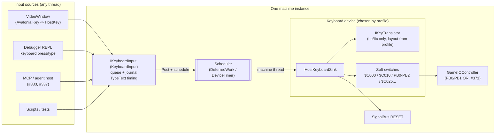

# PRD: Keyboard System

| Field | Value |
|---|---|
| Status | Draft for engineering review |
| Owner | Josh |
| Tracking issue | #386 |
| Builds on | #331 / PR #375 (`HostKey`, `IKeyTranslator`, `AppleIIeKeyTranslator`, scheduler-driven `TypeString`) |
| Related | #333 (agent-friendly debugger), #337 (headless host), #330 and #369 (reset), #371 (Game I/O OR) |
| Supersedes | The *Implementation Architecture* section of [`specs/Keyboard Mapping Specification.md`](./specs/Keyboard%20Mapping%20Specification.md). Its key tables remain a reference, with corrections listed in §15. |

---

## 1. Summary

Define one keyboard architecture that serves every machine the core will host: the Apple IIe today; the Apple IIc, the Apple IIgs (65816), and the speculative 65832 machine later. It must also serve every input source: the Avalonia `VideoWindow`, the debugger REPL, scripts, and the future MCP/agent host.

The design has three layers:

1. **Input sources** only produce host-neutral events: a physical `HostKey` going down or up, with a `KeyboardModifiers` snapshot, or plain text.
2. **`IKeyboardInput`**, one per machine, accepts those events from any thread. It applies them on the emulator thread through scheduler events, and owns text-typing timing.
3. **The machine's keyboard device**, chosen by the machine profile, turns host keys into whatever its hardware presents to software. For the IIe and IIc that is an ASCII latch at `$C000`/`$C010` built on an `IKeyTranslator`. For the IIgs it is ADB key codes handled by an ADB controller.

No static or global state is allowed, so any number of machines can run in one process.

## 2. Problem

The current design is one Apple IIe-shaped `KeyboardDevice` that every caller drives directly with machine codes:

- **Host code chooses machine codes.** `VideoWindow` translates keys itself and calls `KeyDown(byte)`. The REPL `keyboard press $8D` and `ResetCommand` call the device directly. Each new input source (MCP, scripts) would need its own copy of the IIe rules.
- **There is only one keyboard model.** A IIc, IIgs, or 65832 keyboard cannot be swapped in, because callers assume `$C000` ASCII semantics.
- **Threading is per-method.** `KeyboardDevice` marshals each mutator through `IMachineDispatcher.Post`. Text typing used to schedule events from the REPL thread and advance on strobe clear; #375 fixed that inside the device, but it belongs in a shared layer.
- **Fidelity gaps.** There is no auto-repeat. The `$C010` read returns no ASCII bits. Caps Lock follows PC rules (`pc-toggle`); this spec defaults IIe profiles to real-IIe `hardware` mode instead (§8.1.7, Q1). The profile's `preset` and `autoRepeat` keyboard settings are ignored. See §8.1.
- **Determinism is not testable.** There is no record of when host input landed, so a run with keyboard input cannot be replayed.

## 3. Goals

| # | Goal | Acceptance |
|---|---|---|
| G1 | Input sources are machine-agnostic. | `VideoWindow`, the REPL, and the MCP host only use `HostKey`, `KeyboardModifiers`, and text. None of them references a machine-specific type or code. |
| G2 | One input entry point per machine. | `machine.GetComponent<IKeyboardInput>()` returns the machine's input layer. Nothing outside a keyboard device calls `KeyDown(byte)`. |
| G3 | Emulator-thread application. | Every input event changes machine state only on the machine thread, at a scheduler event boundary, whichever thread it came from. |
| G4 | Deterministic, replayable input. | The same profile, initial state, and input journal produce an identical bus and keyboard trace. A golden-trace test enforces this. |
| G5 | Reliable text typing. | `TypeText` delivers every mappable character, in order, to a polling program. Each key has an observable key-up before the next one. Type-ahead is never overwritten. |
| G6 | Per-machine keyboards. | The profile selects `apple-iie`, `apple-iic`, `adb` (IIgs), or a 65832 model. Each keyboard owns its own translation and soft switches. |
| G7 | Layouts are configuration. | QWERTY and Dvorak (and later international layouts) are chosen in the profile, not in code paths in the window. |
| G8 | Multi-machine safe. | Two machines in one process type independently. Translators are stateless and shareable, and nothing is static. |
| G9 | Testable at every layer. | There are table tests per translator, `IKeyboardInput` tests with a fake scheduler, end-to-end polling-loop tests on real profiles, and golden traces. |

## 4. Non-goals (for v1)

- Implementing the IIc, IIgs/ADB, or 65832 keyboards. This PRD specifies their shape so the IIe work doesn't block them; each is its own epic.
- The numeric keypad (the IIe J16 keypad connector, the IIgs keypad). The `HostKey` enum leaves room for keypad keys, but none are defined yet.
- Mouse and joystick input. These use separate input paths, which may follow the same `IKeyboardInput`-style pattern later.
- International character sets in the video ROM.
- Emulating the ADB microcontroller at the instruction level (M50740 firmware). The IIgs path is high-level emulation (HLE) first.
- Shipping keyboard ROM images. Layouts are C# code tables (see §11 and Q9).
- A key-binding editor UI.

## 5. Users and scenarios

| Persona | Scenario |
|---|---|
| Player | Types into Applesoft in the video window. Shift+1 gives `!`, and holding a key auto-repeats like a real IIe. |
| Developer at the REPL | `keyboard type "10 PRINT \"HI\"\r"` on a running machine; the line appears and runs. `keyboard press ctrl+reset` resets the machine. |
| Agent (MCP, #337) | Types `CATALOG` plus Return on a headless machine, runs until idle, and screen-captures the result. The same script gives the same trace on every run. |
| Emulator developer | Writes a test that boots a profile, types through `IKeyboardInput`, and asserts on RAM. No UI and no `$C000` pokes are involved. |
| Future IIgs work | Adds an `AdbKeyboard` and an ADB controller. Window, REPL, and MCP code are unchanged. |

## 6. Architecture



The layers have these responsibilities:

| Layer | Owns | Must not |
|---|---|---|
| Input source | Mapping its native key type to `HostKey`, plus the modifier snapshot. Its Caps Lock toggle state. Choosing the host binding for the Reset key. | Know any machine code, translator, or soft switch. |
| `IKeyboardInput` | Thread-safe intake, ordering, and hand-off to the emulator thread. `TypeText` (characters to keystrokes, timing). Filtering host auto-repeat. The input journal. | Know `$C000`, ASCII, or ADB. It asks the sink for keystrokes. |
| Keyboard device (sink) | Hardware semantics: translation, latch, strobe, any-key-down, auto-repeat, modifier soft switches, the RESET line, model-specific switches. | Be called from a host thread, or be called by anything other than its `IKeyboardInput` (except bus reads and writes). |

## 7. Contracts

All new types live in `BadMango.Emulator.Devices`. Interfaces go in `BadMango.Emulator.Devices.Interfaces`, following the existing convention. Nothing here references Avalonia.

### 7.1 `HostKey` (exists since #375)

`HostKey` names physical key positions on a modern keyboard, using US-layout legends. It has `None`, the letters `A`–`Z`, the `D0`–`D9` digit row, `Minus`, `Equals`, `OpenBracket`, `CloseBracket`, `Backslash`, `Semicolon`, `Quote`, `Comma`, `Period`, `Slash`, `Backtick`, `Space`, `Return`, `Tab`, `Escape`, `Backspace`, `Delete`, the four arrows, `LeftShift`/`RightShift`, `LeftControl`/`RightControl`, `LeftAlt`/`RightAlt`, and `CapsLock`.

- `HostKey` describes the **physical position**, not the character. Layout (Dvorak, international) is applied by the machine keyboard, never by the input source.
- New members are added only with a decision about every translator's output for them. The `AppleIIeKeyTranslatorTests` coverage test fails otherwise.
- Keypad keys, `Home`/`End`/`PageUp`/`PageDown`, `Insert`, and left/right GUI keys come later, with the IIgs keypad work. Function keys `F1`–`F15` are added to `HostKey` with the IIgs work so they can pass through as ADB keys (§8.3, §12).
- There is no Reset key on modern keyboards, so Reset is a separate input (§7.2). The host chord that invokes it is a **per-profile binding**, not a fixed `HostKey`. `VideoWindow` consumes that chord and maps it to `ResetKeyDown` / `ResetKeyUp` (§10.1, §12). A bound chord is not also delivered as a `HostKey` event. Defaults are machine-specific and provisional (§12).

### 7.2 `IKeyboardInput`

```csharp
public interface IKeyboardInput
{
    /// A physical host key went down. modifiers is the full host modifier snapshot
    /// (Shift, Control, OpenApple, ClosedApple, CapsLock) at the time of the event.
    void KeyDown(HostKey key, KeyboardModifiers modifiers);

    /// A physical host key went up. modifiers is the snapshot after the release.
    void KeyUp(HostKey key, KeyboardModifiers modifiers);

    /// The emulated machine's Reset key (or the IIgs reset key combination) went down or up.
    void ResetKeyDown();
    void ResetKeyUp();

    /// Queues text to be typed as keystrokes. Returns immediately with what was accepted.
    TypeTextReceipt TypeText(string text, TypeTextOptions? options = null);

    /// Drops queued text and releases a key that TypeText is holding.
    void CancelTyping();

    /// True while TypeText has queued or in-flight keystrokes. Thread-safe snapshot.
    bool IsTyping { get; }

    /// Input applied so far, with the cycle at which each event took effect (§7.5).
    IKeyboardInputJournal Journal { get; }
}
```

- **Modifiers travel as a snapshot on every event.** Modifier keys are also `HostKey`s, so `KeyDown(LeftAlt, OpenApple)` updates PB0 even though it produces no character. The snapshot is authoritative and avoids drift when the host misses an event, for example after a focus change. Caps Lock in the snapshot is the host's toggle state.
- **Mapping Alt to the Apple keys is the input source's job.** It is a host binding. The current default is Left Alt for Open Apple and Right Alt for Closed Apple (Command and Option on the IIgs).
- **Host auto-repeat is filtered.** A `KeyDown` for a key that is already down is ignored, because the machine keyboard generates its own auto-repeat (§8.1.4). Sources must still send `KeyUp`.
- **Reset is its own input.** Whether the line asserts depends on the device (Ctrl required or not, §8.1.6).

### 7.3 Threading and scheduler semantics

1. **Any thread may call.** Calls append an `InputEvent` to a lock-protected FIFO in call order, then `IMachineDispatcher.Post` a drain action. If the machine is quiescent (paused, or stepped by a test), `Post` runs the drain inline before returning, which is the current dispatcher contract.
2. **The drain runs on the machine thread.** It schedules one `ScheduledEventKind.DeferredWork` event per drained batch, due at the next scheduler turn. That event applies the batch to the sink in FIFO order and stamps each event with `scheduler.Now`. Input is never applied in the middle of an instruction or bus access.
3. **Typing uses `DeviceTimer` events.** All `TypeText` steps (key down, key up, gap, strobe-wait re-checks) are `DeviceTimer` events scheduled by the input layer on the machine thread. The machine's RESET scheduler flush drops them. A typing-generation counter makes any survivors no-ops (§10.4).
4. **Strobe clear never starts the next key.** Software clearing the strobe only changes device state. The next typed key starts on its own scheduled event, after it checks the sink's `IsReadyForTypedKey`.
5. **Time is emulated time.** Durations in `TypeTextOptions` are milliseconds of emulated time, converted to cycles with the machine's CPU clock from the profile (`cpu.clockSpeed`). There is no hard-coded 1,020 cycles/ms, which is wrong for the IIgs and the 65832.

### 7.4 `IHostKeyboardSink` (machine side)

```csharp
public interface IHostKeyboardSink
{
    void OnHostKeyDown(HostKey key, KeyboardModifiers modifiers);
    void OnHostKeyUp(HostKey key, KeyboardModifiers modifiers);
    void OnResetKey(bool pressed);

    /// For TypeText: the keystroke that produces c on this keyboard and layout, if any.
    bool TryGetKeystroke(char c, out HostKeystroke keystroke);

    /// For TypeText: true when software has consumed the previous key (IIe: strobe clear).
    bool IsReadyForTypedKey { get; }

    /// Releases every key the input layer pressed (used by CancelTyping and RESET).
    void ReleaseAllTypedKeys();
}

public readonly record struct HostKeystroke(HostKey Key, KeyboardModifiers Modifiers);
```

Every machine keyboard implements this. Only its `KeyboardInput` calls it, and only on the machine thread. That contract is the boundary between "host" and "hardware".

### 7.5 Determinism and the input journal

- Each applied event is journaled as `(Cycle, InputEvent)`. That includes key down, key up, reset, every `TypeText` keystroke, and `CancelTyping`.
- **Determinism contract:** the same profile, the same initial machine state (RAM fill, any RNG seed), and the same journal replayed at the same cycles produce an identical trace. Live host input is not deterministic in *when* it lands, but once journaled it replays exactly.
- `KeyboardInput.Replay(IEnumerable<(Cycle, InputEvent)>)` schedules journaled events at their recorded cycles. This is used by golden-trace tests and by the agent host for reproducible sessions.
- When the machine is paused or stepped by a caller (tests, an agent between `run-until` calls), events apply at the current cycle. Scripted input is deterministic without a journal.

### 7.6 Multi-machine

- `KeyboardInput` and the keyboard device are per-machine components, created by `MachineFactory` or the profile builder and found through `GetComponent<T>()`.
- Translators are stateless and immutable, so one instance may be shared.
- No `static` mutable state is allowed anywhere in the keyboard path. One existing exception remains: `KeyboardDevice` uses `ResetSourceDeviceId = int.MinValue + 2` as a constant source ID, which is fine because it is per-signal-bus.
- A test boots two machines in one process, types into one, and asserts that the other's `$C000` is unchanged (§13).

## 8. Per-machine keyboards

### 8.1 Apple IIe: `AppleIIeKeyboard` (today's `KeyboardDevice`)

Hardware facts are cited to: **[TRM-e]** *Apple IIe Technical Reference Manual*, ch. 2 "The Keyboard" and ch. 4 "Reset routine"; and **[Sather]** Jim Sather, *Understanding the Apple IIe*, ch. 7 "Keyboard" and ch. 3, Figure 3.8.

#### 8.1.1 Encoder and translation

- The keyboard is a switch matrix scanned by an AY-3600-PRO encoder. Its key code, together with Shift and Control, addresses a 2K keyboard ROM that produces the ASCII code [TRM-e ch. 2; Sather ch. 7]. The ROM holds four sets: caps-locked or unlocked, standard or alternate. The alternate set is Dvorak on US machines and the local layout on export machines [Sather ch. 7].
- **Caps Lock** selects the caps-locked set. That set differs from the unlocked set only in that the unmodified ("ALONE") code for the 26 letters is uppercase. On a real IIe, Caps Lock with Shift still gives uppercase, and Caps Lock never affects digits or punctuation [Sather ch. 7]. IIe profiles default to that `hardware` behavior (§8.1.7, Q1). PR #375's translator still uses the PC rule (Shift XOR Caps Lock, `pc-toggle`); the default flips when the implementation of this spec lands.
- **Control** behavior follows the Control and Both columns of TRM-e Table 2-3:
  - Ctrl+A…Z gives `$01`–`$1A`.
  - Ctrl+`[`, Ctrl+`\` and Ctrl+`]` give `$1B`, `$1C` and `$1D`.
  - Ctrl+2 gives `$00` and Ctrl+6 gives `$1E`, with or without Shift. These keys exist so the keyboard can produce every code from `$00` to `$7F` [Sather ch. 7].
  - Ctrl+Minus gives `$1F`.
  - Control leaves every other key unchanged. For example, Ctrl+1 is `1` and Ctrl+Shift+1 is `!`.
- **Special keys** are the same in every column: Delete `$7F`, Left `$08`, Tab `$09`, Down `$0A`, Up `$0B`, Return `$0D`, Right `$15`, Esc `$1B`, Space `$20` [TRM-e Table 2-3]. Return and the arrows share codes with Ctrl-M, H, U, J and K [Sather ch. 7].
- The host's **Backspace** maps to `$08`, the IIe left arrow, which is what Apple II software treats as "back". **Delete** maps to `$7F`.
- **Open Apple and Closed Apple** are not part of the encoder. They drive PB0 and PB1 directly and never change the character code [TRM-e ch. 2, Sather ch. 7].

`AppleIIeKeyTranslator` (an `IKeyTranslator`) implements the table above for the US QWERTY layout. It is exhaustively table-tested since #375.

#### 8.1.2 Soft switches

| Address | Access | Behavior | Source |
|---|---|---|---|
| `$C000`–`$C00F` read | R | Bit 7 is the keyboard strobe (set by a key press or auto-repeat). Bits 0–6 hold the last key's ASCII, which persists after the strobe clears. | TRM-e ch. 2; Sather ch. 7, Keyboard Operational Summary |
| `$C010` read | R | Bit 7 is any-key-down (AKD). Bits 0–6 are the ASCII. Clears the strobe. | Sather ch. 7, Keyboard Operational Summary ("Read AKD and ASCII; reset KEYSTROBE") |
| `$C011`–`$C01F` read | R | IOU/MMU status in bit 7; ASCII in bits 0–6. | Sather ch. 7, Keyboard Operational Summary |
| `$C010`–`$C01F` write | W | Clears the strobe (any value). | Sather ch. 7, Keyboard Operational Summary ("W$C01X Reset KEYSTROBE") |
| `$C061`, `$C062` | R | PB0 (Open Apple) and PB1 (Closed Apple), bit 7. These are ORed with joystick buttons (#371). | TRM-e ch. 2 |
| `$C063` | R | PB2. Shows the Shift key only if the shift-key mod (X6 jumper) is installed. | TRM-e ch. 2 "Shift-Key Mod" |

- **AKD** is high while any matrix key is down. It excludes Reset, Control, Shift, Caps Lock and both Apple keys [TRM-e ch. 2]. With several keys held, AKD stays high until all are up.
- **Debounce:** ASCII and the strobe appear about 10 ms after the key goes down, while AKD rises at once [Sather ch. 7, Keyboard Operational Summary]. We model the strobe as immediate by default, and the profile can opt into a debounce delay (Q4).
- **Rollover:** a new key pressed while another is held is encoded and read normally [Sather ch. 7, Keyboard Operational Summary]. TRM-e describes this as both "N-key rollover" and "two-key rollover", so see Q3.

#### 8.1.3 The strobe and `TypeText` readiness

`IsReadyForTypedKey` is true when the strobe is clear, meaning software has consumed the last key. This is a convenience the real keyboard doesn't have (a real typist can overwrite an unread key), and it is configurable through `TypeTextOptions.WaitForConsumption`.

#### 8.1.4 Auto-repeat

When a key is held for 534–801 ms, the IOU begins generating auto-repeat strobes at 15 Hz. The exact delay depends on the phase of the flash counter. Both the delay (32–48 vertical scans) and the rate (vertical frequency ÷ 4) derive from the video vertical scan [Sather ch. 3, Figure 3.8; ch. 7, Keyboard Operational Summary]. Pressing any matrix key restarts the delay [Sather ch. 7, Keyboard Operational Summary]. *Inside the Apple IIe* gives about 900 ms and 15 per second, so we use Sather's derivation, which is tied to the scan count.

The emulation counts VBlank events from the video device. On the 4th VBlank boundary after 32–48 scans, it sets the strobe again with the same ASCII while the key is held. The profile's `autoRepeat` flag enables this, and it already exists in the a2 profiles. `TypeText` hold times (50 ms by default) are far below the repeat delay.

#### 8.1.5 Shift-key mod (PB2)

On the IIe, PB2 reflects Shift only when the X6 jumper is soldered (the "single-wire shift-key mod"). Without it, PB2 is the game-port switch 2 input [TRM-e ch. 2]. A per-device profile option, `shiftKeyMod`, gates this. It defaults to off, matching a stock IIe with no X6 jumper. This is a behavior change: today's device always reports Shift on PB2.

#### 8.1.6 Reset combinations

- **Reset** pulls RESET low only with Control, unless the keyboard jumpers are changed so Reset alone works [Sather ch. 7]. That jumper is the profile option `requireControlForReset`, the existing `RequireControlForReset`. The Reset key is not part of AKD.
- **Ctrl+Open Apple+Reset:** the firmware does a forced cold start. It writes two bytes into each page of main RAM, which destroys the reset vector, and then cold-starts [TRM-e ch. 4 "Forced Cold Start"].
- **Ctrl+Closed Apple+Reset,** with or without Open Apple: the firmware runs the built-in self-test [TRM-e ch. 4].
- These are firmware behaviors. The keyboard only has to hold PB0/PB1 while RESET is released, which already works through #369 (`reset --open-apple` / `--closed-apple`) and the #371 OR.

#### 8.1.7 Layout and Caps Lock options

- **Layout:** `us-qwerty` (default) or `us-dvorak`, the IIe's alternate keyboard ROM set [Sather ch. 7]. The IIe Dvorak switch is a hardware mod [Sather application note], so the profile treats it as a fixed layout plus an optional runtime toggle.
- **Caps Lock mode:**
  - `hardware` (the IIe default): Caps Lock forces letters to uppercase, and Shift has no further effect on letters. This matches a real IIe [Sather ch. 7].
  - `pc-toggle`: Shift XOR Caps Lock, which is today's behavior in PR #375 and remains available as a per-profile option.

  IIe profiles default to `hardware`. This is a behavior change from today's Shift-XOR-Caps translator. Any profile can set `capsLockMode` to `pc-toggle`.

### 8.2 Apple IIc: `AppleIIcKeyboard`

Hardware facts are cited to **[TRM-c]** *Apple IIc Technical Reference Manual*, ch. 1, ch. 4 Table 4-1, Table B-7 and Appendix G.

- **It shares the IIe programming model.** `$C000` holds the data and strobe. `$C010` holds AKD and clears the strobe, and AKD excludes the Apple keys, Control, Shift, Caps Lock and Reset. Software must read the strobe before AKD [TRM-c ch. 4]. The IIc reuses the IIe translator rules through a shared base or composition.
- **The keyboard switch** selects one of two built-in layouts and the matching screen character sets. On US machines, up is QWERTY and down is Dvorak; on international machines it toggles the local layout and US [TRM-c ch. 1]. Software cannot read the switch, since it is handled in the keyboard circuitry [TRM-c ch. 1; RC-SE]. The device exposes it as `KeyboardLayoutSwitch { Primary, Alternate }`, settable from the profile and at runtime by the host.
- **The 80/40 switch** is read at `$C060` bit 7: 1 means the switch is down (40 columns) [TRM-c Table 4-1, Table B-7]. It is only a status bit, and software decides what to do with it. The device exposes `Is40ColumnSwitchDown`.
- **`$C063`** reads 1 in bit 7 when the mouse button is **not** pressed. That makes software looking for the shift-key mod find it [TRM-c Table B-7 notes]. This is the mouse device's switch, not the keyboard's.
- Auto-repeat timing, rollover and the Caps Lock+Shift rule on the IIc are unverified (Q6).

### 8.3 Apple IIgs: `AdbKeyboard` plus `AdbController`

Hardware facts are cited to **[HWR-gs]** *Apple IIgs Hardware Reference*, ch. 6 "The Apple Desktop Bus", and **[TN-58]** Apple IIgs Technical Note #58.

- **Transport:** the keyboard is an ADB device. ADB keyboard register 0 holds two key events. Each is a 7-bit key code plus a "key released" bit 7 [HWR-gs Table 6-10]. The keyboard device turns `HostKey` into ADB key codes and up/down transitions. It does **not** produce ASCII, so it does not use `IKeyTranslator`.
- **Translation:** the ADB microcontroller (an M50740, a 6502-superset microcontroller) generates all 128 ASCII codes and fills the ADB GLU registers [HWR-gs ch. 6]. The emulator implements this as an HLE `AdbController` that applies the layout (selected in the Control Panel) to produce ASCII. It is a separate component from the keyboard, so mouse and ADB commands share it.
- **GLU registers:**

  | Register | Address | Notes |
  |---|---|---|
  | Keyboard Data | `$C000` | Bit 7 is the strobe. It is cleared by reading or writing any address from `$C010` to `$C01F`. |
  | Modifier Key | `$C025` | Bit 7 Command, 6 Option, 5 modifier latch updated with no key, 4 keypad key, 3 key held down (repeating), 2 Caps Lock, 1 Control, 0 Shift. |
  | Mouse Data | `$C024` | |
  | ADB Command/Data | `$C026` | |
  | ADB Status | `$C027` | Keyboard-data-full and keyboard-interrupt-enable bits, among others. |

  `$C010` still provides the AKD and strobe-clear compatibility [HWR-gs Tables 6-2 to 6-7].
- **Auto-repeat:** the rate and delay are set in the Control Panel [HWR-gs ch. 6].
- **Rollover:** modifier keys have n-key rollover. Alphanumeric keys have 2-key lockout, so a third simultaneous key is not recognized [HWR-gs ch. 6].
- **Command key** does the same job as Open Apple on the IIe [HWR-gs glossary]. Whether Option reads as Closed Apple at `$C062`, and how `$C061`/`$C062` are wired on the IIgs, is Q7.
- **Reset combinations** (official sources only; see also §12 for host bindings):
  - The ADB microcontroller detects the reset key combination and asserts RESET [HWR-gs ch. 6]. `IKeyboardInput.ResetKeyDown` maps onto that.
  - **Control-Command-Reset** is special: it generates a special key code, the microcontroller asserts the RESET line, and the system restarts (the reset routine) [HWR-gs ch. 6]. Bit 5 of the ADB Command/Data register at `$C026` is set when Control, Command, and Reset are pressed together; "this condition is usually used to initiate a cold start up" [HWR-gs Table 6-3]. Apple's Tech Info Library article on resetting calls this a cold reset: hold Control and Apple, then press and release Reset, "which makes the machine reboot as if it were just turned on" [TIL-2061]. The IIgs Quick Start Guide gives the same chord (Command-Control-Reset) to start up a disk when the power is already on [QSG-gs].
  - **Control-Reset** is a warm reset: hold Control and press and release Reset [TIL-2061]. The HWR-gs glossary defines Control-Reset as the combination that usually stops an Applesoft program immediately.
  - **Self-test:** "The self-test is activated by pressing Open-Apple and Option on power up, or Open-Apple, Option, and Reset" [TN-95]. That wording does **not** mention Control. This spec does not add Control to the official combination. Many secondary sources write Control-Open-Apple-Option-Reset; that has not been confirmed from an official Apple manual here.
  - **Control Panel:** the documented keyboard path that uses Reset is Option-Control-Reset [QSG-gs; TIL-522]. Holding Option while turning the power on is also documented, though Apple noted that it "doesn't always work" [TIL-522, citing the *Apple IIGS Owner's Guide*, p. 13]. Control-Open-Apple-Escape is widely cited as the running-machine Classic Desk Accessory / Control Panel shortcut; it was **not** independently verified from an official Apple manual for this spec.
- **Extended ADB keyboards and function keys.** The Apple Extended Keyboard (M0115) and Apple Extended Keyboard II (M3501) are ADB keyboards with fifteen function keys, F1–F15 [MacHW ch. 8 and Figure 8-10; TIL-112]. The Extended Keyboard II's stated requirement is "Any Apple personal computer with an Apple Desktop bus interface" [TIL-112], which includes the IIgs [HWR-gs ch. 6]. The M0115 is the same ADB device class [MacHW ch. 8]. The compact keyboard that shipped with the IIgs has no function keys; these extended keyboards are the ADB devices that add them. Contemporary IIgs programmers used an Extended ADB keyboard on the IIgs and read F1–F15 from software [Empson-94].
  - ADB key-down codes for F13, F14 and F15 are `$69`, `$6B` and `$71` [MacHW Figure 8-10]. Those three keys sit immediately to the right of F12 in the function-key row. A PC 101-key keyboard labels that same cluster Print Screen, Scroll Lock and Pause, so the host maps Print Screen → F13, Scroll Lock → F14 and Pause → F15. That is a layout correspondence, not an Apple document that literally names those PC legends on the M0115/M3501.
  - Software can see the function keys. Through the Event Manager, the extended keys arrive as key-down events whose character codes look like lowercase letters from the numeric keypad, distinguished by the keypad modifier bit (`keyPad`, `$2000`) [Empson-94]. Through `$C000`/`$C010`, the same keys are identified by reading the Modifier Key register at `$C025` and testing the keypad bit (bit 4) [Empson-94; HWR-gs Table 6-5]. A few programs use them; they are ordinary ADB keys, not reserved host shortcuts.
- **Known hardware anomaly:** while an arrow key (or Space or Delete with Fast Space/Delete on) auto-repeats, pressing Control sets the Shift bit in `$C025` instead of Control [TN-58]. The fidelity profile may reproduce this.

### 8.4 65832 machine (placeholder)

This machine defines its own keyboard and does not have to imitate the Apple II. Requirements on it:

- It implements `IHostKeyboardSink`, so window, REPL, MCP and journal support come for free.
- It is expected to expose raw `HostKey`-derived scan codes, through a FIFO and an interrupt, rather than an ASCII latch.
- `TryGetKeystroke` can be implemented with a US layout table.
- Its register layout belongs in the 65832 architecture spec, not here.

## 9. `TypeText`

### 9.1 Characters to keystrokes

- Each character goes to `sink.TryGetKeystroke(c, out keystroke)`. For IIe and IIc keyboards, this is a reverse table built once per translator and layout by enumerating every `HostKey` × {none, Shift, Control, Control+Shift}. Among the keystrokes that produce a code, the one with the fewest modifiers wins.
- Newlines: `\r`, `\n`, and `\r\n` each become **one** Return. `\t` becomes Tab, and `\b` becomes Backspace (`$08`).
- **Case** is typed exactly: `A` is typed as Shift+A. The host's live Caps Lock state is ignored, because `TypeText` uses its own modifier snapshot. `TypeTextOptions.ForceUppercase` upper-cases letters first, for software that needs uppercase. The keyboard-device option is `typeText.forceUppercase` in the machine profile's device configuration. The unenhanced `pocket2e-a2` profile defaults it to true, because Applesoft on an unenhanced IIe needs uppercase keywords. Every other profile defaults it to false. Any profile can set the option.
- **Unmappable characters** are anything with no keystroke, such as non-ASCII or emoji. `TypeTextOptions.Unmappable` decides what happens: `Skip` (the default), `Replace` (with `ReplacementChar`, default `?`), or `Reject` (nothing is queued and the receipt lists the offending characters). The receipt always reports accepted and skipped counts, so the REPL and MCP can surface them.

### 9.2 Timing (defaults)

| Step | Default | Notes |
|---|---|---|
| Hold | 50 ms | Key down to key up. This is the current `TypeString` default. |
| Gap | 10 ms (hold ÷ 5, minimum 1 ms) | Key up to the next key down. AKD is observably low in between. |
| Strobe wait poll | 1 ms | Used only when `WaitForConsumption` is set and the previous key is unread. |
| Wait for consumption | on | The next key waits until the sink reports it is ready (IIe: strobe clear). |
| Return extra delay | 0 ms | Optional `ReturnDelay`, for software that is slow after a line ends. |

Durations are emulated time (§7.3). Typing state is per machine. A new `TypeText` while typing is in progress appends to the queue.

### 9.3 Interaction with live keys

While `TypeText` is active, live `KeyDown` events still apply, but `TypeText` keystrokes use their own modifier snapshot. After typing finishes, the input layer restores the device's modifier state to the last live snapshot, so a held Open Apple stays visible on PB0.

## 10. Integration

### 10.1 `VideoWindow`

The window maps Avalonia `Key` to `HostKey`, keeps its Alt-to-Apple-key binding and Caps Lock toggle, and calls `IKeyboardInput.KeyDown` and `KeyUp` with the snapshot. That is all it does for ordinary keys. It never touches a translator or `KeyDown(byte)`. (The #375 interim reads `IKeyboardDevice.Translator`; that property goes away in migration step 4.)

**Reset binding.** `VideoWindow` reads `bindings.reset` and `bindings.coldReset` from the machine profile (§11.1, §12) and maps those host chords to `ResetKeyDown` / `ResetKeyUp` or the cold-reset machine action. It does not hard-code F12. The bound chord is consumed and is not also delivered as a `HostKey` event. Defaults are machine-specific and **provisional** (§12). The menu command and the REPL `reset` command always work, independently of the host binding.

### 10.2 Debugger REPL

- `keyboard type <text>` calls `TypeText` and prints the receipt.
- `keyboard press <chord>` accepts chords such as `shift+1`, `ctrl+c`, `ctrl+reset`, `return` and `open-apple`. It does key down, holds for the default hold time, then key up.
- `keyboard press $8D` stays available as a debugging convenience. It maps the code back to a keystroke with `TryGetKeystroke` and fails clearly if there is none.
- `keyboard read` is unchanged.
- `reset` (#369) uses `ResetKeyDown` and `ResetKeyUp` plus modifier snapshots instead of device methods.

### 10.3 MCP / agent host (#333, #337)

The agent tools are `keyboard.type(text, options)`, `keyboard.press(chord)` and `keyboard.key(down|up, key, modifiers)`. They are thin wrappers over `IKeyboardInput`. Because the agent normally drives a paused or `run-until` machine, input lands at known cycles (§7.5). The journal is exported with snapshots (#339) for reproducible sessions.

### 10.4 Reset (#330, #369)

When RESET asserts, the device clears the strobe and cancels typing. The input layer's typing generation increments, and any key held by `TypeText` is released. That matches today's `OnResetAsserted` behavior from #369. Live held keys and modifiers survive RESET, which already has a test. The machine's scheduler flush drops `DeviceTimer` typing events, and the generation counter makes any `DeferredWork` survivors no-ops.

### 10.5 Game I/O (#371)

`GameIOController` keeps ORing joystick buttons with `IKeyboardDevice.Modifiers` for PB0, PB1 and PB2. On the IIe, PB2 joins the OR only when `shiftKeyMod` is on. On the IIc, `$C063` is the mouse button (§8.2). On the IIgs, the wiring is open (Q7).

## 11. `IKeyTranslator` and layouts

- `IKeyTranslator.Translate(HostKey, KeyboardModifiers) -> byte?` is a building block for keyboards that output **one code per keystroke** (the IIe and IIc). It is not a cross-machine contract. ADB and the 65832 machine do not use it.
- Implementations are stateless and shareable.
- **Layouts** are C# code tables (or separate translator classes), selected in the profile: `AppleIIeKeyTranslator` (US QWERTY) and, later, `AppleIIeDvorakTranslator`. The keyboard ROM is emulated in those tables. We will not ship keyboard ROM images. A ROM-image-driven translator is out of scope unless a real need appears later. Sather Table 7.2 documents the 2K IIe keyboard ROM layout (matrix position XY maps to ROM address `XY × 4` plus the mode and set bits) and is the reference for building the C# tables [Sather ch. 7].

### 11.1 Profile schema sketch

This extends the existing `motherboard[].config` for the keyboard. Existing keys are kept, and `preset` is mapped to `model`.

```jsonc
{
  "type": "keyboard",
  "name": "Keyboard",
  "enabled": true,
  "config": {
    "model": "apple-iie",              // apple-iie | apple-iic | adb | (65832 TBD); default from machine type
    "preset": "enhanced",              // existing; kept for compatibility (enhanced | original)
    "layout": "us-qwerty",             // primary layout
    "alternateLayout": "us-dvorak",    // IIc keyboard switch "down" / IIe Dvorak mod; optional
    "layoutSwitch": "primary",         // initial switch position: primary | alternate
    "capsLockMode": "hardware",        // hardware | pc-toggle. IIe default is hardware (Q1).
    "requireControlForReset": true,    // IIe keyboard jumper
    "autoRepeat": true,                // existing key; enables §8.1.4
    "shiftKeyMod": false,              // IIe X6 jumper: Shift on PB2. Default off (stock IIe).
    "strobeDebounceMs": 0,             // 0 = immediate; 10 ≈ AY-3600 bounce mask (Q4)
    "bindings": {                      // host bindings used by VideoWindow; overridable data
      "reset": "F12",                  // IIe/IIc default shown; IIgs default is Ctrl+Alt+F12. See §12.
      "coldReset": "Ctrl+F12"          // IIe/IIc default shown; IIgs default is Ctrl+Alt+Shift+F12.
    },
    "typeText": {                      // defaults for TypeText on this machine
      "holdMs": 50,
      "gapMs": 10,
      "waitForConsumption": true,
      "forceUppercase": false,         // true by default on pocket2e-a2 only
      "unmappable": "skip"             // skip | replace | reject
    }
  }
}
```

For the IIc, `"model": "apple-iic"` also accepts `"columns80Switch": "up" | "down"`, the initial 80/40 switch position. On the unenhanced `pocket2e-a2` profile, `typeText.forceUppercase` defaults to true; every other profile leaves it false. IIe profiles default `capsLockMode` to `hardware`. The `bindings` values in the sketch are the IIe/IIc defaults; IIgs profiles use the IIgs defaults in §12. All of those binding defaults are provisional and can be overridden in this block without a code change.

## 12. Host key bindings

Reset and cold-reset host chords are **per-profile settings** (`config.bindings.reset` and `config.bindings.coldReset`). Each machine family has its own defaults, in the tables below. **These defaults are provisional and subject to change.** A profile overrides them by setting the `bindings` block. A binding is just data: changing a default later does not require a code change. Tests must read the bindings from the profile rather than hard-coding F12 or any other chord.

`VideoWindow` consumes the bound chord and maps it to `ResetKeyDown` / `ResetKeyUp`, or to the cold-reset machine action. The chord is not also delivered as a `HostKey` event. The menu command and the REPL `reset` command always work, including `reset --open-apple` and `reset --closed-apple` (#369), regardless of the host binding.

| Host input | Default binding | Notes |
|---|---|---|
| Left Alt / Right Alt | Open Apple / Closed Apple | On the IIgs, Command and Option. |
| Backspace | `HostKey.Backspace` (IIe `$08`) | |
| Delete | `HostKey.Delete` (IIe `$7F`) | |

### 12.1 IIe and IIc defaults

These continue the earlier decision in [`specs/Keyboard Mapping Specification.md`](./specs/Keyboard%20Mapping%20Specification.md). They apply only to IIe and IIc profiles. The IIe and IIc have no function keys, so using F12 does not hide a machine key.

| Host input | Default binding | Notes |
|---|---|---|
| Reset | F12 | Maps to `ResetKeyDown` / `ResetKeyUp`. Plain F12 asserts Reset with Control implied, so `requireControlForReset` does not block the shortcut. Left Alt+F12 holds Open Apple (IIe reboot / forced cold start). Right Alt+F12 holds Closed Apple (IIe self-test). |
| Cold reset | Ctrl+F12 | The cold-reset machine action. It does not also assert the Reset key. |

### 12.2 IIgs defaults

On the IIgs, every host function key must reach the emulated machine as an ADB key (§8.3). F12 is a real key on the Extended Keyboard and Extended Keyboard II [MacHW Figure 8-10], and software can read it [Empson-94], so F12 is **not** the Reset default on this profile. Host Print Screen, Scroll Lock and Pause are mapped to F13, F14 and F15 and also pass through.

| Host input | Default binding | Notes |
|---|---|---|
| F1–F15 | The matching ADB function key | Pass through. `HostKey` gains `F1`–`F15` with the IIgs work. |
| Print Screen, Scroll Lock, Pause | F13, F14, F15 | Same cluster as F13–F15 on the Extended Keyboard (§8.3). |
| Reset | Ctrl+Alt+F12 | The whole chord is consumed and maps to `ResetKeyDown` / `ResetKeyUp` with Control implied (a warm Control-Reset [TIL-2061]). This is not a single ADB key, so it does not collide with F12 or any other function key. |
| Cold reset | Ctrl+Alt+Shift+F12 | The cold-reset machine action. It does not also assert the Reset key, and it does not collide with a single ADB key. |
| IIgs Control-Command-Reset / self-test / Control Panel | Menu or REPL | Use `reset --open-apple` (Control-Command-Reset cold start [HWR-gs Table 6-3; TIL-2061]), `reset --open-apple --closed-apple` (self-test, following [TN-95]), or the documented Option-Control-Reset Control Panel path when that action exists. Additional host chords may be added later as more `bindings` entries; they are data. |

## 13. Testing strategy

1. **Translator table tests** (exist for the IIe since #375). For every `HostKey` × {Shift, Caps Lock, Control} × Apple-key combination, they check the expected code or `null`. A coverage test fails if a `HostKey` is added without a decision. Each new layout or model gets its own table.
2. **`KeyboardInput` unit tests** use a fake scheduler and dispatcher. They cover:
   - FIFO order across threads
   - nothing applied off the machine thread
   - host auto-repeat filtering
   - `TypeText` steps scheduled with the exact cycle deltas for a given clock rate
   - `WaitForConsumption` behavior
   - `CancelTyping` and the RESET generation
   - receipt counts and unmappable policies
3. **End-to-end polling-loop tests** (exist for the IIe since #375). A 6502 loop in RAM waits for `$C000` bit 7, clears the strobe through `$C010`, and stores to a buffer on the real `pocket2e-a2-enh` profile. Input goes only through `IKeyboardInput`, and nothing pokes `$C000`. Cases:
   - `TypeText("Hello, World!")` with a key-up between characters
   - Shift+H, `i`, Shift+1 giving `Hi!`
   - Caps Lock in both modes: with Caps Lock down, Shift+A gives `A` in `hardware` mode and `a` in `pc-toggle`
   - Control
   - Apple keys held
   - type-ahead kept while the program isn't reading
   - auto-repeat count over a held key (once implemented)
4. **Golden traces.** A fixed `TypeText` script runs on a fixed profile and initial state. The trace records `(cycle, $C000, AKD, PB0–PB2, RESET)` at each keyboard state change and is compared with a checked-in golden file. A determinism test replays the journal and asserts an identical trace.
5. **Multi-machine test.** Two machines run in one process, input goes to one, and the other is unaffected.
6. **Flake guard.** The `TypeText` end-to-end tests run in a loop (20 or more times) in CI or before merge.

## 14. Migration plan

Each step builds and tests green on its own (`dotnet build BackPocketEmulator.slnx -c Release -warnaserror` and `dotnet test`).

1. **Done in #375.** Added `HostKey`, `IKeyTranslator`, `AppleIIeKeyTranslator`, and `IKeyboardDevice.Translator` (interim). `VideoWindow` maps to `HostKey`. `TypeString` runs on scheduler events, the strobe clear never starts a key, and the test suite was added.
2. **Add the input layer.** Add `IKeyboardInput`, `TypeTextOptions`, `TypeTextReceipt`, `IHostKeyboardSink`, `HostKeystroke`, the `InputEvent` journal types, and a `KeyboardInput` implementation. `KeyboardDevice` implements `IHostKeyboardSink`. `MachineFactory` (or the builder) registers one `KeyboardInput` per machine whenever a keyboard sink exists.
3. **Move text typing.** Move `TypeString` logic into `KeyboardInput.TypeText`, using the profile clock rate instead of 1,020 cycles/ms. Delete `IKeyboardDevice.TypeString`, and update `KeyboardCommand type` and the tests in the same change.
4. **Move `VideoWindow`.** Switch it to `IKeyboardInput` and remove its use of `IKeyboardDevice.Translator`, `KeyDown(byte)`, `KeyUp()` and `SetModifiers`. Wire the Reset and cold-reset bindings from the profile (§12), including the IIe/IIc Alt+F12 Open-Apple and Closed-Apple combinations when those defaults are in effect. Do not hard-code F12.
5. **Move the REPL.** Switch `KeyboardCommand` (`press` chords, `type`) and `ResetCommand` to `IKeyboardInput`.
6. **Narrow `IKeyboardDevice`.** Remove `KeyDown(byte)`, `KeyUp()`, `SetModifiers`, `Translator`, `PressResetKey` and `ReleaseResetKey` from the public interface. They become sink methods. Rename `KeyboardDevice` to `AppleIIeKeyboard`, keeping `[DeviceType("keyboard")]`.
7. **Read the profile config.** Parse the keyboard config from §11.1: `capsLockMode` (default **`hardware`** on IIe profiles), `requireControlForReset`, `autoRepeat`, `shiftKeyMod` (default **false**), the `typeText` defaults (including `forceUppercase`, true on `pocket2e-a2` only), and the `bindings` for Reset and cold reset (machine-specific defaults from §12; provisional). Update the profile JSON schema.
8. **Add the journal and replay.** Add the input journal and `Replay`, the golden-trace test, the determinism test, and the multi-machine test.
9. **IIe fidelity.** Add auto-repeat (§8.1.4), ASCII in the `$C010` low bits, strobe clear on writes to `$C010`–`$C01F` (check the overlap with the IOU/MMU `$C00x`/`$C01x` handlers first), AKD with multiple held keys, PB2 gated by `shiftKeyMod`, and the `hardware` Caps Lock mode as the IIe default, with `pc-toggle` still selectable. **Behavior changes:** `shiftKeyMod` defaults to off, so Shift is no longer shown on PB2 unless a profile turns the option on; `capsLockMode` defaults to `hardware`, which changes today's Shift-XOR-Caps behavior in PR #375's `AppleIIeKeyTranslator`.
10. **MCP tools** (with #337). Add `keyboard.type`, `keyboard.press` and `keyboard.key`.
11. **Later epics:** `AppleIIcKeyboard` (§8.2), `AdbKeyboard` and `AdbController` (§8.3), the 65832 keyboard (§8.4), and later layouts such as Dvorak as C# tables (§11).

## 15. Corrections to `specs/Keyboard Mapping Specification.md`

- It says Delete gives "`$FF` or N/A". On the IIe, Delete is `$7F` [TRM-e Table 2-3].
- It lists the Control combinations only for letters and `[`. The full IIe table includes `$1C`, `$1D`, `$00` (Ctrl+2), `$1E` (Ctrl+6) and `$1F` (Ctrl+Minus) [TRM-e Table 2-3].
- It says the letters are "uppercase by default". The IIe keyboard produces lowercase unless Shift or Caps Lock is active [Sather ch. 7].
- Its `IKeyboardController` sketch is superseded by §7.

## 16. Open questions

| # | Question | Notes |
|---|---|---|
| Q2 | Should the `$C011`–`$C01F` reads expose keyboard ASCII in bits 0–6? | Sather says yes. Today the IOU/MMU status handlers own those reads, so we need to confirm their low bits come from the keyboard latch. |
| Q3 | **IIe rollover.** TRM-e says both "N-key rollover" and "two-key rollover". When the newest of two held keys is released, does the older key re-strobe, and which key auto-repeats? | Needs a hardware check or the AY-3600 datasheet. Sather quotes the datasheet: "If the match occurs for an already encoded key, the match is not recognized." |
| Q4 | Should we model the roughly 10 ms debounce (AKD high before the strobe and ASCII update)? | Some software may read AKD and `$C000` together. The default is off. |
| Q6 | **IIc details:** auto-repeat delay and rate, rollover, the Caps Lock+Shift rule, and the encoder part. | TRM-c ch. 11 still needs reading. |
| Q7 | **IIgs:** do `$C061`/`$C062` reflect Command/Option (and the joystick buttons) the way the IIe Apple keys do, and is Option the IIe Closed Apple? | HWR-gs only confirms that Command does Open Apple's job (glossary). Function-key pass-through is a separate, verified fact (§8.3, [Empson-94]) and is not part of this question. |

### Decided (Josh, 2026-11-10)

| # | Decision | Notes |
|---|---|---|
| Q1 | **IIe profiles default to `hardware` Caps Lock, configurable.** With Caps Lock down, letters are uppercase whether or not Shift is held, matching a real IIe [Sather ch. 7]. `pc-toggle` (Shift XOR Caps Lock, today's PR #375 behavior) remains a per-profile option. | This is a behavior change from the current translator. The default flips when the implementation of this spec lands; #375 is left as `pc-toggle`. |
| Q5 | **Shift-key mod defaults to off.** PB2 does not show Shift unless the profile sets `shiftKeyMod` to true. | Matches a stock IIe with no X6 jumper [TRM-e ch. 2]. This is a behavior change: today's device always reports Shift on PB2. |
| Q8 | **Reset and cold-reset bindings are per-profile settings with machine-specific defaults, and those defaults are provisional (subject to change).** IIe and IIc profiles keep F12 as Reset (Control implied) and Ctrl+F12 as cold reset, with Alt modifiers as Open Apple / Closed Apple. IIgs profiles pass every host function key (F1–F15, plus Print Screen / Scroll Lock / Pause as F13–F15) through as an ADB key, and default Reset to Ctrl+Alt+F12 and cold reset to Ctrl+Alt+Shift+F12, chords that do not collide with any single ADB key. The menu command and the REPL `reset` command always work. A profile overrides the bindings in its `bindings` block; a binding is just data, so changing a default later does not require a code change. | IIe/IIc F12 defaults come from [`specs/Keyboard Mapping Specification.md`](./specs/Keyboard%20Mapping%20Specification.md). IIgs F-key pass-through is required because the Extended Keyboard and Extended Keyboard II have F1–F15 as ordinary ADB keys [MacHW Figure 8-10; TIL-112; Empson-94]. |
| Q9 | **We will not ship keyboard ROM images.** The keyboard ROM is emulated in C# code tables. A ROM-image-driven translator is out of scope unless a real need appears later. | Sather Table 7.2 remains the reference for building the C# tables. |
| Q10 | **Yes.** `TypeText` forces uppercase on the unenhanced `pocket2e-a2` profile by default (`typeText.forceUppercase: true`). Other profiles default to false. Any profile can set the option. | Applesoft on an unenhanced IIe needs uppercase keywords. |

## 17. Sources

- **[TRM-e]** Apple Computer, *Apple IIe Technical Reference Manual*: ch. 2 "The Keyboard" (Table 2-2, Table 2-3, Switch Inputs and Shift-Key Mod) and ch. 4 (Forced Cold Start, Automatic Self-Test). Full text: <https://archive.org/stream/Apple_IIe_Technical_Reference_Manual/Apple_IIe_Technical_Reference_Manual_djvu.txt>
- **[Sather]** Jim Sather, *Understanding the Apple IIe* (Quality Software, 1985): ch. 7 "Input/Output" (keyboard ROM, Caps Lock sets, Table 7.2, Keyboard Operational Summary, keyboard section and Keyboard Operational Summary) and ch. 3, Figure 3.8 (auto-repeat timing). Scan: <https://dmcmillan.co.uk/blog/apple-iie-without-a-keyboard/Understanding_the_Apple_IIe.pdf>
- **[TRM-c]** Apple Computer, *Apple IIc Technical Reference Manual*: ch. 1 (80/40 and keyboard switches), ch. 4 Table 4-1, Table B-7. <https://archive.org/stream/apple-iic-tech-ref/Image081317124723.duplex.merged_djvu.txt>
- **[HWR-gs]** Apple Computer, *Apple IIgs Hardware Reference*: ch. 6 "The Apple Desktop Bus" (Control-Command-Reset and the reset routine; Tables 6-2 to 6-7 and 6-10, including Table 6-3 bit 5 for the Control-Command-Reset cold start-up; glossary entry for Control-Reset). A clean PDF is at <https://retrotechwiki.com/images/b/bf/Apple_IIGS_Hardware_Reference_1989.pdf>. OCR text: <https://archive.org/stream/Apple_IIgs_Hardware_Reference/Apple_IIgs_Hardware_Reference_djvu.txt>
- **[RC-SE]** Retrocomputing Stack Exchange, "What do the 80/40 and keyboard buttons on my Apple IIc do?" (cites TRM-c). <https://retrocomputing.stackexchange.com/questions/13977>
- **[TN-58]** Apple IIgs Technical Note #58, "Keyboard Modifiers Register Anomaly" (Dave Lyons, 1989). <https://apple2.gs/technotes/tn-iigs-058/>
- **[TN-95]** Apple IIgs Technical Note #95, "ROM Diagnostic Errors" (Dan Strnad, September 1990): self-test is activated by Open-Apple and Option on power up, or Open-Apple, Option, and Reset. <https://apple2.gs/technotes/tn-iigs-095/>
- **[TIL-112]** Apple Tech Info Library #112, "Apple Extended Keyboard: Specifications" (created 4 December 1989; reviewed 25 June 1992): the Extended Keyboard II (replacement for M0115) has 15 function keys (F1–F15); system requirement is any Apple personal computer with an Apple Desktop Bus interface. <https://www.savagetaylor.com/TIL/TIL00112.pdf>
- **[TIL-522]** Apple Tech Info Library #522, "Apple IIGS: Entering the Control Panel" (reviewed 21 September 1987): Option while powering on (Owner's Guide p. 13; "doesn't always work"); Option-Control-Reset. <https://www.savagetaylor.com/TIL/TIL00522.pdf>
- **[TIL-2061]** Apple Tech Info Library #2061, "Apple IIGS: Resetting And Buffer Clearing": warm reset is Control-Reset; cold reset is Control-Apple-Reset, "reboot as if it were just turned on." <http://absurdengineering.org/library/MASTER%20Tech%20Info%20Library/Apple%20II%20Hardware/Apple%20IIGS%20Hardware%20Issues/TIL02061%20-%20Apple%20IIGS%20-%20Resetting%20And%20Buffer%20Clearing.pdf>
- **[QSG-gs]** Apple Computer, *Apple IIGS Quick Start Guide* (1988, part no. 031-0107-A): Control Panel via Option-Control-Reset; start a disk when the power is on via Command-Control-Reset. <https://mirrors.apple2.org.za/ftp.apple.asimov.net/documentation/hardware/machines/Apple%20IIGS%20Quick%20Start%20Guide.pdf>
- **[MacHW]** Apple Computer, *Guide to the Macintosh Family Hardware*, 2nd edition (Addison-Wesley, 1990), ch. 8 "Apple Desktop Bus": the Apple Extended Keyboard is an ADB keyboard; F1–F15 and their key-down transition codes (F13 `$69`, F14 `$6B`, F15 `$71`) are in Figure 8-10, immediately to the right of F12. <https://vintageapple.org/inside_o/pdf/Guide_to_Macintosh_Family_Hardware_2nd_Edition_1990.pdf>
- **[Empson-94]** David Empson, "Re: Extended ADB keyboard help," *comp.sys.apple2.programmer*, 2 August 1994: on a IIgs with an Extended ADB keyboard, F1–F15 are visible to the Event Manager (keypad modifier bit) and via `$C000`/`$C010` plus `$C025` bit 4. <https://groups.google.com/g/comp.sys.apple2.programmer/c/oZBTT54qOTc>
- Gary Little, *Inside the Apple IIe* (Brady, 1985), ch. 6, "Keyboard auto-repeat" (about 900 ms, 15 per second). <https://apple2online.com/wp-content/uploads/Inside-the-Apple-IIe.pdf>
