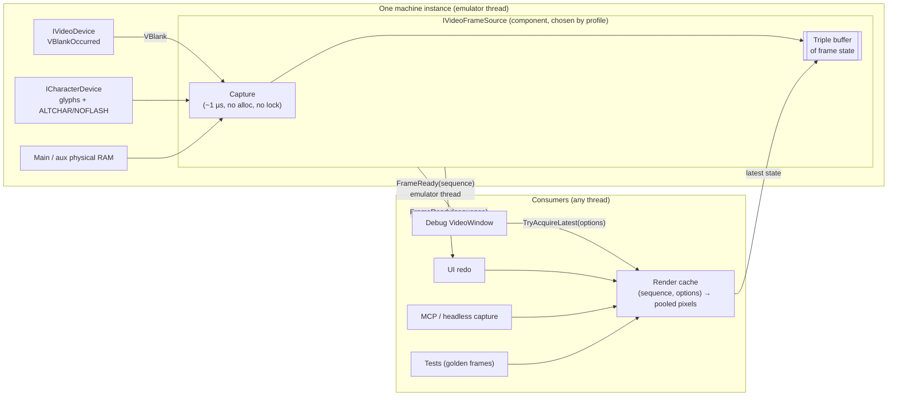

# PRD: Video Pipeline

| Field | Value |
|---|---|
| Status | Draft for engineering review |
| Owner | Josh |
| Tracking issue | #325 (decouple frame production from `VideoWindow` presentation) |
| Builds on | `main` as of 2026-11-11: `VideoDevice.VBlankOccurred`, `DisplayMemorySnapshot`, `Pocket2VideoRenderer`, `CharacterDevice`, and `VideoWindow` with the #316–#323 fixes. |
| Related | PR #377 (first attempt at #325; superseded by this spec, see §15), #319 / #320 (stale attachment), #323 (closed window rendering into a disposed buffer), #258 (emulator hot-path performance), #333 / #337 (agent-friendly debugger, headless host), `KEYBOARD-SYSTEM-PRD.md` (same layering rules) |
| Supersedes | The frame-production parts of `VideoWindow` and the unused `IVideoSession` (`src/BadMango.Emulator.Rendering/IVideoSession.cs`). |

---

## 1. Summary

Define one video pipeline that serves every machine the core will host and every consumer of frames. Machines: the Apple IIe-family Pocket2 today; the IIc, the IIgs (65816), and the speculative 65832 machine later. Consumers: the debug `VideoWindow`, the planned UI redo, headless capture for tests, and the MCP/agent host.

The design has three layers:

1. **Capture (emulator thread).** At VBlank the machine's frame source copies the *frame state* into a lock-free triple buffer. The state is the display-memory snapshot, the video and character soft switches, the effective glyph table, the flash phase, and the cycle. This costs about 1 µs, allocates nothing, and never takes a lock.
2. **Render (consumer thread, lazy).** The first consumer that asks for a given sequence and set of render options renders pixels into a pooled buffer. Every other consumer asking for the same key shares that render. With no consumers, nothing is rendered.
3. **Present (consumer).** A consumer gets a leased, read-only `VideoFrame` (`ReadOnlyMemory<uint>` plus generic metadata), copies or uploads it once, and disposes the lease.

Each machine owns exactly one `IVideoFrameSource` component. The machine builder creates it and the machine disposes it. There is no static registry and no global state, so any number of machines can run in one process.

## 2. Problem

Today `VideoWindow` owns the whole pipeline: the VBlank subscription, the snapshot, the renderer call, the flash counter, character-ROM tracking, and the pixel buffer. PR #377 moved that into a headless producer, but its design repeats or adds problems. Measured on the box (Release, `Pocket2VideoRenderer`, see §12):

- **Rendering on the emulator thread, always.** #377 renders every frame inside the VBlank scheduler callback: 452 µs per HiRes frame, about 2.7% of the emulator thread at 1×, more when unthrottled. It keeps rendering with no consumer attached, because nothing ever detaches the producer.
- **A static service locator.** `MachineVideoFrameSourceRegistry` (a static `ConditionalWeakTable`) hard-codes the Pocket2 producer and renderer, so other machines can't plug in their own. It attaches once and never re-attaches or disposes.
- **A lock instead of a pipeline.** Render, buffer swap, and the consumer's copy all share one lock, so the emulator and UI threads block each other. The data is copied three times per frame on the way to the bitmap.
- **Consumer state on a shared producer.** `ColorMode` is a setter on the shared source, so the last window to set it decides what every consumer sees.
- **Off-thread reads.** `ForceRender()` reads live RAM and soft switches from the UI or REPL thread while the CPU runs.
- **Silent failures.** An empty `catch` swallows production errors, which repeats the "FPS 0 with an empty log" problem from #316–#318. One throwing `FrameReady` subscriber stops the others.
- **Per-byte delegates.** `IVideoRenderer.RenderFrame` reads memory through `Func<ushort, byte>`. That costs a delegate call per display byte and two delegate allocations (128 B) per frame.
- **Glyph RAM is ignored.** The renderer only reads `GetCharacterRomData()`. Custom glyph banks (`ALTGLYPH1`/`ALTGLYPH2`, glyph RAM at `$C042`–`$C04D`) never reach the screen.
- **The headless assembly isn't headless.** `BadMango.Emulator.Rendering` references Avalonia because of `PixelBuffer`.

## 3. Goals

| # | Goal | Acceptance |
|---|---|---|
| G1 | Consumers can't break emulation. | Opening, closing, replacing, or crashing a consumer never changes machine state, never throws into the scheduler, and never stops capture. A test closes a window mid-frame and the machine keeps producing frames. |
| G2 | The emulator thread does almost nothing for video. | VBlank capture is ≤ 2 µs typical with zero allocations and no locks (§12). The emulator thread never waits on a consumer. |
| G3 | No consumers means no rendering. | With no consumer acquiring frames, the render count stays 0 while the machine runs. |
| G4 | Many consumers, one render. | Two consumers asking for the same sequence and options trigger one render. Consumers with different options (for example one green, one color) each get their own. |
| G5 | Tear-free frames. | Pixels, mode, PAGE2, ALTCHAR, flash, and glyphs in one frame all come from the same VBlank. |
| G6 | Machine-agnostic contract. | `IVideoFrameSource`, `VideoFrame`, and `VideoFrameInfo` contain nothing Apple II-specific. Frame size is per frame, so IIgs Super Hi-Res fits without contract changes. |
| G7 | Pluggable producers. | The profile selects the frame source. Pocket2 ships now; IIgs and 65832 producers are added without touching consumers. |
| G8 | Multi-machine safe. | Two machines in one process produce independent frames. No static mutable state exists anywhere in the video path. |
| G9 | Headless. | Frame sources and renderers live in Avalonia-free assemblies. A test or the MCP host can boot a profile, run it, and assert on pixels without Avalonia. |
| G10 | Observable failures. | Every capture, render, or subscriber failure is logged (rate-limited) and counted. No empty `catch` blocks. |
| G11 | Zero per-frame allocations. | Capture, `FrameReady` dispatch, render, and acquire/release allocate nothing in steady state, enforced by tests (§13). |

## 4. Non-goals (for v1)

- Implementing the IIgs, IIc, or 65832 producers. This spec fixes their shape (§8) so the Pocket2 work doesn't block them.
- Mid-frame (per-scanline) raster effects. v1 captures once per VBlank (Q1).
- NTSC composite signal simulation beyond what `Pocket2VideoRenderer` does today.
- GPU or shader presentation. The UI redo may upload `VideoFrame` pixels to a texture; that is a consumer detail.
- Recording every frame (video capture). v1 always hands out the latest frame (Q4).
- Redesigning the debug `VideoWindow`. It is migrated to be a thin consumer (§10.1) and then left alone until the UI redo.

## 5. Users and scenarios

| Persona | Scenario |
|---|---|
| Player | Runs a game in the video window at a steady 60 fps. Closing and reopening the window, or opening a second one, has no effect on the game. |
| Developer at the REPL | Pauses the machine, pokes `$0400`, types `video refresh`, and the window shows the change immediately. |
| Agent (MCP, #337) | Runs a headless machine until idle, acquires the latest frame, and saves a PNG. No Avalonia is loaded. Repeating the run gives the same pixels. |
| Emulator developer | Writes a test that boots `pocket2e-a2`, runs a program, and compares a frame with a checked-in golden image. |
| Future IIgs work | Adds an `AppleIIgsVideoFrameSource` with 640×400 Super Hi-Res frames. The window, the UI redo, and the MCP host are unchanged. |

## 6. Architecture



The layers have these responsibilities:

| Layer | Owns | Must not |
|---|---|---|
| Frame source: capture | Subscribing to VBlank. Copying display memory, soft-switch state, the glyph table, the flash phase, and the cycle into a free state slot, then publishing it. Raising `FrameReady`. | Render pixels, allocate, take a lock, or call consumer code other than `FrameReady` handlers. |
| Frame source: render cache | Taking the latest published state, rendering it on the caller's thread on first request per (sequence, options), pooling pixel buffers, and leasing them. | Touch live machine state. It only reads captured state. |
| Consumer | Choosing render options, presenting pixels, and disposing leases promptly. Marshaling to its own thread. | Hold a lease across frames, cache machine internals (char ROM, RAM, devices), or block inside `FrameReady`. |

## 7. Contracts

The contracts live in `BadMango.Emulator.Devices`, with interfaces in `BadMango.Emulator.Devices.Interfaces`, next to `IVideoDevice` (the same convention the keyboard spec uses). Nothing here references Avalonia. The Pocket2 implementation and the shared base class live in `BadMango.Emulator.Rendering`, which drops its Avalonia reference (§11).

### 7.1 `IVideoFrameSource`

```csharp
public interface IVideoFrameSource : IDisposable
{
    /// Raised on the emulator thread right after a frame's state is published.
    /// The argument is the new frame's sequence number.
    /// Handlers must not block and must not call back into the machine;
    /// marshal to your own thread (for example Dispatcher.UIThread.Post).
    event Action<long>? FrameReady;

    /// Sequence number of the most recently published frame, or 0 if none yet.
    long LatestSequence { get; }

    /// Leases the latest frame rendered with the given options.
    /// Renders on the calling thread if no consumer has rendered this
    /// (sequence, options) pair yet. Returns false if no frame has been
    /// captured yet, the source is disposed, or the lease pool is exhausted.
    bool TryAcquireLatest(in VideoRenderOptions options, out VideoFrame frame);

    /// Asks for a fresh capture. If the machine is running, this is a no-op:
    /// the next VBlank (at most one frame away) publishes a frame. Otherwise
    /// the capture runs through IMachineDispatcher.Post, which is inline when
    /// the machine is quiescent, and FrameReady is raised.
    void RequestFrame();

    /// Point-in-time counters for diagnostics (§9).
    VideoFrameSourceStats GetStats();
}
```

Decisions:

- **Pull, with a push hint.** `FrameReady` only says that a new sequence exists. Consumers pull pixels when they are ready to present. A slow consumer naturally skips frames, and the emulator never waits.
- **`Action<long>`, not `EventHandler`.** It carries no sender and needs no args allocation. The sequence number lets a consumer skip work if it has already presented that frame.
- **No `ColorMode` (or any other setter) on the source.** Display choices are per-request `VideoRenderOptions`.
- **No `ForceRender`.** `RequestFrame()` never reads machine state off the emulator thread.
- **`IDisposable`.** The machine disposes the source (§7.6). After disposal, `TryAcquireLatest` returns false, `RequestFrame` does nothing, and handlers are released.

### 7.2 `VideoFrame` (the lease)

```csharp
public readonly struct VideoFrame : IDisposable
{
    public VideoFrameInfo Info { get; }

    /// Width × Height pixels, rows Stride pixels apart, in Info.Format.
    /// Valid until Dispose. Read-only: consumers never write into a shared render.
    public ReadOnlyMemory<uint> Pixels { get; }

    /// Returns the buffer to the pool. Safe to call more than once.
    public void Dispose();
}
```

- It is a `readonly struct`, so acquiring a frame allocates nothing. It holds a reference to a pooled slot plus a generation token. `Dispose` decrements the slot's lease count only if the token still matches, so a double dispose or a stale copy can't release someone else's lease.
- **`ReadOnlyMemory<uint>`, not `Span<uint>`.** The lease may be held across an `await` or handed to a dispatcher callback, which a `ref struct` can't do. Consumers take `.Span` once inside the method that does the copy or upload, never per pixel.
- A buffer is never reused while any lease on it is outstanding. Consumers must dispose a lease within one present (`using var frame = ...`).

### 7.3 `VideoFrameInfo`, `VideoPixelFormat`, `VideoRenderOptions`

```csharp
public readonly record struct VideoFrameInfo(
    long Sequence,          // monotonic per source, starts at 1
    ulong Cycle,            // scheduler cycle at capture (VBlank start or RequestFrame)
    int Width,              // pixels
    int Height,             // pixels
    int Stride,             // pixels per row (>= Width)
    VideoPixelFormat Format);

public enum VideoPixelFormat
{
    Bgra8888,               // premultiplied, alpha always 0xFF; matches Avalonia Bgra8888/Premul
}

public readonly record struct VideoRenderOptions(
    DisplayColorMode ColorMode = DisplayColorMode.Color);
```

- **Metadata is generic.** Machine-specific state (VideoMode, PAGE2, ALTCHAR, NOFLASH) stays private to the producer's frame state. Nothing in #377 consumed it, and a generic consumer must not depend on it. If debug tooling needs it later, it reads the producer's own diagnostics interface, not `VideoFrameInfo`.
- **The size is per frame.** Pocket2 frames are always 560×384. IIgs Super Hi-Res frames are 640×400 (§8.2). A consumer reallocates its target when `Width`/`Height` change.
- **`VideoRenderOptions` is the render-cache key.** It must stay a small, equatable value type. New host display options (for example a scanline effect) are added as fields with defaults. Hardware-controlled display state never goes here; it is captured state (Q2).

### 7.4 Threading

1. **Capture runs on the emulator thread** inside `VideoDevice.OnVBlankStart`, after VBlank end has been scheduled (the existing #316 ordering). It writes into the producer-owned *back* state slot, then publishes it with one `Interlocked.Exchange` of the slot index into the *ready* position. This is a classic single-producer triple buffer: the emulator thread never waits, and an unconsumed ready slot is simply overwritten by the next VBlank (latest wins).
2. **The render cache is the single consumer of the triple buffer.** Consumer-side access (taking the ready slot, looking up or rendering into the cache, leasing) is serialized by one `System.Threading.Lock` per source. The emulator thread never takes this lock. A render of a new (sequence, options) key happens under that lock on the first requester's thread. A second consumer asking for the same key waits for it (bounded by one render, ≤ 0.5 ms) rather than rendering a duplicate.
3. **`FrameReady` is raised on the emulator thread** after publication. Subscribers are stored in an immutable array that is replaced on subscribe or unsubscribe (custom event accessors), so dispatch allocates nothing (no `GetInvocationList()`). Each handler runs in its own `try`/`catch` (§9).
4. **`RequestFrame()`** checks `IMachine.State`. When `Running`, it does nothing. Otherwise it calls `IMachineDispatcher.Post(CaptureAndPublish)`, which runs inline when the machine is quiescent, so capture always happens on the machine thread.
5. **Locks** use `System.Threading.Lock` (`private readonly Lock gate = new();`), never `object` (repository style rule). There is exactly one lock per source, on the consumer side.

### 7.5 Frame state and capture

The base class `VideoFrameSource<TState>` (in `BadMango.Emulator.Rendering`) implements the triple buffer, render cache, lease pool, subscriber list, `RequestFrame`, diagnostics, and disposal. A producer supplies only:

```csharp
public abstract class VideoFrameSource<TState> : IVideoFrameSource
    where TState : class
{
    protected abstract TState CreateState();                       // called 3 times at construction
    protected abstract void Capture(TState state);                 // emulator thread; no alloc, no lock
    protected abstract VideoFrameGeometry GetGeometry(TState state); // width, height, stride
    protected abstract void Render(TState state, in VideoRenderOptions options, Span<uint> pixels); // consumer thread
}
```

- The three state objects and all their arrays are allocated once at construction. `Capture` copies into them; it never allocates.
- The base stamps `Sequence` and `Cycle` (from the scheduler) after `Capture` returns, then publishes.
- **No consumers, no render.** Capture still runs on every VBlank (about 1 µs) so `TryAcquireLatest` and `RequestFrame` always have current state, but pixels are only rendered when a consumer asks.

### 7.6 Ownership, lifecycle, and multi-machine

- **The machine builder registers the source.** `MachineBuilder` gains `AddComponentFactory<T>(Func<IMachine, T> factory)`, which runs after device initialization and adds the result as a component. `MachineFactory` and the headless host call `builder.WithVideoFrameSource(profile)` (an extension in `BadMango.Emulator.Rendering`). It reads the profile's video device config key `frameSource` (default `"pocket2"` for `video` devices) and registers the matching factory. Consumers get the source with `machine.GetComponent<IVideoFrameSource>()`, or have it injected. Views never resolve it through a static.
- **The machine disposes it.** `IMachine` gains `IDisposable`. `Machine.Dispose()` stops the run loop, then disposes every `IDisposable` component in reverse registration order. Disposing the source unsubscribes from `VBlankOccurred`, releases `FrameReady` handlers, and returns pooled buffers once outstanding leases are disposed.
- **Profile reload means a new machine and a new source.** Consumers reattach to the new machine's source. The old source is disposed with the old machine, which removes the #319/#320 stale-attachment failure mode by construction.
- **No static mutable state.** `MachineVideoFrameSourceRegistry` is not adopted. Static, immutable lookup tables (palettes, the factory name map) are fine. `DefaultCharacterRom.GetRomData()` must return a defensive copy (or `ReadOnlyMemory<byte>`) so two machines never share a mutable array.
- A test runs two machines in one process and asserts that their frames, sequences, and counters are independent (§13).

## 8. Per-machine producers

### 8.1 Pocket2 (IIe family): `Pocket2VideoFrameSource`

Replaces #377's `MachineVideoFrameProducer`. It is selected by `frameSource: "pocket2"`.

**Frame state (`Pocket2FrameState`):**

| Field | Size | Source at capture |
|---|---|---|
| `Main` | `$0400`–`$5FFF` (23,552 B) | Physical main RAM (`IMainMemoryProvider.MainRam`). Falls back to side-effect-free DMA bus reads only when physical RAM isn't exposed. This keeps the existing `DisplayMemorySnapshot` rule: never read through the MMU. |
| `Aux` | `$0400`–`$5FFF` (23,552 B) | `IExtended80ColumnDevice.AuxiliaryRam`, when present. `HasAux` is false otherwise. |
| `Glyphs` | 4,096 B | `ICharacterDevice.CopyEffectiveGlyphs` (§8.1.1), copied only when `GlyphVersion` changed. |
| `Mode` (including mixed variants), `IsPage2` | — | `IVideoDevice` |
| `AltCharSet`, `NoFlash1`, `NoFlash2` | — | `ICharacterDevice` |
| `FlashOn` | — | Producer counter, toggled every 16 VBlanks (~1.9 Hz), advanced only by VBlank captures, not `RequestFrame`. |

Total: about 51 KB per slot, 153 KB per machine. The snapshot copies (main plus aux) measured 1.0 µs.

#### 8.1.1 Character set and custom glyph banks

- **The character device is the only owner of glyphs.** The producer never loads, caches, or falls back to a character ROM itself.
- The built-in charset `pocket2-charset.rom` (`DefaultCharacterRom`) is Josh's own C#-generated, hand-edited Pocket2 character set, including MouseText. It is not an Apple ROM image; it is the project's legitimate default. When a profile names no character ROM, `CharacterDevice` loads it at build time.
- `ICharacterDevice` gains:

  ```csharp
  /// Incremented whenever the effective glyph table changes: LoadCharacterRom,
  /// any glyph RAM write (bus or WriteGlyphRam), or an ALTGLYPH1/ALTGLYPH2 toggle.
  long GlyphVersion { get; }

  /// Copies the 4 KB effective glyph table: bank 1 ($000-$7FF) from glyph RAM when
  /// ALTGLYPH1 is on, otherwise from the character ROM; bank 2 ($800-$FFF) likewise
  /// for ALTGLYPH2. An unloaded ROM bank is copied as zeros.
  void CopyEffectiveGlyphs(Span<byte> destination);
  ```

- During capture the producer compares `GlyphVersion` with the version stored in the slot it is filling, and copies the 4 KB table only when it differs. Custom glyph banks therefore flow to the screen automatically. Today they don't (§2).
- The video path no longer uses `CharacterRomChanged` or `ICharacterDevice.OnVBlank`. They stay for other consumers (`CharacterPreviewWindow`, the glyph editor) until those move to `GlyphVersion`.

#### 8.1.2 Renderer input

`Pocket2VideoRenderer` is renamed in place and changes signature:

```csharp
internal sealed class Pocket2VideoRenderer
{
    public const int Width = 560;
    public const int Height = 384;

    public void Render(Pocket2FrameState state, in VideoRenderOptions options, Span<uint> pixels);
}
```

- It reads `ReadOnlySpan<byte>` views over `state.Main`, `state.Aux`, and `state.Glyphs`, indexed as `address - 0x0400`. There are no `Func<ushort, byte>` delegates and no per-byte indirection.
- The 11-parameter `IVideoRenderer.RenderFrame` and the `IVideoRenderer` interface are deleted. Renderers are private to their producer; the cross-machine contract is `IVideoFrameSource`.
- Rendering allocates nothing.

### 8.2 Apple IIgs (placeholder): `AppleIIgsVideoFrameSource`

- Captures the IIe-compatible state above plus Super Hi-Res: `$E1/2000`–`$E1/9FFF` (pixels, SCBs, palettes), `NEWVIDEO` (`$C029`), and the border and text colors (`$C034`, `$C022`).
- Frames are 640×400 Bgra8888 for every mode. 320-mode pixels are doubled horizontally, and all modes are line-doubled. Legacy modes render into the same 640×400 frame using the IIe renderer centered or scaled (decided with the IIgs epic). Border inclusion is Q3.
- Per-scanline SCB effects are deferred to the per-scanline capture follow-up (Q1).

### 8.3 65832 machine (placeholder)

The 65832's video hardware isn't defined yet. It plugs in through `VideoFrameSource<TState>` with its own state type and geometry. Nothing in the contract assumes a 6502-family memory map.

## 9. Diagnostics and error handling

- **Inject a logger.** Every frame source takes a Serilog `ILogger` from the machine builder (`MachineBuilder.WithLogger`). There is no `Logger.None` default inside the core.
- **No empty `catch` blocks.** Each failure path logs and counts:
  - **Capture failure** (emulator thread): caught so it can't unwind `OnVBlankStart`. It is logged and counted (`CaptureErrors`), the previous ready slot stays published, and `FrameReady` is not raised for the failed capture.
  - **Render failure** (consumer thread): logged and counted (`RenderErrors`). `TryAcquireLatest` returns false for that call, and the cache entry is not poisoned (the next request retries).
  - **Subscriber failure:** each `FrameReady` handler runs in its own `try`/`catch`. A throwing handler is logged and counted (`SubscriberErrors`) and does not stop later handlers.
  - Critical exceptions (`OutOfMemoryException`, `AccessViolationException`, `InvalidProgramException`, `BadImageFormatException`) are never caught.
- **Rate limiting.** The first occurrence of each error kind is logged with its stack trace. Repeats are summarized at most once every 5 seconds with a count.
- **Counters.** `VideoFrameSourceStats` is a `readonly record struct` with `FramesCaptured`, `FramesRendered`, `CacheHits`, `CaptureErrors`, `RenderErrors`, `SubscriberErrors`, `LeasesOutstanding`, `PoolExhausted`, and `LatestSequence`. Counters use `Interlocked`. The status monitor and a new REPL `video stats` show them. FPS in the window is computed from presented sequences, not VBlank callbacks.
- **Lease pool.** The pool starts at 3 buffers per source and grows to at most 8. If all 8 are leased, `TryAcquireLatest` returns false and `PoolExhausted` is incremented and logged (it indicates a consumer leaking leases).

## 10. Integration

### 10.1 Debug `VideoWindow`

- `DebugWindowManager` passes the machine's `IVideoFrameSource` to the window. The window no longer receives `IMachine` for video, and keeps no references to the video device, character device, RAM, or char ROM.
- **Present path:** in `FrameReady`, the handler coalesces with the existing `vblankPending` flag (renamed `presentPending`) and posts to the UI thread at the existing `VBlankUiPriority` (Normal; the #316 decision). On the UI thread it does `TryAcquireLatest(new VideoRenderOptions(colorMode))`, copies `frame.Pixels.Span` straight into the `WriteableBitmap` framebuffer (one copy), and disposes the lease.
- **`ColorMode`** is a window field used in the render options. Changing it re-presents the latest frame with the new options; there's no machine interaction.
- **`ForceRedraw()`** calls `RequestFrame()`, then presents the latest frame.
- **Close** unsubscribes `FrameReady` and nothing else. The machine and its source don't notice.
- `PixelBuffer` moves to `BadMango.Emulator.Debug.UI` (its only user) and gains a `CopyFrom(VideoFrame)` that writes into the locked framebuffer, replacing the separate `GetPixels()` plus `Commit()` copy.

### 10.2 Debugger REPL

- `video refresh` calls `RequestFrame()` on the current machine's source.
- New: `video stats` prints `VideoFrameSourceStats`.
- New: `video screenshot <path.png> [color|green|amber|white]` acquires the latest frame and writes a PNG. This needs a PNG encoder in a non-Avalonia assembly; `System.IO.Compression` plus a minimal encoder is enough, so no new dependency is required.

### 10.3 MCP / agent host (#333, #337)

The headless host uses the same `TryAcquireLatest` and the same PNG writer as `video screenshot`. No Avalonia is loaded.

### 10.4 The planned UI redo

The new UI is just another consumer: it takes `IVideoFrameSource` from the machine, chooses its own render options, and uploads `VideoFrame.Pixels` to a bitmap or texture. Nothing in the core changes for the redo. The debug `VideoWindow` migration in §10.1 is deliberately minimal and serves as the reference consumer.

## 11. Layering and assemblies

| Assembly | Contains after this spec | References |
|---|---|---|
| `BadMango.Emulator.Devices` | `IVideoFrameSource`, `VideoFrame`, `VideoFrameInfo`, `VideoPixelFormat`, `VideoRenderOptions`, `VideoFrameSourceStats`, `DisplayColorMode` (moved from `Rendering/DisplayColors.cs`); `ICharacterDevice.GlyphVersion`/`CopyEffectiveGlyphs` | Bus (unchanged) |
| `BadMango.Emulator.Rendering` | `VideoFrameSource<TState>`, `Pocket2VideoFrameSource`, `Pocket2FrameState`, `Pocket2VideoRenderer`, `CharacterRenderer`, `DisplayColors`, `ScaledPixelWriter`, `DisplayMemorySnapshot` (or folded into `Pocket2FrameState`), `WithVideoFrameSource` builder extension, PNG writer | Devices, Bus. **No Avalonia.** |
| `BadMango.Emulator.Debug.UI` | `VideoWindow`, `PixelBuffer` (moved), `CharacterPreviewWindow` | Rendering, Avalonia |

- Deleted: `IVideoRenderer`, `IVideoSession`, and from #377 `MachineVideoFrameSourceRegistry` and `MachineVideoFrameProducer`.
- `BadMango.Emulator.Rendering.csproj` drops `<PackageReference Include="Avalonia" />`. A build check (an architecture test that inspects referenced assemblies) fails if Avalonia comes back.
- Naming: a producer is `<Machine>VideoFrameSource` (`Pocket2VideoFrameSource`, `AppleIIgsVideoFrameSource`). "Machine" alone is never used as a prefix for something machine-specific.

## 12. Performance budgets

Measured 2026-11-11 on the box (Release, `Pocket2VideoRenderer` as on `main`, random RAM, 2,000 iterations):

| Operation | Measured today | Budget | Thread |
|---|---|---|---|
| Snapshot capture, main + aux | 1.0 µs | ≤ 2 µs total capture, including soft-switch reads and publish | Emulator |
| Glyph table copy (4 KB) | — | Only on `GlyphVersion` change | Emulator |
| `FrameReady` dispatch | — | 0 B allocated | Emulator |
| Render, Text40 | 182 µs | ≤ 182 µs | Consumer |
| Render, Text80 | 243 µs | ≤ 243 µs | Consumer |
| Render, HiRes | 452 µs | ≤ 452 µs (expect a drop once per-byte delegates are gone) | Consumer |
| Render, Double Hi-Res | 129 µs | ≤ 129 µs | Consumer |
| Render allocations | 128 B/frame (two delegates) | 0 B | Consumer |
| Copies from render to bitmap | 2 full-frame copies (#377) | 1 (lease → framebuffer, ~25 µs) | Consumer |
| Renders with no consumers | 1 per VBlank (#377) | 0 | — |
| Emulator-thread render cost | ~2.7% at 1× (#377) | 0 | Emulator |
| Memory per machine | — | ~153 KB state + 3–8 × 860 KB pixel buffers | — |

Rendering budgets are "no regression from `main`". The allocation and emulator-thread budgets are hard limits enforced by tests (§13). Timing budgets are checked by an explicit `[Category("Perf")]` test that is run before merge, not gated in CI.

## 13. Testing strategy

All tests run without Avalonia except the `VideoWindow` ones. Each test runs on a fake scheduler or a real profile, as noted.

1. **Golden pixel tests (first, before any refactor).** Using `main`'s renderer, generate golden frames for fixed RAM contents in Text40, Text80, LoRes, Double LoRes, HiRes, Double HiRes, and mixed modes, with page 1 and 2, ALTCHAR on and off, flash on and off, and each `DisplayColorMode`. Check them in as compact binary or PNG files. Every later step must match them bit for bit, except intentional changes (glyph RAM), which update goldens in the same PR with a note.
2. **Capture is tear-free.** Change `Mode`, PAGE2, ALTCHAR, RAM, and glyphs after a VBlank but before acquire. The frame reflects the VBlank state.
3. **Concurrency.** One thread raises VBlanks at maximum rate while 4 consumer threads acquire, read every pixel, and dispose, for 10,000 frames. Assert no torn frame (each frame matches the golden for its sequence's pattern), no exception, `LeasesOutstanding == 0` at the end, and the VBlank thread never blocked (measured wait = 0).
4. **Shared render.** Two consumers acquire the same sequence with the same options: `FramesRendered` increases by 1 and `CacheHits` by 1. Different options: 2 renders.
5. **No consumers.** Run a real `pocket2e-a2` machine for 120 VBlanks with no acquire: `FramesCaptured == 120`, `FramesRendered == 0`.
6. **Device swap and reattach.** Rebuild the machine (profile reload) with a window attached. The window shows the new machine's frames, the old source is disposed, and the old video device has no `VBlankOccurred` subscribers.
7. **Charset changes.** Load a different character ROM; enable `ALTGLYPH1` with modified glyph RAM; write glyph RAM while the overlay is on. Each change appears in the next frame. No change means no glyph copy (assert via a copy counter).
8. **80-column / aux.** Text80 and Double HiRes frames use aux RAM from physical memory even with RAMRD/80STORE set, matching goldens. A machine without `IExtended80ColumnDevice` renders Text80 as 40-column, as today.
9. **Throwing subscriber.** Three handlers; the second throws. The first and third still run, `SubscriberErrors == 1`, one error is logged, and the next VBlank is scheduled normally.
10. **Capture and render failures.** A fault-injected capture or render logs, counts, and leaves the previous frame available. No empty catches (a Roslyn check or code review).
11. **Two machines.** Two `pocket2e-a2` machines in one process with different RAM produce different frames and independent sequence numbers and counters. Disposing one leaves the other running.
12. **Lifecycle.** `Machine.Dispose()` disposes the source. After disposal, acquire returns false, `RequestFrame` does nothing, and a lease taken before disposal is still readable until disposed.
13. **`RequestFrame`.** While paused, it captures inline and raises `FrameReady` once. While running, it doesn't capture off-thread (assert it was not invoked outside the machine thread).
14. **Zero allocations.** Using `GC.GetAllocatedBytesForCurrentThread()` around 1,000 iterations after warm-up: capture plus publish plus dispatch = 0 B; acquire plus render plus dispose = 0 B.
15. **Window close.** Closing the `VideoWindow` removes exactly its `FrameReady` handler; the source keeps capturing. (This replaces #377's renamed-but-inverted `CloseWindow_DetachesVBlankHandler…` assertion.)
16. **Layering.** An architecture test asserts that `BadMango.Emulator.Rendering` and `BadMango.Emulator.Devices` don't reference any `Avalonia*` assembly.

## 14. Migration plan

Each step builds and tests green on its own (`dotnet build BackPocketEmulator.slnx -c Release -warnaserror` and `dotnet test`).

1. **Goldens.** Add the golden pixel tests (§13.1) against `main`'s renderer. No production change.
2. **Contracts and lifecycle.** Add the §7 contract types to `Devices` and move `DisplayColorMode` there. Make `IMachine : IDisposable` and implement component disposal in `Machine`. Add `MachineBuilder.AddComponentFactory<T>`. Add `DefaultCharacterRom` defensive copy.
3. **Glyph API.** Add `GlyphVersion` and `CopyEffectiveGlyphs` to `ICharacterDevice` and `CharacterDevice`, with tests for every version bump trigger.
4. **Renderer input.** Change `Pocket2VideoRenderer` to `Render(Pocket2FrameState, in VideoRenderOptions, Span<uint>)` with span views. Delete `IVideoRenderer`. Goldens must still pass (glyph RAM now visible is the one expected difference, covered by new tests).
5. **Frame source.** Add `VideoFrameSource<TState>` (triple buffer, render cache with `System.Threading.Lock`, lease pool, immutable subscriber array, `RequestFrame`, stats, logging) and `Pocket2VideoFrameSource`. Add `WithVideoFrameSource(profile)` and the `frameSource` profile key with its schema entry. Register it in `MachineFactory` and the headless host. Tests §13.2–§13.14.
6. **Layering.** Move `PixelBuffer` to `Debug.UI` (with `CopyFrom(VideoFrame)`), drop Avalonia from `Rendering`, delete `IVideoSession`, and add the architecture test.
7. **Window and REPL.** Switch `VideoWindow` and `DebugWindowManager` to the injected source (§10.1). Remove every machine-internals reference from the window. `video refresh` uses `RequestFrame`. Add `video stats` and `video screenshot`. Tests §13.15. This step completes #325.

**Reuse from PR #377's branch (`copilot/decouple-frame-production`):**

- The capture logic in `MachineVideoFrameProducer.CaptureDisplaySnapshot` (physical RAM first, side-effect-free DMA reads as fallback, aux handling), adapted into `Pocket2VideoFrameSource.Capture`.
- The tests `VBlank_CapturesModeAndPageAtProductionTime`, `FrameReady_NotifiesAllSubscribers`, `VBlank_WithPhysicalMainRam_UsesPhysicalRamInsteadOfBus`, and the window test `VBlankSnapshot_UsesModeCapturedAtVBlank`, rewritten against the new API.
- The `VideoWindow` deletions (snapshot, char ROM, flash, and render code), which carry over as-is.

**Not reused:** `MachineVideoFrameSourceRegistry`, the `IVideoFrameSource` shape, `VideoFrameMetadata`, the `ColorMode` setter, `ForceRender`, the single `object` lock around render, the empty `catch`, and the default-ROM fallbacks inside the producer.

## 15. Relationship to #325, PR #377, and the UI redo

- This document is the design for #325. Implementation issues for §14 are filed after this PRD is approved; the step-7 PR closes #325.
- PR #377 is superseded. What it gets right (machine-scoped production, metadata captured at VBlank, the window as a pure consumer) is kept here. Whether to close it or retarget its branch is Josh's call.
- #323 remains the stopgap for the closed-window bug until step 7 lands.
- The UI redo consumes `IVideoFrameSource` as specified in §10.4 and needs no core changes.

## 16. Open questions

| # | Question | Notes |
|---|---|---|
| Q1 | **Per-scanline capture.** v1 captures once per VBlank. Do we need a per-scanline change log (mode and page switches mid-frame, IIe split-screen tricks, IIgs SCB interrupts) in the first IIgs milestone, or can it wait? | Proposal: keep v1 per-frame; design `TState` so a producer can add a scanline event list later without contract changes. |
| Q2 | **Which display controls are hardware state and which are host options?** Phosphor color and any NTSC filter are host options. But RGB-card modes, Video-7 style DHR modes, and the IIgs monochrome bit (`$C021`) are set by software. | Proposal: anything software can change is captured state; `VideoRenderOptions` stays host-only. Needs confirmation per card as each is added. |
| Q3 | **IIgs border.** Should IIgs frames include the border area (color from `$C034`), making them larger than 640×400? | Affects only the IIgs producer's geometry, not the contract. |
| Q4 | **Every-frame consumers.** Video recording or frame-exact agent traces need every frame, not just the latest. Add a bounded queue subscription mode, or leave that to a separate recorder that subscribes to `FrameReady` and acquires synchronously? | v1 is latest-frame only. |
| Q5 | **Indexed pixel formats.** Should the source also offer palette-indexed frames (cheaper to share, natural for a GPU shader in the UI redo), or is `Bgra8888` enough? | Adding a `VideoPixelFormat` member later is non-breaking. |
| Q6 | **Profile default render options.** The profile's video config has `colorMode: "ntsc"`. Should that become the default `VideoRenderOptions` that consumers start from, or should color mode be purely a host/user setting? | Today the profile value is ignored by the window. |
