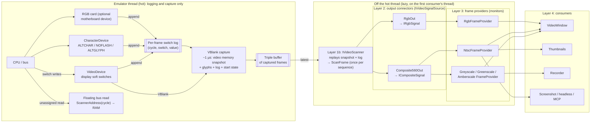

# PRD: Video Pipeline

| Field | Value |
|---|---|
| Status | Draft for engineering review |
| Owner | Josh |
| Tracking issue | #325 (decouple frame production from `VideoWindow` presentation) |
| Builds on | `main` as of 2026-11-11: `VideoDevice` (soft switches, `VBlankOccurred`, `CyclesPerFrame = 17030`), `DisplayMemorySnapshot`, `Pocket2VideoRenderer`, `CharacterDevice`, and `VideoWindow` with the #316–#323 fixes. |
| Related | PR #377 (first attempt at #325; superseded by this spec, see §16), #319 / #320 (stale attachment), #323 (closed window rendering into a disposed buffer), #258 (emulator hot-path performance), #333 / #337 (agent-friendly debugger, headless host), `KEYBOARD-SYSTEM-PRD.md` (same layering rules), `specs/video/Apple II Video Display Specification.md` (mode reference) |
| Supersedes | The frame-production parts of `VideoWindow`, the unused `IVideoSession` (`src/BadMango.Emulator.Rendering/IVideoSession.cs`), `IVideoRenderer`, and `DisplayColorMode`. |

---

## 1. Summary

Define one video pipeline that serves every machine the core will host and every consumer of frames. Machines: the Apple II, II+, IIe, enhanced IIe, and IIc family (Pocket2 today), the IIgs (65816), and the speculative 65832 machine later. Consumers: the debug `VideoWindow`, thumbnails, a recorder, screenshots, the planned UI redo, headless capture for tests, and the MCP/agent host.

The pipeline follows the real hardware, in four layers:

1. **Video device.** Owns the display soft-switch state and scans the right memory region for the current mode. Scanning memory is a separate step from producing output.
2. **Output connectors** (`IVideoSignalSource<TSignal>`). Each connector turns the scan into the signal that leaves the machine through one jack:
   - `Composite560Out` on every Apple II through the IIc
   - `RgbOut` from an optional IIe RGB card
   - IIgs composite and RGB outputs later
   - conceivably HDMI or DisplayPort outputs

   A machine may have several outputs live at once, like a real IIgs or a IIe with an RGB card.
3. **Frame providers**, the monitors: `GreyscaleFrameProvider`, `GreenscaleFrameProvider`, `AmberscaleFrameProvider`, `NtscFrameProvider`, and `RgbFrameProvider`. Each turns a signal into BGRA pixels, with whatever artifacts that monitor has. Marker interfaces (`ICompositeSignal`, `IRgbSignal`) and generic constraints mean an impossible pairing, such as an NTSC monitor on an RGB output, does not compile.
4. **Consumers.** These take frames and put them in a window, a thumbnail, a recorder, a PNG, or a test assertion. A window picks an output connector, then a frame provider.

**None of these layers runs on the emulator thread.** The hot thread does two cheap things:

- It appends each display soft-switch change, stamped with its cycle, to a per-frame switch log.
- At VBlank, it snapshots video memory (about 1 µs) into a lock-free triple buffer together with that log.

Scanning, signal generation, and frame providing all happen lazily, off-thread, by replaying the snapshot and the switch log. That replay places a mid-frame mode change at the exact video fetch it affected, so split screens and other mid-frame switch tricks are reproduced.

Each machine owns its video components. The machine builder creates them and the machine disposes them. There is no static registry and no global state, so any number of machines can run in one process.

## 2. Problem

Today `VideoWindow` owns the whole pipeline: the VBlank subscription, the snapshot, the renderer call, the flash counter, character-ROM tracking, and the pixel buffer. PR #377 moved that into a headless producer, but its design repeats or adds problems. Measured on the box (Release, `Pocket2VideoRenderer`, see §13):

- **Rendering on the emulator thread, always.** #377 renders every frame inside the VBlank scheduler callback: 452 µs per HiRes frame, about 2.7% of the emulator thread at 1×, more when unthrottled. It keeps rendering with no consumer attached, because nothing ever detaches the producer.
- **A static service locator.** `MachineVideoFrameSourceRegistry` (a static `ConditionalWeakTable`) hard-codes the Pocket2 producer and renderer, so other machines can't plug in their own. It attaches once and never re-attaches or disposes.
- **A lock instead of a pipeline.** Render, buffer swap, and the consumer's copy all share one lock, so the emulator and UI threads block each other. The data is copied three times per frame on the way to the bitmap.
- **One monolithic step.** Scanning, character generation, signal shaping, and monitor coloring are a single `RenderFrame` call that takes a `DisplayColorMode`. The machine paints final colors, so monitors can't be swapped, outputs can't be added, and #377's `ColorMode` setter on the shared producer let the last window decide what every consumer saw.
- **Wrong monitor behavior.** Monochrome "modes" fake lo-res and hi-res as solid tinted shades instead of the dot patterns a real green-screen shows. Color mode always draws text white, even in mixed mode, where a real color monitor shows fringes. There is no `ntsc` mode at all: every Pocket2 profile sets `colorMode: "ntsc"`, and nothing reads it.
- **Frame-granular state.** Mode and page are read once per frame, so mid-frame switch changes (split screens, VBL-synced tricks) are lost.
- **A constant floating bus.** Reads of unassigned I/O return a fixed `FloatingBusValue`. A real IIe returns the byte the video circuit is fetching at that moment, and some software depends on it.
- **Off-thread reads.** `ForceRender()` reads live RAM and soft switches from the UI or REPL thread while the CPU runs.
- **Silent failures.** An empty `catch` swallows production errors, which repeats the "FPS 0 with an empty log" problem from #316–#318. One throwing `FrameReady` subscriber stops the others.
- **Per-byte delegates.** `IVideoRenderer.RenderFrame` reads memory through `Func<ushort, byte>`. That costs a delegate call per display byte and two delegate allocations (128 B) per frame.
- **Glyph RAM is ignored.** The renderer only reads `GetCharacterRomData()`. Custom glyph banks (`ALTGLYPH1`/`ALTGLYPH2`, glyph RAM at `$C042`–`$C04D`) never reach the screen.
- **The headless assembly isn't headless.** `BadMango.Emulator.Rendering` references Avalonia because of `PixelBuffer`.

## 3. Goals

| # | Goal | Acceptance |
|---|---|---|
| G1 | Consumers can't break emulation. | Opening, closing, replacing, or crashing a consumer never changes machine state, never throws into the scheduler, and never stops capture. A test closes a window mid-frame and the machine keeps producing frames. |
| G2 | No video layer on the hot thread. | The emulator thread only logs switch changes (≤ 5 ns each, no allocation) and captures at VBlank (≤ 2 µs, no allocation, no lock). Scanning, signal generation, and frame providing never run on it (§13). |
| G3 | No consumers means no work. | With no consumer acquiring frames, the scan, signal, and frame counts stay 0 while the machine runs. |
| G4 | The layers match the hardware. | Video device (switches + scanning), output connector (signal), frame provider (monitor), consumer. Each can be replaced without touching the others. |
| G5 | Impossible pairings don't compile. | `NtscFrameProvider` with `RgbOut`, or `RgbFrameProvider` with `Composite560Out`, is a compile error, verified by a test (§14). |
| G6 | Multiple live outputs. | A machine exposes every output it has at once (IIgs composite and RGB; IIe composite and an RGB card). One scan per frame feeds them all. |
| G7 | Mid-frame accuracy. | Display switch changes take effect at the exact video fetch they precede, from the cycle-stamped log. Burst is decided per scanline. |
| G8 | Many consumers, shared work. | One scan per sequence, one signal per (sequence, output), one frame per (sequence, output, provider), however many consumers ask. |
| G9 | Tear-free frames. | Everything in one frame comes from one snapshot and one switch log. The off-thread layers never read live machine state. |
| G10 | Multi-machine safe. | Two machines in one process produce independent frames. No static mutable state exists anywhere in the video path. |
| G11 | Headless. | Everything below the consumer layer is Avalonia-free. A test or the MCP host can boot a profile and assert on pixels without Avalonia. |
| G12 | Observable failures. | Every capture, scan, signal, provider, or subscriber failure is logged (rate-limited) and counted. No empty `catch` blocks. |
| G13 | Zero per-frame allocations. | Logging, capture, `FrameReady` dispatch, scan, signal generation, frame providing, and acquire/release allocate nothing in steady state, enforced by tests (§14). |

## 4. Non-goals (for v1)

- Implementing the IIgs, IIc, or 65832 video, or a specific RGB card. This spec fixes their shape (§8) so the Pocket2 work doesn't block them.
- Intra-frame memory changes (racing the beam, writing a line after it was drawn). v1 snapshots memory at VBlank. The extension point is reserved in the contracts now: a cycle-stamped write log for the video pages, carried by `CapturedFrame` and replayed by the scanner (§7.2, decided Q1). Beam-racing games are a wanted, not urgent, follow-up.
- Analog monitor effects: color-killer lag, phosphor persistence, bloom, scanline gaps, a filtered YIQ decoder. v1 providers are exact. The extension point is reserved: a `FrameProviderOptions` record on every provider, defaulting to exact, or additional providers (§7.5, decided Q8).
- GPU frame providers. Allowed in the UI redo as `IFrameProvider<ICompositeSignal>` implementations, with the CPU providers and their goldens as the reference (decided Q5).
- An every-frame queue in the main API. The main API stays latest-frame only; recording uses a separate recorder (§11.6, decided Q4).
- Redesigning the debug `VideoWindow`. It is migrated to be a thin consumer with output and monitor selectors (§11.1), then left alone until the UI redo.

## 5. Users and scenarios

| Persona | Scenario |
|---|---|
| Player | Runs a game in the video window at a steady 60 fps, switching between a greenscale and an NTSC monitor from the window menu. Closing and reopening the window, or opening a second one on a different monitor, has no effect on the game. |
| Demo coder | Runs a program that flips TEXT and HIRES mid-frame on a cycle-counted loop. The split appears on exactly the right line and column. |
| IIe owner with an RGB card | Enables the RGB card in the profile. Opens one window on `Composite560Out` with `NtscFrameProvider` and another on `RgbOut` with `RgbFrameProvider`, both live. |
| Developer at the REPL | Pauses the machine, pokes `$0400`, types `video refresh`, and the window shows the change immediately. |
| Agent (MCP, #337) | Runs a headless machine until idle, acquires the latest composite frame through `GreenscaleFrameProvider`, and saves a PNG. No Avalonia is loaded. Repeating the run gives the same pixels. |
| Emulator developer | Writes a test that boots `pocket2e-a2`, runs a program, and compares the scan, the dot stream, and the decoded frames with checked-in goldens. |
| Future IIgs work | Adds a IIgs scanner plus composite and RGB outputs. The window, the UI redo, and the MCP host are unchanged. |

## 6. Architecture



The layers have these responsibilities:

| Layer | Runs on | Owns | Must not |
|---|---|---|---|
| 1a. Video device, hot side (`VideoDevice`, plus switch-owning devices such as `CharacterDevice` and the RGB card) | Emulator thread | Display soft-switch state. Appending each change to the switch log. At VBlank, snapshotting video memory and publishing the captured frame. Raising `FrameReady`. Answering floating-bus reads arithmetically. | Scan, generate signals, allocate, take a lock, or call consumer code other than `FrameReady` handlers. |
| 1b. Video device, scanner (`IVideoScanner`, one per machine family) | Consumer side | Replaying the captured snapshot and switch log to work out, fetch by fetch, which bytes the video circuit read and in which mode, after character generation. | Read live RAM or live switches. It only sees the captured frame. |
| 2. Output connector (`IVideoSignalSource<TSignal>`) | Consumer side | Turning the scan into the signal on one jack: composite dots and burst, or RGB pixels. | Know about monitors, phosphors, or color decoding. |
| 3. Frame provider (`IFrameProvider<TSignal>`) | Consumer side | Turning a signal into BGRA the way a given monitor would show it. Stateless and shared. | Know about machines, modes, text, or soft switches. It only sees the signal. |
| 4. Consumer | Its own thread | Choosing an output and a frame provider, presenting pixels, disposing leases promptly, marshaling to its own thread. | Hold a lease across frames, cache machine internals, or block inside `FrameReady`. |

**Why the hot thread can stay out of it.** The Apple IIe video circuit was *not* independent of the CPU. It shared RAM and the bus with the 6502, fetching a display byte on the alternate clock phase of every CPU cycle. That shared fetch is exactly why floating-bus reads return video data. The IIgs VGC is more independent but is still clock-locked to the system. We can move the work off the hot thread because the output is fully determined by two things: memory contents and the cycle-stamped switch history. The emulator records those cheaply, and everything else is a pure function of the record. The one hardware interaction that must happen on the hot thread, the floating bus, is computed arithmetically from the cycle count (§8.1.6), with no scanner running there.

## 7. Contracts

Machine-side types (layers 1 and 2, the signal marker interfaces, and the frame lease) live in `BadMango.Emulator.Devices`, with interfaces in `BadMango.Emulator.Devices.Interfaces`, the same convention the keyboard spec uses. The `IFrameProvider<TSignal>` contract sits beside the signal markers in Devices; the frame provider implementations (layer 3) live in `BadMango.Emulator.Rendering`, which drops its Avalonia reference (§12). Nothing below the consumer layer references Avalonia.

### 7.1 Names at a glance

| Layer | Contract | Pocket2 / IIe implementation | Later |
|---|---|---|---|
| 1a | `IVideoDevice` (refactored), `IDisplaySwitchLog`, `CapturedFrame<TState>` | `VideoDevice`, `Pocket2CapturedState` | IIgs VGC device |
| 1b | `IVideoScanner<TState>`, `ScanFrame` | `Pocket2VideoScanner` | `AppleIIgsVideoScanner` |
| 2 | `IVideoOutput`, `IVideoSignalSource<TSignal>` | `Composite560Out`; `RgbOut` (from the RGB card) | `AppleIIgsCompositeOut`, `AppleIIgsRgbOut`, conceivably `HdmiOut` / `DisplayPortOut` |
| Signals | `IVideoSignal`, `ICompositeSignal`, `IRgbSignal` | `Composite560Signal`, `RgbSignal` | New markers only if a signal has new semantics |
| 3 | `IFrameProvider<TSignal>` | `GreyscaleFrameProvider`, `GreenscaleFrameProvider`, `AmberscaleFrameProvider`, `NtscFrameProvider`, `RgbFrameProvider` | Fidelity via `FrameProviderOptions` or extra providers (§7.5) |
| 4 | `VideoFrame` lease | `VideoWindow`, PNG writer, headless host | UI redo, thumbnails, recorder |

Naming rules:

- Outputs are `<Kind>Out`, with a machine prefix only when the machine's output differs (`AppleIIgsCompositeOut`).
- Frame providers are `<Look>FrameProvider`.
- Scanners are `<Machine>VideoScanner`.
- "Machine" alone is never a prefix for something machine-specific.

### 7.2 Hot side: switch log and capture

```csharp
public enum DisplaySwitch : byte
{
    Text, Mixed, Page2, HiRes, Col80, Store80, DoubleHiRes /* AN3 */,
    AltCharSet, NoFlash1, NoFlash2, AltGlyph1, AltGlyph2,
    // RGB card and IIgs switches are appended by those devices' specs.
}

public readonly record struct DisplaySwitchEvent(uint CycleInFrame, DisplaySwitch Switch, bool Value);

public interface IDisplaySwitchLog
{
    /// Emulator thread only. Appends a change; no allocation, no lock.
    void Record(DisplaySwitch which, bool value);
}
```

- **Who logs.** Every device that owns a display-affecting switch records changes through the machine's `IDisplaySwitchLog`: `VideoDevice` for TEXT, MIXED, PAGE2, HIRES, 80COL, 80STORE, and AN3/DHIRES; `CharacterDevice` for ALTCHAR, NOFLASH, and ALTGLYPH; the RGB card for its own mode switches.
- **When.** Only actual changes are recorded; writing the same value again is not logged. `CycleInFrame` is `scheduler.Now − frameStartCycle`.
- **Cost.** One bounds check and one 8-byte store into the back slot's preallocated array. The budget is ≤ 5 ns per change, with no allocation (§13).
- **Capacity.** Each slot holds 4,096 events (32 KB). On overflow, further events in that frame are dropped, the slot is flagged `LogOverflowed`, and `SwitchLogOverflows` is counted and logged. The scanner then replays what was logged and applies the frame's end state from the first dropped event onward. Software that toggles more than 4,096 times in a frame is not a v1 target.
- **The frame window.** Frame *N*'s log covers the cycles from the previous VBlank start to this VBlank start. That is the 70 blanking lines, then the 192 visible lines (`CyclesPerFrame = 17030` = 262 lines × 65 cycles on NTSC machines). The slot also stores the switch state at the window's start, so a frame can be replayed on its own.
- **Capture at VBlank start.** On the emulator thread, inside `VideoDevice.OnVBlankStart`, after VBlank end has been scheduled (the existing #316 ordering), the device:
  1. copies the video memory regions into the back slot;
  2. copies the glyph table if `GlyphVersion` changed (§8.1.1);
  3. stamps `Sequence` and `Cycle`;
  4. stores the current switch state as the next frame's start state;
  5. publishes the slot with one `Interlocked.Exchange` of the slot index;
  6. raises `FrameReady`.

  This is a single-producer triple buffer: the emulator never waits, and an unconsumed ready slot is overwritten by the next VBlank (latest wins). The switch log is written straight into the back slot, so publishing it copies nothing.

```csharp
public sealed class CapturedFrame<TState> where TState : class
{
    public ulong Sequence { get; }            // 0 means none yet; published frames start at 1
    public ulong Cycle { get; }               // VBlank start (or RequestFrame)
    public ulong FrameStartCycle { get; }
    public TState State { get; }              // machine-specific: memory snapshot, glyphs, start switches
    public ReadOnlySpan<DisplaySwitchEvent> SwitchLog { get; }
    public bool LogOverflowed { get; }
    public ReadOnlySpan<VideoWriteEvent> WriteLog { get; }   // reserved (§7.2.1); always empty in v1
    public bool WriteLogOverflowed { get; }
}
```

- **Sequence is a `ulong`, like `Cycle`.** A sequence is never negative. `LatestSequence` is 0 until the first frame is published; published frames start at 1. `Interlocked.Exchange`, `CompareExchange`, and `Read` have `ulong` overloads since .NET 5, so the published sequence and `LatestSequence` need no signed packing. Acquire tickets stay `long` (0 is a free holder-table slot, §7.6).

- **Backing and validity.** `SwitchLog` and `WriteLog` are computed on each call from preallocated per-slot arrays plus a count (`events.AsSpan(0, count)`). No span is ever stored. Slots, and the `CapturedFrame` objects in them, are reused by the triple buffer, so a `CapturedFrame` and anything read from it are valid only while the caller holds the slot: inside `IVideoScanner.Scan`, or while holding a `CapturedFrameLease` (§11.6). Keeping a reference after that means reading a later frame.

- **Memory is snapshotted once per frame.** The off-thread layers never read live RAM: doing so would tear, because the CPU keeps writing while they work. A program that rewrites a line after it has been drawn (racing the beam) shows the end-of-frame contents in v1.

#### 7.2.1 Reserved extension point: the video-page write log (beam racing)

Josh wants beam-racing games supported eventually; it isn't a v1 priority. The contracts reserve the hook now so adding it later changes no public signature:

```csharp
public readonly record struct VideoWriteEvent(uint CycleInFrame, uint Address, byte Value, VideoMemoryBank Bank);

public enum VideoMemoryBank : byte { Main, Aux /* IIgs: E0, E1 appended by that spec */ }

public interface IVideoWriteLog
{
    /// Emulator thread only. Appends a write that landed in a captured video region.
    /// No allocation, no lock. Not installed in v1.
    void Record(uint address, byte value, VideoMemoryBank bank);
}
```

- `CapturedFrame<TState>` already carries `WriteLog` and `WriteLogOverflowed` (below). In v1 no `IVideoWriteLog` is installed, so `WriteLog` is always empty and capture cost is unchanged.
- **Snapshot semantics with the write log on.** The scanner needs memory as it was at the *start* of the frame window, so the capture keeps the previous VBlank's snapshot as this frame's base (the slots already hold it) and the log records every video-region write since then. The scanner starts from the start-of-window memory and applies each write whose `CycleInFrame` is at or before the fetch, exactly as it applies switch events. The scanner still never reads live RAM.
- **Hot-thread cost when enabled.** One range check on video-region writes plus one 12-byte append into the back slot (budget ≤ 5 ns, like the switch log). A bus write hook in the physical RAM write path calls `Record` only when the address is in a captured region. The capacity and overflow rules mirror the switch log (overflow falls back to end-of-frame contents for the rest of the frame).
- The scanner contract (§7.3) already takes the whole `CapturedFrame`, so turning this on is an implementation change in the capture and scanner, plus a profile or debugger toggle.

### 7.3 Layer 1b: the scanner

```csharp
public interface IVideoScanner<TState> where TState : class
{
    /// Consumer side. Replays the captured frame into a ScanFrame. No allocation.
    void Scan(CapturedFrame<TState> frame, ScanFrame destination);
}
```

- The scanner walks the visible lines fetch by fetch. On the IIe that is one fetch per CPU cycle, during the 40 cycles of each 65-cycle line that carry picture. It applies every log event whose `CycleInFrame` is at or before the fetch's cycle. A switch change therefore takes effect at the exact column it precedes, on the exact line.
- For each fetch it records the bits that leave the character generator or the graphics shifter: 7 video bits (glyph row after inverse, flash, ALTCHAR, and ALTGLYPH for text; memory bits for graphics), bit 7 (for the hi-res delay), the aux bits when 80-column or double-width modes are active, and the mode in effect. For each line it records whether the color burst gate was open, which comes from TEXT at the burst point in horizontal blanking (§8.1.5).
- It uses `ScannerAddress` (§8.1.6), the same pure address function the floating bus uses, so the scan and the floating bus always agree.
- It never touches the machine. Its only input is the captured frame, and that is enforced by its signature.
- **`ScanFrame`** is a sealed class preallocated once per hub and reused for every scan. It is backed by fixed arrays: a `ScanFetch[]` of 192 × 40 fetch records (`readonly record struct ScanFetch(byte MainBits, byte AuxBits, bool Bit7, ScanMode Mode)`) and a `ScanlineFlags[]` of 192 per-line flags (burst gate). It exposes them as `ReadOnlySpan<ScanFetch> Line(int y)` and `ReadOnlySpan<ScanlineFlags> LineFlags` for the outputs, which read it synchronously under the hub lock. It is never handed to consumers.
- It merges `SwitchLog` and `WriteLog` by `CycleInFrame` during replay. In v1 the write log is empty, so this is a no-op branch, but the merge is implemented and tested from the start (§14.27) so the beam-racing upgrade (§7.2.1) needs no scanner rework.

### 7.4 Layer 2: output connectors and signals

```csharp
// Signals: marker interfaces carry the compatibility rules.
public interface IVideoSignal
{
    ulong Sequence { get; }
    ulong Cycle { get; }
}

public interface ICompositeSignal : IVideoSignal
{
    int DotsPerLine { get; }                  // 560
    int Lines { get; }                        // 192
    int StrideWords { get; }                  // 9
    ReadOnlyMemory<ulong> Dots { get; }       // packed LSB-first, see below
    ReadOnlyMemory<ScanlineFlags> LineFlags { get; }   // one per line
}

public interface IRgbSignal : IVideoSignal
{
    int Width { get; }
    int Height { get; }
    int Stride { get; }                       // pixels per row
    ReadOnlyMemory<uint> Pixels { get; }      // finished Bgra8888, alpha 0xFF; palette already applied by the output
}

[Flags]
public enum ScanlineFlags : byte { None = 0, ColorBurst = 1 }

// Outputs.
public interface IVideoOutput : IDisposable
{
    string Name { get; }                      // "composite", "rgb"
    Type SignalType { get; }                  // typeof(ICompositeSignal) or typeof(IRgbSignal)

    /// Raised on the emulator thread right after a frame is published. The argument
    /// is the sequence number. Handlers must not block and must not call back into
    /// the machine; marshal to your own thread.
    event Action<ulong>? FrameReady;

    ulong LatestSequence { get; }

    /// If the machine is running, a no-op (the next VBlank is at most one frame away).
    /// Otherwise captures through IMachineDispatcher.Post (inline when quiescent).
    void RequestFrame();

    VideoPipelineStats GetStats();

    /// Typed dispatch for UI code that holds an output as IVideoOutput.
    TResult Accept<TResult>(IVideoOutputVisitor<TResult> visitor);
}

public interface IVideoSignalSource<TSignal> : IVideoOutput
    where TSignal : class, IVideoSignal
{
    bool TryAcquireLatestSignal(out SignalLease<TSignal> signal);

    /// Shared per (sequence, this output, provider Id, provider Options). The
    /// constraint makes an incompatible provider a compile error.
    bool TryAcquireLatestFrame(IFrameProvider<TSignal> provider, out VideoFrame frame);
}

public interface IVideoOutputVisitor<TResult>
{
    TResult Visit<TSignal>(IVideoSignalSource<TSignal> output)
        where TSignal : class, IVideoSignal;
}
```

- **Concrete outputs:** `Composite560Out : IVideoSignalSource<ICompositeSignal>`, producing pooled `Composite560Signal` objects, and `RgbOut : IVideoSignalSource<IRgbSignal>`, producing pooled `RgbSignal` objects.
- **Who maps colors (rule, Josh 2026-11-11).** RGB and newer outputs (`RgbOut`, `AppleIIgsRgbOut`, a future `HdmiOut`/`DisplayPortOut`) emit *finished* BGRA8888. Mapping hardware color numbers to RGB is the output's job, because on real hardware the card or chip did it: the Video-7 drives a fixed 16-color RGBI table (it physically output digital RGBI, and the RGBI-to-BGRA mapping is that table), and the IIgs VGC looks colors up in its 12-bit palette. Composite outputs, by contrast, emit dots, and the monitor (frame provider) decodes color. `RgbFrameProvider` is therefore a pass-through plus optional cosmetic options (§7.5, §9.1).
- **Multiple outputs are normal.** Each output is a machine component (`machine.GetComponents<IVideoOutput>()`). All outputs on a machine share one captured frame and one scan per sequence. Each generates its own signal at most once per sequence.
- **The composite dot layout (`Composite560Signal`).** 192 lines × 560 dots, one dot per 14.318 MHz dot-clock period of the active line. Each line is 9 64-bit words (576 bits). Dot *x* is bit `x & 63` of word `x >> 6`, LSB-first, matching the order the Apple II shifts video bytes out. Bits 560–575 are zero. A frame is 13,824 bytes of dots plus 192 bytes of line flags. The dot order is defined on word bits and so doesn't depend on byte order. A byte view of the words (`MemoryMarshal.AsBytes(Dots.Span)`, for example for a GPU texture upload) assumes little-endian; code that takes one asserts `BitConverter.IsLittleEndian`.
- **Why packed bits rather than a byte per dot (107,520 bytes, 7.8× more):**
  - The dot stream is cached and read by every frame provider, so small wins: 13.8 KB stays in L2.
  - Generation is bit-oriented: a hi-res byte becomes 14 dots, a 40-column glyph row 14 dots, an 80-column or DHR byte 7 dots, each through a small table and a shift into a 64-bit accumulator, with no per-dot branch.
  - The NTSC provider's 4-dot window is a shift and a mask. The greyscale-family providers expand 8 dots to 8 pixels through a 256-entry table.

### 7.5 Layer 3: frame providers and compile-time pairing

```csharp
public interface IFrameProvider<in TSignal> where TSignal : class, IVideoSignal
{
    string Id { get; }                        // "greyscale", "greenscale", "amberscale", "ntsc", "rgb"
    string DisplayName { get; }

    /// Immutable. Every provider's default is its exact options; goldens are pinned to them.
    FrameProviderOptions Options { get; }

    VideoFrameGeometry GetOutputGeometry(TSignal signal);

    /// Consumer side. Allocates nothing. Writes GetOutputGeometry(signal).Height rows of
    /// Width pixels at Stride; throws ArgumentException if
    /// bgraOutput.Length < Stride * Height.
    void Provide(TSignal signal, Span<uint> bgraOutput);
}

public readonly record struct VideoFrameGeometry(int Width, int Height, int Stride);   // Stride in pixels

/// Reserved extension point for monitor fidelity (decided Q8). Value equality (records)
/// lets the hub share frames between consumers with equal options.
public abstract record FrameProviderOptions
{
    public bool ScanlineGaps { get; init; }   // cosmetic; false = exact
}

public sealed record MonochromeOptions : FrameProviderOptions { /* v1: no extra members */ }

public sealed record NtscOptions : FrameProviderOptions
{
    public NtscDecoder Decoder { get; init; } = NtscDecoder.FourDotWindow;   // exact
    public int ColorKillerLagLines { get; init; }                             // 0 = exact
}

public sealed record RgbOptions : FrameProviderOptions
{
    public float Brightness { get; init; } = 1.0f;                            // 1.0 = exact pass-through
}

public enum NtscDecoder : byte { FourDotWindow /* , FilteredYiq: reserved */ }

public sealed class GreyscaleFrameProvider : IFrameProvider<ICompositeSignal> { /* ... */ }
public sealed class GreenscaleFrameProvider : IFrameProvider<ICompositeSignal> { /* ... */ }
public sealed class AmberscaleFrameProvider : IFrameProvider<ICompositeSignal> { /* ... */ }
public sealed class NtscFrameProvider : IFrameProvider<ICompositeSignal> { /* ... */ }
public sealed class RgbFrameProvider : IFrameProvider<IRgbSignal> { /* ... */ }

public static class FrameProviders
{
    /// Immutable catalog: every provider compatible with TSignal, for menus.
    public static IReadOnlyList<IFrameProvider<TSignal>> For<TSignal>() where TSignal : class, IVideoSignal;
    public static bool TryGet<TSignal>(string id, out IFrameProvider<TSignal> provider) where TSignal : class, IVideoSignal;
}
```

- **Typed code can't pair things wrong.** `composite.TryAcquireLatestFrame(new RgbFrameProvider(), out _)` fails to compile (CS1503), because `RgbFrameProvider` is not an `IFrameProvider<ICompositeSignal>`. The same goes for `NtscFrameProvider` on `RgbOut`.
- **UI code that holds an `IVideoOutput` reaches the typed world through `Accept(visitor)`.** Inside `Visit<TSignal>`, it offers `FrameProviders.For<TSignal>()`. The catalog is the only place with a runtime type switch, and it only lists compatible providers.
- **Providers are physical.** The greyscale family and NTSC accept composite only; RGB accepts RGB only. A future HDMI or DisplayPort output implements `IRgbSignal` if it is a plain digital RGB frame, or a new marker if its semantics differ.
- `IFrameProvider<in TSignal>` is contravariant, so a hypothetical provider written against `IVideoSignal` would accept any signal. None is planned. The `class` constraint matches `IVideoSignalSource<TSignal>` and keeps variance meaningful (variance applies only to reference type arguments). Signals are never ref structs: they are pooled, cached, and shared across threads, so `allows ref struct` is deliberately not used anywhere in these contracts.
- Providers are stateless, immutable, and shared by every output and machine in the process.
- **Options (reserved for fidelity work, decided Q8).** Each provider takes its options record in its constructor (`new NtscFrameProvider(new NtscOptions { ColorKillerLagLines = 3 })`), defaulting to the exact options, and exposes `With(options)` returning a new instance. `FrameProviders.For<TSignal>()` returns the exact instances. The hub's frame cache key is (sequence, output, provider `Id`, `Options`), so two windows with equal options share one frame. v1 implements only the exact values; non-exact values are accepted by the type system but rejected with `NotSupportedException` at construction until implemented. Fidelity work then either adds option values (when the effect is a variant of the same monitor) or adds a provider (when it is a different monitor). Temporal effects that need earlier frames (phosphor persistence) don't fit a stateless shared provider; they are a consumer-side post-pass or a later stateful-provider contract, not part of v1.

### 7.6 `VideoFrame` and `SignalLease<TSignal>` (the leases)

```csharp
public readonly struct VideoFrame : IDisposable
{
    private readonly FrameSlot? slot;         // pooled, owned by the hub
    private readonly long ticket;             // unique per acquire

    public VideoFrameInfo Info { get; }       // Sequence, Cycle, Width, Height, Stride; always Bgra8888

    /// Throws ObjectDisposedException if this lease was released (or is default).
    public ReadOnlyMemory<uint> Pixels =>
        slot is not null && slot.IsHeld(ticket) ? slot.Pixels : throw new ObjectDisposedException(nameof(VideoFrame));

    /// Releases this lease's ticket. Idempotent: a second call, a call on a copy, or a
    /// call on default(VideoFrame) does nothing.
    public void Dispose() => slot?.Release(ticket);
}

public readonly struct SignalLease<TSignal> : IDisposable where TSignal : class, IVideoSignal
{
    // Same slot + ticket scheme; Signal throws ObjectDisposedException once released.
    public TSignal Signal { get; }
    public void Dispose();
}

public readonly record struct VideoFrameInfo(ulong Sequence, ulong Cycle, int Width, int Height, int Stride);
```

- **Why a `readonly struct`.** Acquiring allocates nothing. A class lease would allocate per acquire, or, if pooled, a stale reference would point at a recycled lease. A `ref struct` can't cross an `await` or a dispatcher callback. Being `readonly` means no defensive copies under `using var`, `in`, or readonly fields.
- **Ticket-based release.** A frame buffer is shared: one cached frame can be leased to several consumers at once, so a per-slot generation alone can't tell a second dispose of a copy from a different consumer's release. Instead:
  - Each acquire takes a unique ticket (`Interlocked.Increment` on a per-hub `long` counter) and records it in the slot's **fixed holder table** (`long[16]`, preallocated; a free entry is 0) with a compare-and-swap.
  - `Dispose` does a compare-and-swap of its ticket back to 0. If the ticket isn't found, nothing happens, so double dispose, disposing a copy, and `default` are all harmless and can never release someone else's hold.
  - A buffer returns to its pool only when its holder table is empty and it is no longer the cache entry for the latest sequence.
  - If a buffer already has 16 holders, or every buffer in a pool (3 growing to 8) is held, the acquire returns false and `PoolExhausted` is counted and logged (§10).
  - `SignalLease<TSignal>` uses the same slot, ticket, and holder-table scheme.
- **`ReadOnlyMemory<T>`, not `Span<T>`.** A lease may be held across an `await` or handed to a dispatcher callback, which a span (a `ref struct`) can't do. Consumers take `.Span` once inside the method that does the copy, upload, or decode, never per pixel (`.Span` costs a type check and slice per call).
- **Validity of lease memory (rule).** Memory taken from a lease (`Pixels`, the signal's `Dots`, `LineFlags`, or `Pixels`, or the `Signal` object itself) is valid only until that lease is disposed. Consumers never store it beyond the lease. The ticket check guards each access through the lease, but not a `ReadOnlyMemory<T>` already copied out, so this is a rule, backed by the Debug fill below and test §14.31.
- **No writes (rule).** Lease buffers are shared between consumers. Never write through them, including through `MemoryMarshal.TryGetArray` or `MemoryMarshal.AsMemory` on the returned `ReadOnlyMemory<T>`.
- **Debug poisoning.** In Debug builds a pool fills a buffer with `0xDEADBEEF` (dots, flags, and pixels alike, as their element type allows) when it is freed, so a use after dispose shows up as an obvious pattern in tests (§14.12 and §14.31 run in Debug).
- **Ownership and pools (rule).** All pixel, dot, flag, captured-memory, and event buffers are plain arrays (`uint[]`, `ulong[]`, `ScanlineFlags[]`, `byte[]`, `DisplaySwitchEvent[]`, `VideoWriteEvent[]`) of exactly the needed length, owned by that machine's hub or its slot pools. Not `ArrayPool<T>.Shared`: it returns oversized arrays (breaking length and stride arithmetic), shares buffers across machines, and can't track holders. Not `IMemoryOwner<T>`: it adds a disposable reference object per rent. Pooled memory leaves the hub only through a lease.
- A buffer is never reused while any lease on it is outstanding. Consumers dispose within one present (`using var frame = ...`).

### 7.7 Threading

1. **Emulator thread:** switch logging, VBlank capture and publication, `FrameReady`, and floating-bus reads. Nothing else, and no locks.
2. **Consumer side:** each machine has one `VideoPipelineHub` component that holds the consumer side of the triple buffer, the scan cache, and every output's signal and frame caches. All of it is serialized by one `System.Threading.Lock`, which the emulator thread never takes. The first consumer that needs a scan, signal, or frame for a sequence does the work on its own thread under that lock. Later requests for the same key are cache hits. A second consumer that arrives mid-work waits for it, bounded by one scan, one signal, and one provide, rather than duplicating it.
3. **`FrameReady`** subscribers are stored in an immutable array replaced on subscribe or unsubscribe (custom event accessors), so dispatch allocates nothing (no `GetInvocationList()`). Each handler runs in its own `try`/`catch` (§10).
4. **`RequestFrame()`** checks `IMachine.State`. When `Running`, it does nothing. Otherwise it calls `IMachineDispatcher.Post(CaptureAndPublish)`, which runs inline when the machine is quiescent, so capture always happens on the machine thread.
5. **Locks** use `System.Threading.Lock` (`private readonly Lock gate = new();`), never `object` (repository style rule).

### 7.8 Ownership, lifecycle, and multi-machine

- **The machine builder registers the video components.** `MachineBuilder` gains `AddComponentFactory<T>(Func<IMachine, T> factory)`, which runs after device initialization and adds the result as a component.
  - `builder.WithVideoPipeline(profile)` registers the `VideoPipelineHub`, the machine family's scanner, and one output per connector.
  - Every Pocket2 machine gets `Composite560Out`. `RgbOut` is added only when the profile enables the RGB card (§8.2).
  - Consumers enumerate `machine.GetComponents<IVideoOutput>()` or have outputs injected. Views never resolve anything through a static.
- **The machine disposes them.** `IMachine` gains `IDisposable`. `Machine.Dispose()` stops the run loop, then disposes every `IDisposable` component in reverse registration order. Disposing the hub unsubscribes from VBlank, releases `FrameReady` handlers, and returns pooled buffers once outstanding leases are disposed.
- **Profile reload means a new machine and new outputs.** Consumers reattach to the new machine's outputs. The old ones are disposed with the old machine, which removes the #319/#320 stale-attachment failure mode by construction.
- **No static mutable state.** `MachineVideoFrameSourceRegistry` is not adopted. Static, immutable tables (dot-expansion tables, palettes, the `FrameProviders` catalog, the `ScannerAddress` tables) are fine. `DefaultCharacterRom` exposes `public static ReadOnlySpan<byte> RomData { get; }` over a private static readonly array, replacing `GetRomData()`. `CharacterDevice` copies it into its own array (`RomData.CopyTo(rom)`), so two machines never share a mutable array. A span is used rather than `ReadOnlyMemory<byte>` because `MemoryMarshal.TryGetArray` on a `ReadOnlyMemory<byte>` would hand back the shared writable array, and a span returned from a static property can't be stored.

### 7.9 Type shapes

- **Type shapes (rule).** Types that own pooled memory or leases (`CapturedFrame<TState>`, the `VideoFrame` and `SignalLease<TSignal>` slot holders, and the pools) are `sealed class`es, not records: a `with` expression would copy buffer ownership, and value equality would compare those array references, which looks meaningful but isn't. Immutable values with no ownership (`VideoFrameGeometry`, `ScanFetch`, the provider `Options` records, profile and config shapes) are records or `readonly record struct`s. C# 15 `closed` is only for hierarchies that will never grow. Signal formats stay open through the marker interfaces so IIgs and HDMI outputs can be added later.

## 8. Per-machine video

### 8.1 Pocket2 (II through IIc family)

#### 8.1.1 Captured state and the character set

**`Pocket2CapturedState`:**

```csharp
public sealed class Pocket2CapturedState
{
    private readonly byte[] main = new byte[0x5C00];     // $0400-$5FFF
    private readonly byte[] aux = new byte[0x5C00];
    private readonly byte[] glyphs = new byte[0x1000];

    public ReadOnlySpan<byte> Main => main;
    public ReadOnlySpan<byte> Aux => HasAux ? aux : default;
    public ReadOnlySpan<byte> Glyphs => glyphs;
    public bool HasAux { get; }
    public DisplaySwitchState StartSwitches { get; }      // value type: one bit per DisplaySwitch
    public bool FlashOn { get; }
}
```

The arrays are owned by the slot. Capture writes into them with `CopyTo` from the physical RAM span (internal writer, emulator thread only). The scanner reads them synchronously through the `ReadOnlySpan<byte>` properties, which is why spans, not `ReadOnlyMemory<byte>`, are right here; slot ownership is what keeps them tear-free.

| Field | Size | Source at capture |
|---|---|---|
| `Main` | `$0400`–`$5FFF` (23,552 B) | Physical main RAM (`IMainMemoryProvider.MainRam`). Falls back to side-effect-free DMA bus reads only when physical RAM isn't exposed. Never read through the MMU. |
| `Aux` | `$0400`–`$5FFF` (23,552 B) | `IExtended80ColumnDevice.AuxiliaryRam`, when present. `HasAux` is false otherwise. |
| `Glyphs` | 4,096 B | `ICharacterDevice.CopyEffectiveGlyphs`, copied only when `GlyphVersion` changed. |
| `StartSwitches` | — | Every `DisplaySwitch` value at the frame window's start. |
| `FlashOn` | — | Toggled every 16 VBlanks (~1.9 Hz), advanced only by VBlank captures, not `RequestFrame`. |

Per slot: about 51 KB of state plus 32 KB of switch log, so about 250 KB per machine. The snapshot copies (main plus aux) measured 1.0 µs.

**Character set and custom glyph banks:**

- **The character device is the only owner of glyphs.** The video path never loads, caches, or falls back to a character ROM itself.
- The built-in charset `pocket2-charset.rom` (`DefaultCharacterRom`) is Josh's own C#-generated, hand-edited Pocket2 character set, including MouseText. It is not an Apple ROM image; it is the project's legitimate default. When a profile names no character ROM, `CharacterDevice` loads it at build time.
- `ICharacterDevice` gains:

  ```csharp
  /// Incremented whenever the effective glyph table changes: LoadCharacterRom,
  /// any glyph RAM write (bus or WriteGlyphRam), or an ALTGLYPH1/ALTGLYPH2 toggle.
  long GlyphVersion { get; }

  /// Copies the 4 KB effective glyph table: bank 1 ($000-$7FF) from glyph RAM when
  /// ALTGLYPH1 is on, otherwise from the character ROM; bank 2 ($800-$FFF) likewise
  /// for ALTGLYPH2. An unloaded ROM bank is copied as zeros. Throws ArgumentException
  /// if destination.Length < 4096. Allocates nothing.
  void CopyEffectiveGlyphs(Span<byte> destination);
  ```

- Custom glyph banks therefore flow to the screen automatically. Today they don't (§2). ALTGLYPH toggles mid-frame are also in the switch log, so the scanner applies them at the right fetch. A mid-frame glyph *RAM* write falls under the write-log upgrade path (§7.2).
- The video path no longer uses `CharacterRomChanged` or `ICharacterDevice.OnVBlank`. They stay for other consumers (`CharacterPreviewWindow`, the glyph editor) until those move to `GlyphVersion`.

#### 8.1.2 Scanner: `Pocket2VideoScanner`

- It replaces the scanning half of `Pocket2VideoRenderer`. It reads `ReadOnlySpan<byte>` views over the captured `Main`, `Aux`, and `Glyphs`, indexed as `address − 0x0400`. There are no `Func<ushort, byte>` delegates.
- It applies inverse, flash, NOFLASH, ALTCHAR, and ALTGLYPH, because the real character generator does that before the signal leaves the machine.
- Its output is the preallocated `ScanFrame` (§7.3): per line, 40 `ScanFetch` records (main bits, aux bits, bit 7, mode), plus the burst-gate flag.
- The 11-parameter `IVideoRenderer.RenderFrame` and the `IVideoRenderer` interface are deleted.

#### 8.1.3 `Composite560Out`: dots per mode

| Mode (per fetch, after replay) | Dots |
|---|---|
| 40-column text | Each glyph row is 7 dots, each doubled, so 14 dots per character. |
| 80-column text | 7 dots from aux, then 7 dots from main, per column pair. |
| Lo-res | Each block is 14 dots. The block's 4-bit color is repeated as a dot pattern phase-locked to the absolute dot position (*x* mod 4), so a color monitor recovers the 16 lo-res colors exactly and a monochrome monitor shows the pattern, as on real hardware. |
| Double lo-res | 7 dots each from aux and main, with the aux nibble rotated by one bit, per the IIe hardware. |
| Hi-res | Bits 0–6 of each byte become 7 pixels of 2 dots each (14 dots). When bit 7 is set the byte's dots are delayed by one dot, and the vacated first dot repeats the previous byte's last dot [Sather ch. 8]. |
| Double hi-res | 7 dots each from aux and main, bits 0–6, LSB first. Bit 7 is ignored. |
| Mixed | Graphics fetches for lines 0–159, text fetches for lines 160–191. |

Because the mode is per fetch, a mid-line switch change produces a mid-line mode change in the dots.

#### 8.1.4 Generation without allocation

`Composite560Out` writes 9 words per line through small lookup tables and a 64-bit accumulator. It allocates nothing and keeps no state between frames other than its pools.

#### 8.1.5 Color burst

On a real IIe, the color burst is a 14-cycle sample of the color reference. The IOU gates it on after horizontal sync, during horizontal blanking, once per scanline. The gate (CLRGATE') never opens while the TEXT soft switch is set [Sather ch. 8, p. 8-16].

- **TEXT set (all-text display):** no burst on that line. A color monitor's color killer turns color decoding off, so text appears as clean white dots with no color fringing.
- **TEXT clear (graphics, including mixed mode):** burst on that line, *including* the four text rows at the bottom of a mixed display. A color monitor therefore shows those text rows with green and violet fringes (and white where dots run together). This is real IIe behavior, not a bug [Sather ch. 8].
- The scanner evaluates TEXT from the replayed log at each line's burst point, so a program that flips TEXT mid-frame gets burst on exactly the right lines. `Composite560Out` copies the result into `ScanlineFlags.ColorBurst`.

#### 8.1.6 Floating bus

- A read that the bus resolves to "floating" (today `FloatingBusValue` in `CompositeIOTarget` and `MainBus`) returns the byte the video circuit is fetching during that cycle, as on a real IIe.
- It is computed on the hot thread, without a scanner:
  1. Take `cycleInFrame = scheduler.Now − frameStartCycle`, and derive the vertical count (`cycleInFrame / 65`, mod 262) and horizontal count (`cycleInFrame % 65`).
  2. Call `ScannerAddress.Compute(vertical, horizontal, liveSwitches)`, a pure, table-driven function that implements the IIe video address summation [Sather ch. 5], including the horizontal-blanking addresses.
  3. Read physical RAM (main, or aux where applicable) at that address directly.
- The live state is correct here because the hot thread *is* "now".
- `ScannerAddress` is shared with `Pocket2VideoScanner`, so the floating bus and the picture always agree.
- The budget is ≤ 20 ns per floating-bus read, with no allocation.

### 8.2 IIe RGB card (optional motherboard device)

- **Modeled as an optional motherboard device**, not a slot card: `[DeviceType("rgb-card")]`, added and configured by the profile. This is an approved simplification. Real cards sat in the auxiliary slot or tapped the video signal, and nothing software-visible depends on the slot.
- It contributes `RgbOut : IVideoSignalSource<IRgbSignal>`, which colors the shared scan the way the card does and emits finished BGRA (§7.4). `Composite560Out` stays live alongside it.
- **First model: Video-7 RGB (decided Q10).**
  - **Physical output:** digital RGBI. `RgbOut` maps the card's 4-bit RGBI color numbers to BGRA through the card's fixed 16-color table. The palette lives in the output, not the monitor.
  - **Double hi-res modes (4):** 16-color 140×192; 160×192 color; 560×192 monochrome; and mixed (per-byte color/mono).
  - **Other modes:** clean, fringe-free color for hi-res, lo-res, and text.
  - **Mode selection:** the 80COL/AN3 toggle protocol that the Video-7 shares with Le Chat Mauve and similar cards: with DHIRES set, toggling AN3 clocks the current 80COL state into the card's 2-bit mode register. The card watches those switches on the hot thread, updates its register, and records register changes through `IDisplaySwitchLog` as new `DisplaySwitch` values (`RgbMode0`, `RgbMode1`, appended by the card), so `RgbOut` replays mode changes per fetch like any other switch.
  - **Built to extend:** the protocol decoder and mode register are shared code; later cards (Le Chat Mauve Eve/Féline, etc.) add their modes and color tables incrementally on the same `RgbOut` shape.
  - **To verify during the epic:** the exact protocol sequence and bit order, the mode-number-to-mode mapping, the 160×192 mode's semantics, the mixed mode's per-byte rule, and the RGBI color table, against the Video-7 documentation and AppleWin's Video-7 implementation. The list above is the intended scope, not a verified hardware description.

### 8.3 Apple IIgs (placeholder)

- A IIgs scanner captures and replays the IIe-compatible state plus Super Hi-Res: `$E1/2000`–`$E1/9FFF` (pixels, SCBs, palettes), `NEWVIDEO` (`$C029`), `MONOCOLOR` (`$C021`), and the border and text colors (`$C034`, `$C022`). The SCB and palette contents need the video-page write log to change mid-frame (§7.2.1).
- `AppleIIgsCompositeOut` (`ICompositeSignal`) and `AppleIIgsRgbOut` (`IRgbSignal`) are both live at once, as on the real machine. `AppleIIgsRgbOut` applies the VGC's 12-bit palette (and the fixed IIe-mode colors) and emits finished BGRA (§7.4).
- In Classic (IIe-compatible) modes, the composite output owns the border. How it reads the Classic Control Panel settings (border and text colors from battery RAM) is future work. Border geometry on each output is deferred (Q3, §17).
- IIgs floating-bus and VGC timing is deferred (Q9, §17).

### 8.4 65832 machine (placeholder)

The 65832's video hardware isn't defined yet. It plugs in with its own captured state, scanner, and outputs, using existing signal markers where they fit. Nothing in the contracts assumes a 6502-family memory map.

## 9. Frame providers (monitors)

### 9.1 The v1 providers

| Provider | Accepts | Behavior |
|---|---|---|
| `GreyscaleFrameProvider` (white phosphor), `GreenscaleFrameProvider`, `AmberscaleFrameProvider` | `ICompositeSignal` | Each dot on → phosphor color, off → black. Burst is ignored, as on a real monochrome monitor. Lo-res and hi-res show as their dot patterns ("greenscale"), not as flat shades. |
| `NtscFrameProvider` | `ICompositeSignal` | Lines with `ColorBurst`: artifact color decoded from the dot pattern (below). Lines without burst: white monochrome, because the monitor's color killer disables chroma. So all-text screens are clean white, and mixed-mode text is fringed. |
| `RgbFrameProvider` | `IRgbSignal` | Pass-through copy of the output's finished BGRA. Optional cosmetic options (`RgbOptions`: brightness, scanline gaps) default to exact pass-through. It never maps palettes. |

**`NtscFrameProvider` v1 algorithm:**

- For each dot *x*, take the 4-dot window ending at *x*, rotate it by *x* mod 4 to normalize the color phase, and look up one of the 16 Apple II colors (the lo-res/DHR palette).
- This reproduces lo-res, double lo-res, and DHR colors exactly; hi-res yields its 6 colors, with white where adjacent dots are on.
- Edges get the natural one- to three-dot color fringes of a composite display.
- Palette and phosphor values move from `DisplayColors` into the providers.
- A filtered YIQ decoder and color-killer lag are later fidelity work, reserved as `NtscOptions` values (§7.5). The exact options are the v1 behavior and the golden reference.

**Output geometry:** composite input becomes 560×384, with each scanline doubled, the same frame size the window shows today. RGB input is passed through at its own size.

### 9.2 Behavior changes from `main`

These are intentional, follow from modeling the monitor and the switch log, and update the goldens (§14):

1. Greyscale, greenscale, and amberscale show lo-res and hi-res as dot patterns, where today they show solid tinted shades.
2. NTSC shows mixed-mode text with color fringes, where today it is always white. All-text screens stay white.
3. NTSC colors come from the dot-window decode, so edge pixels can differ from today's per-mode color tables. Solid lo-res and DHR areas match.
4. Mid-frame switch changes now appear where they happen, instead of the whole frame using the VBlank-time mode.
5. The floating bus returns video data instead of a constant.

Text modes through `GreyscaleFrameProvider`, `GreenscaleFrameProvider`, and `AmberscaleFrameProvider` must match `main`'s `White`, `Green`, and `Amber` output bit for bit.

## 10. Diagnostics and error handling

- **Inject a logger.** The hub, scanner, and outputs take a Serilog `ILogger` from the machine builder (`MachineBuilder.WithLogger`). There is no `Logger.None` default inside the core.
- **No empty `catch` blocks.** Each failure path logs and counts:
  - **Capture failure** (emulator thread): caught so it can't unwind `OnVBlankStart`. It is logged and counted (`CaptureErrors`), the previous ready slot stays published, and `FrameReady` is not raised.
  - **Scan, signal, or provide failure** (consumer side): logged and counted (`ScanErrors`, `SignalErrors`, `ProvideErrors`). The acquire returns false for that call, and the cache entry is not poisoned (the next request retries).
  - **Subscriber failure:** each `FrameReady` handler runs in its own `try`/`catch`. A throwing handler is logged and counted (`SubscriberErrors`) and does not stop later handlers.
  - Critical exceptions (`OutOfMemoryException`, `AccessViolationException`, `InvalidProgramException`, `BadImageFormatException`) are never caught.
- **Rate limiting.** The first occurrence of each error kind is logged with its stack trace. Repeats are summarized at most once every 5 seconds with a count.
- **Counters.** `VideoPipelineStats` is a `readonly record struct` with `FramesCaptured`, `SwitchEvents`, `SwitchLogOverflows`, `Scans`, `SignalsGenerated`, `FramesProvided`, `CacheHits`, `CaptureErrors`, `ScanErrors`, `SignalErrors`, `ProvideErrors`, `SubscriberErrors`, `LeasesOutstanding`, `PoolExhausted`, `RecorderDroppedFrames` (only when the recorder is on, §11.6), and `LatestSequence`. `LatestSequence` is a `ulong`, matching `CapturedFrame.Sequence`. The other counters stay `long`. Counters use `Interlocked` (`Exchange`/`CompareExchange`/`Read` have `ulong` overloads since .NET 5). The status monitor and a new REPL `video stats` show them. FPS in the window is computed from presented sequences, not VBlank callbacks.
- **Lease pools.** Each signal pool and each frame pool starts at 3 buffers and grows to at most 8. If all 8 are held, or one buffer already has 16 holders (§7.6), the acquire returns false and `PoolExhausted` is incremented and logged (it indicates a consumer leaking leases).

## 11. Integration

### 11.1 Debug `VideoWindow`

- `DebugWindowManager` passes the machine's outputs to the window. The window keeps no references to the video device, character device, RAM, or char ROM.
- **A window picks an output, then a frame provider.**
  - An **Output** menu lists the machine's `IVideoOutput`s; a new window starts on the profile's `defaultOutput`.
  - A **Monitor** menu lists the compatible providers for that output (through `Accept(visitor)` and `FrameProviders.For<TSignal>()`); a new window starts on `defaultMonitor`.
  - Changing either re-presents the latest frame with no machine interaction. Two windows on one machine may use different outputs and monitors.
- **Present path:** in `FrameReady`, the handler coalesces with the existing `vblankPending` flag (renamed `presentPending`) and posts to the UI thread at the existing `VBlankUiPriority` (Normal; the #316 decision). On the UI thread it calls `TryAcquireLatestFrame(provider)` on the typed output, copies `frame.Pixels.Span` straight into the `WriteableBitmap` framebuffer (one copy), and disposes the lease.
- **`ForceRedraw()`** calls `RequestFrame()`, then presents the latest frame.
- **Close** unsubscribes `FrameReady` and nothing else.
- `PixelBuffer` moves to `BadMango.Emulator.Debug.UI` (its only user) and gains `CopyFrom(VideoFrame)`, which writes into the locked framebuffer.

### 11.2 Debugger REPL

- `video refresh` calls `RequestFrame()`.
- New: `video stats` prints `VideoPipelineStats`.
- New: `video screenshot <path.png> [output] [monitor]` acquires the latest frame and writes a PNG. It defaults to the profile's `defaultOutput` and `defaultMonitor`. The PNG encoder lives in a non-Avalonia assembly (`System.IO.Compression` plus a minimal encoder, no new dependency).
- New: `video signal <path> [output]` dumps the raw signal (dots plus line flags, or pixels).
- New: `video switches` prints the last captured frame's switch log with line and column for each event.

### 11.3 MCP / agent host (#333, #337)

The headless host uses the same outputs, providers, and PNG writer as `video screenshot`. No Avalonia is loaded.

### 11.4 Profile

- The video device config key `colorMode` is renamed `defaultMonitor`. Nothing in the code reads `colorMode` today, so the rename is not a behavior change.
- `defaultMonitor` takes a provider `Id`: `greyscale`, `greenscale`, `amberscale`, `ntsc`, or `rgb`. The existing value `"ntsc"` stays valid, so the four profiles that set it (`pocket2e.json`, `pocket2e-a2.json`, `pocket2e-a2-enh.json`, `pocket2e-devices.json`) only change the key name.
- New key `defaultOutput` takes an output `Name` (`composite`, `rgb`). It defaults to `composite`.
- A `defaultMonitor` that isn't compatible with `defaultOutput` is a profile validation error. When `defaultMonitor` is absent, it is `ntsc` for composite outputs and `rgb` for RGB outputs.
- The RGB card is a motherboard device entry (`"type": "rgb-card"`) with its own config.
- The profile JSON schema gains these keys.

### 11.5 The planned UI redo

The new UI is just another consumer. It enumerates outputs, picks an output and a provider (starting from the profile defaults), and uploads `VideoFrame.Pixels`. Nothing in the core changes for the redo. The debug `VideoWindow` migration in §11.1 is deliberately minimal and serves as the reference consumer.

The redo may implement GPU frame providers (decided Q5), for example decoding `Composite560Signal` in a shader. They are still `IFrameProvider<ICompositeSignal>` implementations, so pairing rules apply unchanged, and the CPU providers and their goldens remain the reference a GPU provider must match (within a stated tolerance) in its tests.

### 11.6 Every-frame consumers: the recorder

Video recording and frame-exact agent traces need every frame. The main API stays latest-frame only (decided Q4). A separate `VideoRecorder` component subscribes to `FrameReady` and acquires synchronously inside the handler, so no frame can be overwritten before it is taken:

- The synchronous acquire is `internal bool VideoPipelineHub.TryPinLatestCapture(ulong expectedSequence, out CapturedFrameLease lease)`, called with the sequence `FrameReady` delivered. It takes the just-published captured slot out of the triple-buffer rotation by swapping in a spare slot from a small bounded pool. That is an index swap, no copy and no allocation, so the emulator thread still does no scanning or rendering.
- **Race with consumers.** Consumer threads also swap the ready-slot index, so the pin swaps it with `Interlocked.Exchange` and then checks `slot.Sequence == expectedSequence`. On a mismatch (a consumer took that slot first), it swaps the slot back with `Interlocked.Exchange` and counts the frame in `RecorderDroppedFrames`, so the recorder never records a stale or duplicate frame.
- `CapturedFrameLease` is an `internal readonly struct : IDisposable` holding the slot and its generation. It has a single owner, so a generation token is enough. Dispose is idempotent, and the `CapturedFrame` is valid only while it is held (§7.2).
- The recorder's own thread scans, generates signals, and provides frames from the pinned captures (through the same scanner, outputs, and providers), encodes, writes, and disposes the leases, which returns the slots to the pool.
- If the spare pool is empty (the recorder fell behind), the pin fails, the frame is dropped and counted (`RecorderDroppedFrames`), and the emulator never waits.
- The recorder is opt-in and off by default. Pinning is internal to the hub and the recorder; the public consumer API stays latest-frame only.

## 12. Layering and assemblies

| Assembly | Contains after this spec | References |
|---|---|---|
| `BadMango.Emulator.Devices` | Layer 1 and 2: refactored `VideoDevice`, `IDisplaySwitchLog` and its implementation, `CapturedFrame<TState>`, `Pocket2CapturedState`, `IVideoScanner<TState>`, `Pocket2VideoScanner`, `ScanFrame`, `ScannerAddress`, `IVideoOutput`, `IVideoSignalSource<TSignal>`, the signal markers and `Composite560Signal`/`RgbSignal`, `Composite560Out`, the RGB card and `RgbOut`, `VideoPipelineHub`, `VideoFrame`, `SignalLease<TSignal>`, `VideoPipelineStats`, the `IFrameProvider<TSignal>` contract and `FrameProviderOptions` records, `VideoWriteEvent`/`IVideoWriteLog` (reserved), `VideoRecorder` (opt-in); `ICharacterDevice.GlyphVersion`/`CopyEffectiveGlyphs` | Bus (unchanged) |
| `BadMango.Emulator.Rendering` | Layer 3: `FrameProviders`, the five providers, `WithVideoPipeline` builder extension, PNG writer | Devices, Bus. **No Avalonia.** |
| `BadMango.Emulator.Debug.UI` | Layer 4: `VideoWindow` (output and monitor menus), `PixelBuffer` (moved), `CharacterPreviewWindow` | Rendering, Avalonia |

- `IFrameProvider<TSignal>` itself is declared in `Devices` (next to the signal markers) so that `IVideoSignalSource<TSignal>.TryAcquireLatestFrame` can name it; the implementations live in `Rendering`.
- Deleted: `IVideoRenderer`, `Pocket2VideoRenderer`, `IVideoSession`, `DisplayColorMode`, `DisplayMemorySnapshot` (folded into `Pocket2CapturedState`), and from #377 `MachineVideoFrameSourceRegistry` and `MachineVideoFrameProducer`. `DisplayColors`, `CharacterRenderer`, and `ScaledPixelWriter` are folded into the scanner, output, and providers, or deleted if unused.
- `BadMango.Emulator.Rendering.csproj` drops `<PackageReference Include="Avalonia" />`. An architecture test fails if Avalonia comes back.

## 13. Performance budgets

Measured 2026-11-11 on the box (Release, `Pocket2VideoRenderer` as on `main`, random RAM, 2,000 iterations):

| Operation | Measured today | Budget | Thread |
|---|---|---|---|
| Switch-log append | — (new) | ≤ 5 ns per change, 0 B | Emulator |
| Video-write-log append (reserved, §7.2.1; not installed in v1) | — | ≤ 5 ns per video-region write when enabled, 0 B; 0 when disabled | Emulator |
| Snapshot capture, main + aux | 1.0 µs | ≤ 2 µs total capture, including glyph check, start state, and publish | Emulator |
| Glyph table copy (4 KB) | — | Only on `GlyphVersion` change | Emulator |
| `FrameReady` dispatch | — | 0 B | Emulator |
| Floating-bus read | constant today | ≤ 20 ns, 0 B | Emulator |
| Emulator-thread render, scan, or generation cost | ~2.7% at 1× (#377 renders there) | 0 | Emulator |
| Scan with switch replay (`Pocket2VideoScanner`) | — (new) | ≤ 40 µs (target, measured in step 5) | Consumer, once per sequence |
| `Composite560Out` signal | — (new) | ≤ 40 µs | Consumer, once per (sequence, output) |
| Greyscale/greenscale/amberscale provide (560×384) | — (new) | ≤ 120 µs | Consumer, once per (sequence, output, provider) |
| NTSC provide (560×384) | — (new) | ≤ 400 µs | Consumer |
| End to end (scan + signal + provide), Text40 | 182 µs (render) | ≤ 182 µs | Consumer |
| End to end, Text80 | 243 µs | ≤ 243 µs | Consumer |
| End to end, HiRes | 452 µs | ≤ 452 µs | Consumer |
| End to end, Double Hi-Res | 129 µs (render) | ≤ 180 µs (NTSC does real decode work that today's DHR path skips) | Consumer |
| Allocations per frame | 128 B (two delegates) | 0 B | All |
| Copies from frame to bitmap | 2 full-frame copies (#377) | 1 (lease → framebuffer, ~25 µs) | Consumer |
| Work with no consumers | 1 render per VBlank (#377) | 0 scans, 0 signals, 0 provides | — |
| Memory per machine | — | ~250 KB captured slots; 3–8 × 14 KB composite signals; 3–8 × 860 KB frames per (output, provider) in use | — |

The hot-thread and allocation budgets are hard limits enforced by tests (§14). The end-to-end budgets are "no regression from `main`" (except the DHR line, which is deliberately looser). The new-stage targets are checked by an explicit `[Category("Perf")]` test that is run before merge, not gated in CI.

## 14. Testing strategy

All tests run without Avalonia except the `VideoWindow` ones. Each test runs on a fake scheduler or a real profile, as noted.

1. **Reference goldens from `main` (first, before any refactor).** Using `main`'s renderer, capture frames for fixed RAM contents in every mode, with page 1 and 2, ALTCHAR on and off, flash on and off, and each `DisplayColorMode`. These are the baseline for §9.2.
2. **Goldens at three levels.**
   - **Scan goldens** (`ScanFrame` records, binary).
   - **Signal goldens:** `Composite560Signal` dots and line flags, binary, bit-exact, monitor-independent.
   - **Frame goldens:** each signal through every compatible provider, as PNG.
   - Text modes through the greyscale-family providers must equal the `main` reference bit for bit. Every other frame golden is new, reviewed visually by Josh before check-in, and the PR lists the §9.2 differences.
3. **Compile-time pairing.** A test compiles snippets with Roslyn (`CSharpCompilation` against the built assemblies):
   - `composite.TryAcquireLatestFrame(new RgbFrameProvider(), out _)` and `rgbOut.TryAcquireLatestFrame(new NtscFrameProvider(), out _)` must fail with CS1503.
   - Every valid pairing must compile.
   - `FrameProviders.For<ICompositeSignal>()` lists exactly the four composite providers, and `For<IRgbSignal>()` lists exactly `RgbFrameProvider`.
4. **Switch-log recording.** Each display switch records exactly one event per actual change, none for repeated writes, with the correct `CycleInFrame`. The log allocates nothing. On overflow, the flag is set, the counter increments, and the error is logged once.
5. **Switch-log replay.** On a fake scheduler, with known memory:
   - TEXT → graphics at line 100 splits the frame at line 100.
   - A HIRES toggle at column 20 of line 50 changes mode at that column.
   - A PAGE2 flip mid-frame shows page 1 above it and page 2 below.
   - 80STORE suppresses the page 2 display.
   - An ALTCHAR change mid-frame affects only later fetches.
   - An overflowed log replays the logged events and then the end state.
   - Replaying the same captured frame twice gives identical scans.
6. **Color burst.** A line with TEXT set at its burst point has no `ColorBurst`; a graphics or mixed line has it, including the mixed text rows. TEXT flipped mid-frame gives burst on exactly the lines after the flip. `NtscFrameProvider` decodes a burst-off line as pure white/black and a burst-on line with fringes.
7. **Dot-level correctness.** Per mode: hi-res bit 7 delay and last-dot carry; lo-res phase locking; DHR and double lo-res aux/main interleave (including the aux nibble rotation); 80-column interleave; inverse, flash, NOFLASH, ALTCHAR, and ALTGLYPH in the dots.
8. **Floating-bus address math.** `ScannerAddress.Compute` matches a table of known (vertical, horizontal, mode) → address values from Sather ch. 5 for text, lo-res, hi-res, mixed, and both pages, including horizontal-blanking addresses. A floating-bus read on a fake scheduler at a chosen cycle returns the RAM byte at that address. A 6502 program that syncs to the display by polling the floating bus locks to the expected line on the `pocket2e-a2-enh` profile.
9. **Frame providers.** Each provider against hand-built signals: solid lo-res colors through `NtscFrameProvider` match the 16-color palette exactly; the greyscale family ignores burst; `RgbFrameProvider` passes pixels through unchanged.
10. **Scanner isolation.** The scanner is given only a `CapturedFrame`. A test mutates live RAM and switches after capture and asserts the scan is unchanged (no live reads, so no tearing).
11. **Multiple live outputs.** A profile with the RGB card enabled exposes `Composite560Out` and `RgbOut`. One sequence acquired on both performs one scan and two signal generations. Disabling the card removes `RgbOut` and leaves composite unchanged. The RGB card is created as a motherboard device from the profile.
12. **Concurrency.** One thread raises VBlanks and switch changes at maximum rate while 4 consumer threads acquire (mixing outputs, providers, and raw signals), read everything, and dispose, for 10,000 frames. Assert no torn frame, no exception, `LeasesOutstanding == 0` at the end, and the emulator thread never blocked.
13. **Shared work.** Two consumers on the same output, provider, and sequence: one scan, one signal, one provide, one cache hit. Two providers on one output: one scan, one signal, two provides.
14. **No consumers.** Run a real `pocket2e-a2` machine for 120 VBlanks with no acquire: `FramesCaptured == 120`, and `Scans`, `SignalsGenerated`, and `FramesProvided` all 0.
15. **Device swap and reattach.** Rebuild the machine (profile reload) with a window attached. The window shows the new machine's frames on the same output and monitor, the old components are disposed, and the old video device has no subscribers.
16. **Charset changes.** Load a different character ROM; enable `ALTGLYPH1` with modified glyph RAM; write glyph RAM while the overlay is on. Each change appears in the next frame's dots. No change means no glyph copy (assert via a copy counter).
17. **80-column / aux.** Text80 and Double HiRes come from aux RAM in physical memory even with RAMRD/80STORE set. A machine without `IExtended80ColumnDevice` generates Text80 as 40-column, as today.
18. **Throwing subscriber.** Three handlers; the second throws. The first and third still run, `SubscriberErrors == 1`, one error is logged, and the next VBlank is scheduled normally.
19. **Failures.** A fault-injected capture, scan, signal, or provide logs, counts, and leaves the previous frame available. No empty catches (a Roslyn check or code review).
20. **Two machines.** Two `pocket2e-a2` machines in one process with different RAM produce different frames and independent sequences, logs, and counters, while sharing provider instances. Disposing one leaves the other running.
21. **Lifecycle.** `Machine.Dispose()` disposes the hub and outputs. After disposal, acquires return false, `RequestFrame` does nothing, and a lease taken before disposal is still readable until disposed.
22. **`RequestFrame`.** While paused, it captures inline and raises `FrameReady` once. While running, it doesn't capture off-thread.
23. **Zero allocations.** Using `GC.GetAllocatedBytesForCurrentThread()` around 1,000 iterations after warm-up, these all allocate 0 B:
    - switch logging
    - capture, publish, and dispatch
    - a floating-bus read
    - scan
    - signal acquire plus generation
    - frame acquire plus provide plus dispose, for every provider
24. **Window.** Closing the `VideoWindow` removes exactly its `FrameReady` handler. The Output menu lists the machine's outputs, the Monitor menu lists only compatible providers, a new window starts on the profile defaults, and two windows on different outputs or monitors present different pixels from one sequence. (This replaces #377's renamed-but-inverted `CloseWindow_DetachesVBlankHandler…` assertion.)
25. **Profile.** `defaultMonitor` and `defaultOutput` parse, default, and validate compatibility. The four updated profiles load with `ntsc`. An `rgb-card` entry adds `RgbOut`.
26. **Layering.** An architecture test asserts that `BadMango.Emulator.Rendering` and `BadMango.Emulator.Devices` don't reference any `Avalonia*` assembly.
27. **Write-log hook (reserved).** In v1, `CapturedFrame.WriteLog` is always empty and capture cost is unchanged. A test hands the scanner a captured frame with a synthetic write log (a line rewritten mid-frame) and asserts the lines above the write show the old bytes and the lines below show the new ones, so the merge in §7.3 works before any capture records writes.
28. **Provider options.** Each provider's default `Options` equals its exact options, and every frame golden is pinned to them. Two consumers with equal options share one provided frame; different options get separate cache entries. Constructing a provider with a not-yet-implemented non-exact option throws `NotSupportedException`.
29. **RGB outputs emit finished BGRA.** `RgbOut` maps each Video-7 RGBI color number through the card's fixed table (golden per mode once the table is verified, §8.2), and `RgbFrameProvider` with exact `RgbOptions` returns those pixels bit-for-bit.
30. **Recorder.** With the recorder on and a deliberately slow drain, every published sequence is either recorded or counted in `RecorderDroppedFrames`, none twice, and the emulator thread never blocks or allocates. With it off, no slot is ever pinned.
31. **Lease safety.**
    - Two consumers hold the same cached frame; one disposes its lease twice and also disposes a copy. The other's `Pixels` stays valid and the buffer isn't freed until it disposes.
    - `default(VideoFrame).Dispose()` does nothing; `Pixels` on a disposed or default lease throws `ObjectDisposedException`; the same for `SignalLease<TSignal>.Signal`.
    - A 17th holder on one buffer, or a pool with all 8 buffers held, makes the acquire return false and increments `PoolExhausted`.
    - In Debug, a `ReadOnlyMemory<uint>` kept past dispose reads `0xDEADBEEF` once the buffer is freed.
32. **Recorder pin race.** A consumer thread hammers `TryAcquireLatestFrame` while the recorder pins on every `FrameReady`. Every pinned lease's `Sequence` equals the `FrameReady` sequence (both `ulong`); mismatches are swapped back and counted, never recorded.
33. **Length rules.** `Provide` with a destination shorter than `Stride × Height` and `CopyEffectiveGlyphs` with fewer than 4,096 bytes throw `ArgumentException`. `DefaultCharacterRom.RomData` copies into two machines' character devices independently (writing one doesn't change the other).

## 15. Migration plan

Each step builds and tests green on its own (`dotnet build BackPocketEmulator.slnx -c Release -warnaserror` and `dotnet test`).

1. **Reference goldens.** Add the `main` reference frames (§14.1). No production change.
2. **Contracts and lifecycle.** Add the layer contracts (§7): the signal markers, `IVideoOutput`, `IVideoSignalSource<TSignal>`, `IFrameProvider<TSignal>`, `FrameProviderOptions` and the per-provider options records (exact defaults only), the leases, `CapturedFrame<TState>` (including the reserved, always-empty `WriteLog`), `VideoWriteEvent`/`IVideoWriteLog` (declared, not installed), and `IVideoScanner<TState>`. Make `IMachine : IDisposable` with component disposal in `Machine`. Add `MachineBuilder.AddComponentFactory<T>` and replace `DefaultCharacterRom.GetRomData()` with `RomData` (§7.8). Add lease tests §14.31 and §14.33 against stub pools. Add the compile-time pairing test (§14.3) with stub providers.
3. **Glyph API.** Add `GlyphVersion` and `CopyEffectiveGlyphs` to `ICharacterDevice` and `CharacterDevice`, with tests for every version bump trigger.
4. **Hot side of the video device.** Refactor `VideoDevice`:
   - Add `IDisplaySwitchLog` and record changes from `VideoDevice` and `CharacterDevice`.
   - Capture at VBlank into the triple buffer with the start state and log.
   - Add `ScannerAddress` and route floating-bus reads through it.
   - Tests §14.4, §14.8, and the hot-side parts of §14.23. Rendering still goes through the old path; the window is unchanged.
5. **Scanner and composite output.** Add `Pocket2VideoScanner`, `ScanFrame`, `Composite560Out`, and `Composite560Signal`. Add the scan and signal goldens and tests §14.5–§14.7, §14.10, §14.17, and §14.27.
6. **Frame providers.** Add the five providers and `FrameProviders`, moving palette and phosphor values out of `DisplayColors`. Add the frame goldens, the text-mode parity check against `main`, §14.9, and §14.28.
7. **Hub and registration.**
   - Add `VideoPipelineHub`: the consumer side of the triple buffer, caches under one `System.Threading.Lock`, lease pools, the immutable subscriber array, `RequestFrame`, stats, and logging.
   - Add `WithVideoPipeline(profile)` and register it in `MachineFactory` and the headless host.
   - Rename `colorMode` to `defaultMonitor` and add `defaultOutput` in the profiles and schema.
   - Tests §14.12–§14.16 and §14.18–§14.22, plus §14.25 without the RGB card and §14.31 against the real hub.
8. **Window, REPL, and layering.**
   - Switch `VideoWindow` and `DebugWindowManager` to outputs plus providers, with the Output and Monitor menus (§11.1).
   - Move `PixelBuffer` to `Debug.UI` and drop Avalonia from `Rendering`.
   - Add `video stats`, `video screenshot`, `video signal`, and `video switches`.
   - Delete `Pocket2VideoRenderer`, `IVideoRenderer`, `IVideoSession`, `DisplayColorMode`, and `DisplayMemorySnapshot`.
   - Tests §14.24 and §14.26. **This step completes #325.**
9. **RGB card (separate epic): Video-7 RGB first.** Add the `rgb-card` motherboard device with the shared 80COL/AN3 mode-protocol decoder, its mode-register switch logging, and `RgbOut` with the Video-7 RGBI color table, covering the four DHGR modes plus clean hi-res, lo-res, and text color (§8.2). Verify the protocol, modes, and table against the Video-7 documentation and AppleWin first. Tests §14.11, §14.29, and the rest of §14.25. `RgbFrameProvider` already exists from step 6.

Later, independent of the steps above: the beam-racing write log (§7.2.1) and the every-frame recorder (§11.6), each as its own issue when wanted.

**Reuse from PR #377's branch (`copilot/decouple-frame-production`):**

- The capture logic in `MachineVideoFrameProducer.CaptureDisplaySnapshot` (physical RAM first, side-effect-free DMA reads as fallback, aux handling), adapted into the VBlank capture.
- The tests `VBlank_CapturesModeAndPageAtProductionTime`, `FrameReady_NotifiesAllSubscribers`, `VBlank_WithPhysicalMainRam_UsesPhysicalRamInsteadOfBus`, and the window test `VBlankSnapshot_UsesModeCapturedAtVBlank`, rewritten against the new API. The mode-capture test becomes a switch-log test.
- The `VideoWindow` deletions (snapshot, char ROM, flash, and render code), which carry over as-is.

**Not reused:** `MachineVideoFrameSourceRegistry`, the `IVideoFrameSource` shape, `VideoFrameMetadata`, the `ColorMode` setter, `ForceRender`, rendering on the emulator thread, the single `object` lock, the empty `catch`, and the default-ROM fallbacks inside the producer.

## 16. Relationship to #325, PR #377, and the UI redo

- This document is the design for #325. Implementation issues for §15 are filed after this PRD is approved; the step-8 PR closes #325. Step 9 (RGB card) is its own epic.
- PR #377 is superseded. What it gets right (machine-scoped production, state captured at VBlank, the window as a pure consumer) is kept here. Whether to close it or retarget its branch is Josh's call.
- #323 remains the stopgap for the closed-window bug until step 8 lands.
- The UI redo consumes outputs and frame providers as specified in §11.5 and needs no core changes.

## 17. Open, deferred, and decided questions

### Open

None. Every question raised by this PRD so far is decided or deferred.

### Deferred to the IIgs milestone

| # | Question | Notes |
|---|---|---|
| Q3 | **IIgs border.** Border geometry on each IIgs output (composite owns it in Classic mode, §8.3), and how the composite output reads the Classic Control Panel border and text colors from battery RAM. | Affects only the IIgs outputs' geometry and state, not the contracts. Deferred by Josh, 2026-11-11. |
| Q9 | **IIgs floating bus and VGC timing.** The IIgs VGC is more independent of the CPU than the IIe's video circuit (but still clock-locked). What does a floating-bus read return on a IIgs, and does `ScannerAddress` need a IIgs variant? | Deferred by Josh, 2026-11-11. |

### Decided (Josh, 2026-11-11)

| # | Decision | Notes |
|---|---|---|
| Q6 | **Color and monitor type are not a video-device concern.** The machine emits signal-level output; the consumer picks the monitor. Decoded frames are shared per (sequence, output, provider). Each `VideoWindow` selects its own monitor; headless capture, screenshots, and the debugger use the same providers. The profile's `colorMode` (read by nothing today) becomes `defaultMonitor`, the initial monitor for new windows. | Josh's rationale: a real Apple IIe had one video output, the composite jack. The video hardware didn't decide whether you saw green, amber, black-and-white, or color; the monitor you plugged in did. A green-screen gave green and black ("greenscale"); an NTSC color monitor gave the hi-res colors. Originally specified with `MonitorType`/`IMonitorDecoder`; the names are superseded by the Pairing decision below. See §7.4, §7.5, §9, §11.4. |
| Layers | **Four layers:** (1) the video device owns soft-switch state and scans memory, with scanning separate from producing output; (2) output connectors (`Composite560Out`, `RgbOut`, later the IIgs outputs, conceivably `HdmiOut`/`DisplayPortOut`) are `IVideoSignalSource<TSignal>`; (3) frame providers are the monitors (`GreyscaleFrameProvider`, `GreenscaleFrameProvider`, `AmberscaleFrameProvider`, `NtscFrameProvider`, `RgbFrameProvider`); (4) consumers pick an output connector, then a frame provider. | See §6, §7, §11.1. |
| Pairing | **Output/monitor compatibility is enforced at compile time** with signal marker interfaces (`ICompositeSignal`, `IRgbSignal`) and `IFrameProvider<TSignal>` constraints. Plugging an RGB monitor into composite, or a mono monitor into RGB, does not compile. This replaces `IMonitorDecoder` and `MonitorType`. | Runtime menus bridge to the typed pairing through `IVideoOutputVisitor<TResult>` and `FrameProviders.For<TSignal>()` (§7.4, §7.5). Tested by §14.3. |
| Q2 | **Multiple outputs can be live at once.** A machine exposes one `IVideoOutput` per output connector (IIe composite plus an RGB card; IIgs composite plus RGB), all fed from one shared scan per frame. | Resolves Q2. See §7.4, §8.2, §8.3, §14.11. |
| RGB card | **The IIe RGB card is an optional motherboard device** (`"type": "rgb-card"`) added by the profile, not a slot card. | An approved simplification. See §8.2, §11.4. |
| Hot thread | **None of the four layers runs on the emulator (hot) thread.** The hot thread only logs cycle-stamped display switch changes into a per-frame log (no allocation) and, at VBlank, snapshots video memory (~1 µs) into the triple buffer with that log. Scanning, signal generation, and frame providing replay lazily off-thread. The floating bus computes the scanner address arithmetically from the cycle count and reads RAM directly. The off-thread scanner never reads live RAM. | Rationale (correction): the IIe video circuit shared RAM and the bus with the CPU, reading on the alternate clock phase, and the IIgs VGC is more independent but still clock-locked. That lock-step is about *when* memory is read, which the cycle-stamped log and the floating-bus arithmetic reproduce exactly; nothing needs the scan itself to run on the CPU's thread. See §6, §7.2, §7.7, §8.1.6. |
| Locks | **Locks use `System.Threading.Lock`, never `object`.** | Applies to the hub and every new type in this spec (§7.7). |
| Q1 | **Intra-frame changes: switches now, memory reserved.** Display switch changes are replayed per fetch in v1. Intra-frame *memory* changes (beam racing) are not in v1, but the extension point is reserved in the contracts: `CapturedFrame.WriteLog`/`IVideoWriteLog` and the scanner's log merge exist from step 2 and 5, empty and tested. | Josh would like to support beam-racing games; not a priority. See §7.2.1, §7.3, §14.27. |
| Q4 | **Every-frame consumers use a separate recorder** that subscribes to `FrameReady` and acquires synchronously (pinning the captured slot). The main API stays latest-frame only. | See §11.6, §14.30. |
| Q5 | **GPU frame providers are allowed in the UI redo.** They are still `IFrameProvider<ICompositeSignal>`; the CPU providers and their goldens remain the reference. | See §11.5. |
| Q7 | **No idealized, fringe-free composite provider.** Providers stay physical; the RGB card is the real path to clean color. | See §7.5, §8.2. |
| Q8 | **Monitor fidelity: v1 stays exact and deterministic, with room reserved.** Every provider carries an immutable `FrameProviderOptions` record defaulting to exact; goldens are pinned to exact. Later fidelity work adds option values or additional providers. | See §7.5, §9.1, §14.28. |
| Q10 | **Video-7 RGB is modeled first**: its four DHGR modes (16-color 140×192, 160×192 color, 560×192 mono, mixed) plus clean hi-res, lo-res, and text color, selected through the 80COL/AN3 toggle protocol shared with Le Chat Mauve and similar cards, so later cards add modes incrementally. | Details are to be verified against Video-7 documentation and AppleWin during the step-9 epic. See §8.2, §15 step 9. |
| RGB pixels | **RGB and newer outputs emit finished BGRA8888; palette mapping is the output's job.** `RgbOut` applies the Video-7's fixed 16-color RGBI table (the card physically output digital RGBI); `AppleIIgsRgbOut` applies the VGC's 12-bit palette; future HDMI/DisplayPort outputs likewise. `RgbFrameProvider` is a pass-through plus optional cosmetic options. Composite outputs emit dots and the monitor decodes color. | Mirrors the hardware: the card or chip did the color lookup, and an RGB monitor just displays it. See §7.4, §8.2, §8.3, §9.1. |

## 18. Sources

- **[Sather]** Jim Sather, *Understanding the Apple IIe* (Quality Software, 1985):
  - ch. 5 "The Video Display": video address summation (vertical and horizontal counters to RAM address), the video scanner's alternate-phase RAM access, and the floating bus.
  - ch. 8 "Video Generation": the color reference burst (14 cycles, gated by CLRGATE' from the IOU after horizontal sync); no burst while TEXT is set; burst not inhibited during the text rows of MIXED mode, so those rows show color (p. 8-16); hi-res delay.
  - Scan: <https://dmcmillan.co.uk/blog/apple-iie-without-a-keyboard/Understanding_the_Apple_IIe.pdf>
- David Empson, "Color burst" (comp.sys.apple2): the Apple II does generate color burst for the text lines in mixed mode; the IIgs on an RGB monitor can show the text lines in fixed color. <https://www.mirrors.apple2.org.za/ground.icaen.uiowa.edu/MiscInfo/Empson/color.burst>
- AppleWin issue #763, "PAL Color Monitor support": discussion of mixed-mode text fringing on NTSC versus PAL output, quoting Sather p. 8-16. <https://github.com/AppleWin/AppleWin/issues/763>
- `specs/video/Apple II Video Display Specification.md` in this repository: mode memory layouts and timing.
