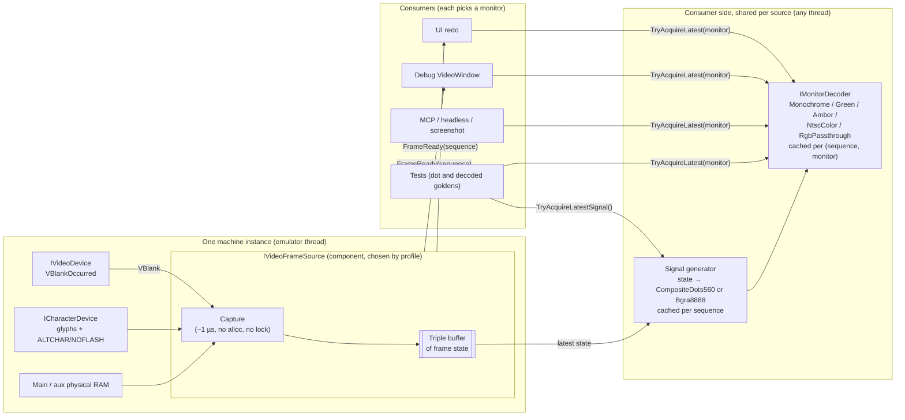

# PRD: Video Pipeline

| Field | Value |
|---|---|
| Status | Draft for engineering review |
| Owner | Josh |
| Tracking issue | #325 (decouple frame production from `VideoWindow` presentation) |
| Builds on | `main` as of 2026-11-11: `VideoDevice.VBlankOccurred`, `DisplayMemorySnapshot`, `Pocket2VideoRenderer`, `CharacterDevice`, and `VideoWindow` with the #316–#323 fixes. |
| Related | PR #377 (first attempt at #325; superseded by this spec, see §16), #319 / #320 (stale attachment), #323 (closed window rendering into a disposed buffer), #258 (emulator hot-path performance), #333 / #337 (agent-friendly debugger, headless host), `KEYBOARD-SYSTEM-PRD.md` (same layering rules), `specs/video/Apple II Video Display Specification.md` (mode reference) |
| Supersedes | The frame-production parts of `VideoWindow`, the unused `IVideoSession` (`src/BadMango.Emulator.Rendering/IVideoSession.cs`), and `DisplayColorMode`. |

---

## 1. Summary

Define one video pipeline that serves every machine the core will host and every consumer of frames. Machines: the Apple IIe-family Pocket2 today; the IIc, the IIgs (65816), and the speculative 65832 machine later. Consumers: the debug `VideoWindow`, the planned UI redo, headless capture for tests, and the MCP/agent host.

The pipeline mirrors the real hardware. A real Apple IIe has one video output, a composite jack. The machine doesn't know or care whether a green-screen, an amber, a white, or an NTSC color monitor is plugged in; the monitor decides what the signal looks like. So the emulator splits the same way:

1. **Capture (emulator thread).** At VBlank the machine's frame source copies the *frame state* into a lock-free triple buffer. The state is the display-memory snapshot, the video and character soft switches, the effective glyph table, the flash phase, and the cycle. This costs about 1 µs, allocates nothing, and never takes a lock.
2. **Signal generation (consumer thread, lazy).** The first consumer that asks for a sequence turns the captured state into the machine's *output signal*. For Apple II composite machines that is a dot stream of 560 dots per scanline for 192 lines, plus a per-scanline color-burst flag (`CompositeDots560`). For machines with RGB outputs (the IIgs, RGB cards) it is pre-colored `Bgra8888`. The signal is monitor-independent and generated once per sequence.
3. **Monitor (consumer thread, lazy).** An `IMonitorDecoder` (Monochrome, Green, Amber, NtscColor, RgbPassthrough) decodes the signal into BGRA pixels. Decoded frames are cached and shared per (sequence, monitor). With no consumers, nothing is generated or decoded.
4. **Present (consumer).** A consumer gets a leased, read-only `VideoFrame`, copies or uploads it once, and disposes the lease.

Each machine owns exactly one `IVideoFrameSource` component. The machine builder creates it and the machine disposes it. The monitor belongs to the consumer: each `VideoWindow` picks its own, and headless capture, screenshots, and the debugger use the same decoders. There is no static registry and no global state, so any number of machines can run in one process.

## 2. Problem

Today `VideoWindow` owns the whole pipeline: the VBlank subscription, the snapshot, the renderer call, the flash counter, character-ROM tracking, and the pixel buffer. PR #377 moved that into a headless producer, but its design repeats or adds problems. Measured on the box (Release, `Pocket2VideoRenderer`, see §13):

- **Rendering on the emulator thread, always.** #377 renders every frame inside the VBlank scheduler callback: 452 µs per HiRes frame, about 2.7% of the emulator thread at 1×, more when unthrottled. It keeps rendering with no consumer attached, because nothing ever detaches the producer.
- **A static service locator.** `MachineVideoFrameSourceRegistry` (a static `ConditionalWeakTable`) hard-codes the Pocket2 producer and renderer, so other machines can't plug in their own. It attaches once and never re-attaches or disposes.
- **A lock instead of a pipeline.** Render, buffer swap, and the consumer's copy all share one lock, so the emulator and UI threads block each other. The data is copied three times per frame on the way to the bitmap.
- **The monitor is baked into the machine.** The renderer takes a `DisplayColorMode` and paints final colors directly. #377 made it worse by putting a `ColorMode` setter on the shared producer, so the last window to set it decides what every consumer sees. A monochrome "mode" fakes lo-res and hi-res as solid tinted shades instead of the dot patterns a real green-screen shows. Color mode always draws text white, even in mixed mode, where a real color monitor shows green and violet fringes. There is also no `ntsc` mode at all: every Pocket2 profile sets `colorMode: "ntsc"`, and nothing reads it.
- **Off-thread reads.** `ForceRender()` reads live RAM and soft switches from the UI or REPL thread while the CPU runs.
- **Silent failures.** An empty `catch` swallows production errors, which repeats the "FPS 0 with an empty log" problem from #316–#318. One throwing `FrameReady` subscriber stops the others.
- **Per-byte delegates.** `IVideoRenderer.RenderFrame` reads memory through `Func<ushort, byte>`. That costs a delegate call per display byte and two delegate allocations (128 B) per frame.
- **Glyph RAM is ignored.** The renderer only reads `GetCharacterRomData()`. Custom glyph banks (`ALTGLYPH1`/`ALTGLYPH2`, glyph RAM at `$C042`–`$C04D`) never reach the screen.
- **The headless assembly isn't headless.** `BadMango.Emulator.Rendering` references Avalonia because of `PixelBuffer`.

## 3. Goals

| # | Goal | Acceptance |
|---|---|---|
| G1 | Consumers can't break emulation. | Opening, closing, replacing, or crashing a consumer never changes machine state, never throws into the scheduler, and never stops capture. A test closes a window mid-frame and the machine keeps producing frames. |
| G2 | The emulator thread does almost nothing for video. | VBlank capture is ≤ 2 µs typical with zero allocations and no locks (§13). The emulator thread never waits on a consumer. |
| G3 | No consumers means no work. | With no consumer acquiring frames, the signal-generation and decode counts stay 0 while the machine runs. |
| G4 | The machine emits a signal; the monitor makes the picture. | Frame sources emit `CompositeDots560` or `Bgra8888`, never a monitor-specific image. Green, amber, white, and NTSC color are monitor decoders chosen by the consumer. |
| G5 | Many consumers, one decode. | Two consumers asking for the same sequence and monitor trigger one decode; the signal is generated once per sequence regardless of how many monitors are in use. |
| G6 | Tear-free frames. | Dots, burst flags, mode, PAGE2, ALTCHAR, flash, and glyphs in one frame all come from the same VBlank. |
| G7 | Machine-agnostic contract. | `IVideoFrameSource`, `VideoFrame`, and `VideoFrameInfo` contain nothing Apple II-specific beyond the format tag. Frame size is per frame, so IIgs Super Hi-Res fits without contract changes. |
| G8 | Pluggable producers and monitors. | The profile selects the frame source. Pocket2 ships now; IIgs and 65832 producers are added without touching consumers. A new monitor is one decoder class plus one enum member. |
| G9 | Multi-machine safe. | Two machines in one process produce independent frames. No static mutable state exists anywhere in the video path. |
| G10 | Headless. | Frame sources, signal generators, and monitor decoders live in Avalonia-free assemblies. A test or the MCP host can boot a profile, run it, decode through any monitor, and assert on pixels without Avalonia. |
| G11 | Observable failures. | Every capture, generation, decode, or subscriber failure is logged (rate-limited) and counted. No empty `catch` blocks. |
| G12 | Zero per-frame allocations. | Capture, `FrameReady` dispatch, signal generation, decode, and acquire/release allocate nothing in steady state, enforced by tests (§14). |

## 4. Non-goals (for v1)

- Implementing the IIgs, IIc, or 65832 producers. This spec fixes their shape (§8) so the Pocket2 work doesn't block them.
- Mid-frame (per-scanline) raster effects. v1 captures once per VBlank (Q1). The signal format already carries per-line burst flags so per-line capture can fill them later.
- Analog monitor effects: color-killer lag, phosphor persistence, bloom, scanline gaps, a filtered YIQ decoder (Q8).
- GPU or shader presentation. The UI redo may upload `VideoFrame` pixels to a texture; that is a consumer detail (Q5).
- Recording every frame (video capture). v1 always hands out the latest frame (Q4).
- Redesigning the debug `VideoWindow`. It is migrated to be a thin consumer with a monitor selector (§11.1) and then left alone until the UI redo.

## 5. Users and scenarios

| Persona | Scenario |
|---|---|
| Player | Runs a game in the video window at a steady 60 fps, switching between a green-screen and an NTSC color monitor from the window menu. Closing and reopening the window, or opening a second one on a different monitor, has no effect on the game. |
| Developer at the REPL | Pauses the machine, pokes `$0400`, types `video refresh`, and the window shows the change immediately. |
| Agent (MCP, #337) | Runs a headless machine until idle, acquires the latest frame through the `Green` monitor, and saves a PNG. No Avalonia is loaded. Repeating the run gives the same pixels. |
| Emulator developer | Writes a test that boots `pocket2e-a2`, runs a program, and compares the dot stream and the decoded `NtscColor` frame with checked-in goldens. |
| Future IIgs work | Adds an `AppleIIgsVideoFrameSource` that emits 640×400 `Bgra8888`. Windows default to `RgbPassthrough`. The window, the UI redo, and the MCP host are unchanged. |

## 6. Architecture



The layers have these responsibilities:

| Layer | Owns | Must not |
|---|---|---|
| Frame source: capture | Subscribing to VBlank. Copying display memory, soft-switch state, the glyph table, the flash phase, and the cycle into a free state slot, then publishing it. Raising `FrameReady`. | Generate signals, decode, allocate, take a lock, or call consumer code other than `FrameReady` handlers. |
| Signal generator (per machine) | Turning captured state into the machine's output signal, exactly as the video hardware would emit it: dots, burst flags, inverse and flash, or RGB pixels. | Know about monitors, phosphors, or color decoding. Touch live machine state. |
| Monitor decoder (shared, stateless) | Turning a signal into BGRA the way a given kind of monitor would display it. | Know about machines, modes, text, or soft switches. It only sees the signal. |
| Consumer | Choosing a monitor, presenting pixels, and disposing leases promptly. Marshaling to its own thread. | Hold a lease across frames, cache machine internals (char ROM, RAM, devices), or block inside `FrameReady`. |

## 7. Contracts

The contracts live in `BadMango.Emulator.Devices`, with interfaces in `BadMango.Emulator.Devices.Interfaces`, next to `IVideoDevice` (the same convention the keyboard spec uses). Nothing here references Avalonia. The shared base class, the Pocket2 implementation, and the monitor decoders live in `BadMango.Emulator.Rendering`, which drops its Avalonia reference (§12).

### 7.1 `IVideoFrameSource`

```csharp
public interface IVideoFrameSource : IDisposable
{
    /// Raised on the emulator thread right after a frame's state is published.
    /// The argument is the new frame's sequence number.
    /// Handlers must not block and must not call back into the machine;
    /// marshal to your own thread (for example Dispatcher.UIThread.Post).
    event Action<long>? FrameReady;

    /// The signal format this source emits. Constant for the source's lifetime.
    VideoFrameFormat SignalFormat { get; }

    /// The monitor new consumers should start with, from the profile's
    /// defaultMonitor (§11.4). The source itself never uses it.
    MonitorType DefaultMonitor { get; }

    /// Sequence number of the most recently published frame, or 0 if none yet.
    long LatestSequence { get; }

    /// Leases the latest frame's raw output signal (SignalFormat).
    /// Generates it on the calling thread if no consumer has yet.
    bool TryAcquireLatestSignal(out VideoFrame frame);

    /// Leases the latest frame as seen on the given monitor (always Bgra8888).
    /// Generates the signal and decodes it on the calling thread if no consumer
    /// has done so for this (sequence, monitor) pair yet. Returns false if no
    /// frame has been captured yet, the source is disposed, the monitor doesn't
    /// support SignalFormat, or the lease pool is exhausted.
    bool TryAcquireLatest(MonitorType monitor, out VideoFrame frame);

    /// Asks for a fresh capture. If the machine is running, this is a no-op:
    /// the next VBlank (at most one frame away) publishes a frame. Otherwise
    /// the capture runs through IMachineDispatcher.Post, which is inline when
    /// the machine is quiescent, and FrameReady is raised.
    void RequestFrame();

    /// Point-in-time counters for diagnostics (§10).
    VideoFrameSourceStats GetStats();
}
```

Decisions:

- **Pull, with a push hint.** `FrameReady` only says that a new sequence exists. Consumers pull when they are ready to present. A slow consumer naturally skips frames, and the emulator never waits.
- **`Action<long>`, not `EventHandler`.** It carries no sender and needs no args allocation. The sequence number lets a consumer skip work if it has already presented that frame.
- **The source never chooses a monitor.** It hosts the shared decode cache so that two windows on the same monitor share one decode, but the monitor is always a parameter supplied by the consumer. There is no `ColorMode` or any other display setter on the source.
- **No `ForceRender`.** `RequestFrame()` never reads machine state off the emulator thread.
- **`IDisposable`.** The machine disposes the source (§7.7). After disposal, acquires return false, `RequestFrame` does nothing, and handlers are released.

### 7.2 `VideoFrame` (the lease)

```csharp
public readonly struct VideoFrame : IDisposable
{
    public VideoFrameInfo Info { get; }

    /// Bgra8888 only: Width × Height pixels, rows Stride pixels apart.
    public ReadOnlyMemory<uint> Pixels { get; }

    /// CompositeDots560 only: Height rows of Stride 64-bit words, dots packed LSB-first (§7.4).
    public ReadOnlyMemory<ulong> Dots { get; }

    /// CompositeDots560 only: one ScanlineFlags byte per row.
    public ReadOnlyMemory<byte> LineFlags { get; }

    /// Returns the buffers to the pool. Safe to call more than once.
    public void Dispose();
}
```

- It is a `readonly struct`, so acquiring a frame allocates nothing. It holds a reference to a pooled slot plus a generation token. `Dispose` decrements the slot's lease count only if the token still matches, so a double dispose or a stale copy can't release someone else's lease.
- **`ReadOnlyMemory<T>`, not `Span<T>`.** The lease may be held across an `await` or handed to a dispatcher callback, which a `ref struct` can't do. Consumers take `.Span` once inside the method that does the copy, upload, or decode, never per pixel.
- Members that don't apply to `Info.Format` are empty.
- A buffer is never reused while any lease on it is outstanding. Consumers must dispose a lease within one present (`using var frame = ...`).

### 7.3 `VideoFrameInfo`, `VideoFrameFormat`, `ScanlineFlags`, `MonitorType`

```csharp
public readonly record struct VideoFrameInfo(
    long Sequence,          // monotonic per source, starts at 1
    ulong Cycle,            // scheduler cycle at capture (VBlank start or RequestFrame)
    VideoFrameFormat Format,
    int Width,              // dots (CompositeDots560) or pixels (Bgra8888)
    int Height,             // scanlines (CompositeDots560) or pixel rows (Bgra8888)
    int Stride);            // 64-bit words per row (CompositeDots560) or pixels per row (Bgra8888)

public enum VideoFrameFormat
{
    CompositeDots560,       // Apple II composite output: 560 dots × 192 lines + per-line burst flag
    Bgra8888,               // pre-colored RGB output; premultiplied, alpha always 0xFF
}

[Flags]
public enum ScanlineFlags : byte
{
    None = 0,
    ColorBurst = 1,         // the line carried color burst
}

public enum MonitorType
{
    Monochrome,             // white phosphor
    Green,
    Amber,
    NtscColor,
    RgbPassthrough,
}
```

- **Metadata is generic.** Machine-specific state (VideoMode, PAGE2, ALTCHAR, NOFLASH) stays private to the producer's frame state. Nothing in #377 consumed it, and a generic consumer must not depend on it.
- **The size is per frame.** Pocket2 signals are always 560×192 dots; decoded Pocket2 frames are 560×384. IIgs frames are 640×400 `Bgra8888` (§8.2). A consumer reallocates its target when `Width`/`Height` change.
- **`MonitorType` is the decode-cache key.** Adding a monitor means one new enum member and one decoder (§9). Display-device properties go into the monitor, never into the source; hardware state goes into the signal (Q2 decision rule, §17).
- `DisplayColorMode` is deleted once nothing uses it (§15 step 7).

### 7.4 The `CompositeDots560` format

One frame is 192 scanlines. Each scanline is 560 dots, one per 14.318 MHz dot clock period of the active line. A dot is either on (signal high) or off. That is enough to represent every Apple II display mode exactly, because every mode is a sequence of on/off dots at that clock (§8.1.3).

**Storage: packed bits, not bytes.**

- Each row is `Stride = 9` 64-bit words (576 bits). Dot *x* is bit `x & 63` of word `x >> 6`, LSB-first, which matches the order in which the Apple II shifts video bytes out (bit 0 first). Bits 560–575 are always zero.
- A frame is 192 × 9 × 8 = **13,824 bytes** of dots plus 192 bytes of `LineFlags`. One byte per dot would be 107,520 bytes, 7.8× more.
- Why bits:
  - The dot stream is cached and read by every monitor decode, so it should stay small. 13.8 KB fits in L1/L2; 105 KB does not.
  - Generation is naturally bit-oriented. A hi-res byte becomes 14 dots, a 40-column glyph row becomes 14 dots, and an 80-column or DHR byte becomes 7 dots. Each is a small lookup table plus a shift into a 64-bit accumulator, with no per-dot branches.
  - Decoding is bit-oriented too. The NTSC decoder's 4-dot sliding window is a shift and a mask on the same accumulator. The monochrome decoders expand 8 dots at a time to 8 BGRA pixels through a 256-entry table (8 KB, L1-resident).
  - Byte-per-dot would only save a shift per dot, while costing 8× the memory traffic on every decode.

**`LineFlags`:** bit 0 (`ColorBurst`) is set when the line carried color burst (§8.1.4). Other bits are reserved and must be zero.

### 7.5 Threading

1. **Capture runs on the emulator thread** inside `VideoDevice.OnVBlankStart`, after VBlank end has been scheduled (the existing #316 ordering). It writes into the producer-owned *back* state slot, then publishes it with one `Interlocked.Exchange` of the slot index into the *ready* position. This is a classic single-producer triple buffer: the emulator thread never waits, and an unconsumed ready slot is simply overwritten by the next VBlank (latest wins).
2. **The consumer side is the single consumer of the triple buffer.** Taking the ready slot, generating the signal, looking up or decoding into the cache, and leasing are serialized by one `System.Threading.Lock` per source. The emulator thread never takes this lock. Generation and decode for a new key happen under that lock on the first requester's thread. A second consumer asking for the same key waits for it (bounded by one generation plus one decode) rather than duplicating the work.
3. **`FrameReady` is raised on the emulator thread** after publication. Subscribers are stored in an immutable array that is replaced on subscribe or unsubscribe (custom event accessors), so dispatch allocates nothing (no `GetInvocationList()`). Each handler runs in its own `try`/`catch` (§10).
4. **`RequestFrame()`** checks `IMachine.State`. When `Running`, it does nothing. Otherwise it calls `IMachineDispatcher.Post(CaptureAndPublish)`, which runs inline when the machine is quiescent, so capture always happens on the machine thread.
5. **Locks** use `System.Threading.Lock` (`private readonly Lock gate = new();`), never `object` (repository style rule). There is exactly one lock per source, on the consumer side.

### 7.6 Frame state, capture, and generation

The base class `VideoFrameSource<TState>` (in `BadMango.Emulator.Rendering`) implements the triple buffer, the signal cache, the decode cache, the lease pools, the subscriber list, `RequestFrame`, diagnostics, and disposal. A producer supplies only:

```csharp
public abstract class VideoFrameSource<TState> : IVideoFrameSource
    where TState : class
{
    protected abstract VideoFrameFormat Format { get; }
    protected abstract TState CreateState();                           // called 3 times at construction
    protected abstract void Capture(TState state);                     // emulator thread; no alloc, no lock
    protected abstract VideoFrameGeometry GetSignalGeometry(TState state); // width, height, stride
    protected abstract void Generate(TState state, in SignalTarget target); // consumer thread; writes dots+flags or pixels
}
```

- The three state objects and all their arrays are allocated once at construction. `Capture` copies into them; it never allocates.
- The base stamps `Sequence` and `Cycle` (from the scheduler) after `Capture` returns, then publishes.
- The signal for a sequence is generated at most once and cached. Decoded frames are cached per (sequence, `MonitorType`).
- **No consumers, no work.** Capture still runs on every VBlank (about 1 µs) so acquires and `RequestFrame` always have current state, but signals are generated and decoded only when a consumer asks.

### 7.7 Ownership, lifecycle, and multi-machine

- **The machine builder registers the source.** `MachineBuilder` gains `AddComponentFactory<T>(Func<IMachine, T> factory)`, which runs after device initialization and adds the result as a component. `MachineFactory` and the headless host call `builder.WithVideoFrameSource(profile)` (an extension in `BadMango.Emulator.Rendering`). It reads the profile's video device config keys `frameSource` (default `"pocket2"` for `video` devices) and `defaultMonitor` (§11.4), and registers the matching factory. Consumers get the source with `machine.GetComponent<IVideoFrameSource>()`, or have it injected. Views never resolve it through a static.
- **The machine disposes it.** `IMachine` gains `IDisposable`. `Machine.Dispose()` stops the run loop, then disposes every `IDisposable` component in reverse registration order. Disposing the source unsubscribes from `VBlankOccurred`, releases `FrameReady` handlers, and returns pooled buffers once outstanding leases are disposed.
- **Profile reload means a new machine and a new source.** Consumers reattach to the new machine's source. The old source is disposed with the old machine, which removes the #319/#320 stale-attachment failure mode by construction.
- **No static mutable state.** `MachineVideoFrameSourceRegistry` is not adopted. Static, immutable lookup tables (dot-expansion tables, palettes, the decoder table, the factory name map) are fine. Decoders are stateless and shared. `DefaultCharacterRom.GetRomData()` must return a defensive copy (or `ReadOnlyMemory<byte>`) so two machines never share a mutable array.
- A test runs two machines in one process and asserts that their frames, sequences, and counters are independent (§14).

## 8. Per-machine producers

### 8.1 Pocket2 (IIe family): `Pocket2VideoFrameSource`

Replaces #377's `MachineVideoFrameProducer`. It is selected by `frameSource: "pocket2"` and emits `CompositeDots560`.

**Frame state (`Pocket2FrameState`):**

| Field | Size | Source at capture |
|---|---|---|
| `Main` | `$0400`–`$5FFF` (23,552 B) | Physical main RAM (`IMainMemoryProvider.MainRam`). Falls back to side-effect-free DMA bus reads only when physical RAM isn't exposed. This keeps the existing `DisplayMemorySnapshot` rule: never read through the MMU. |
| `Aux` | `$0400`–`$5FFF` (23,552 B) | `IExtended80ColumnDevice.AuxiliaryRam`, when present. `HasAux` is false otherwise. |
| `Glyphs` | 4,096 B | `ICharacterDevice.CopyEffectiveGlyphs` (§8.1.1), copied only when `GlyphVersion` changed. |
| `Mode` (including mixed variants), `IsPage2` | — | `IVideoDevice` |
| `TextSwitch` | — | `IVideoDevice` (TEXT soft switch; drives color burst, §8.1.4) |
| `AltCharSet`, `NoFlash1`, `NoFlash2` | — | `ICharacterDevice` |
| `FlashOn` | — | Producer counter, toggled every 16 VBlanks (~1.9 Hz), advanced only by VBlank captures, not `RequestFrame`. |

Total: about 51 KB per slot, 153 KB per machine. The snapshot copies (main plus aux) measured 1.0 µs.

#### 8.1.1 Character set and custom glyph banks

- **The character device is the only owner of glyphs.** The producer never loads, caches, or falls back to a character ROM itself.
- The built-in charset `pocket2-charset.rom` (`DefaultCharacterRom`) is Josh's own C#-generated, hand-edited Pocket2 character set, including MouseText. It is not an Apple ROM image; it is the project's legitimate default. When a profile names no character ROM, `CharacterDevice` loads it at build time.
- `ICharacterDevice` gains:

  ```csharp
  /// Incremented whenever the effective glyph table changes: LoadCharacterRom,
  /// any glyph RAM write (bus or WriteGlyphRam), or an ALTGLYPH1/ALTGLYPH2 toggle.
  long GlyphVersion { get; }

  /// Copies the 4 KB effective glyph table: bank 1 ($000-$7FF) from glyph RAM when
  /// ALTGLYPH1 is on, otherwise from the character ROM; bank 2 ($800-$FFF) likewise
  /// for ALTGLYPH2. An unloaded ROM bank is copied as zeros.
  void CopyEffectiveGlyphs(Span<byte> destination);
  ```

- During capture the producer compares `GlyphVersion` with the version stored in the slot it is filling, and copies the 4 KB table only when it differs. Custom glyph banks therefore flow to the screen automatically. Today they don't (§2).
- The video path no longer uses `CharacterRomChanged` or `ICharacterDevice.OnVBlank`. They stay for other consumers (`CharacterPreviewWindow`, the glyph editor) until those move to `GlyphVersion`.

#### 8.1.2 Signal generator

`Pocket2VideoRenderer` becomes `Pocket2SignalGenerator`:

```csharp
internal sealed class Pocket2SignalGenerator
{
    public const int DotsPerLine = 560;
    public const int Lines = 192;
    public const int StrideWords = 9;

    public void Generate(Pocket2FrameState state, Span<ulong> dots, Span<byte> lineFlags);
}
```

- It reads `ReadOnlySpan<byte>` views over `state.Main`, `state.Aux`, and `state.Glyphs`, indexed as `address - 0x0400`. There are no `Func<ushort, byte>` delegates and no per-byte indirection.
- It knows nothing about colors. Inverse, flash, NOFLASH, and ALTCHAR are applied here, because the real character generator applies them before the signal leaves the machine.
- The 11-parameter `IVideoRenderer.RenderFrame` and the `IVideoRenderer` interface are deleted. Generators are private to their producer; the cross-machine contracts are `IVideoFrameSource` and the signal formats.
- Generation allocates nothing.

#### 8.1.3 Dots per mode

All modes map onto the 560-dot line:

| Mode | Dots |
|---|---|
| 40-column text | Each glyph row is 7 dots, each doubled, so 14 dots per character. |
| 80-column text | 7 dots from aux, then 7 dots from main, per column pair. |
| Lo-res | Each block is 14 dots. The block's 4-bit color is repeated as a dot pattern phase-locked to the absolute dot position (*x* mod 4), so a color monitor recovers the 16 lo-res colors exactly and a monochrome monitor shows the pattern, as on real hardware. |
| Double lo-res | 7 dots each from aux and main, with the aux nibble rotated by one bit, per the IIe hardware. |
| Hi-res | Bits 0–6 of each byte become 7 pixels of 2 dots each (14 dots). When bit 7 is set the byte's dots are delayed by one dot, and the vacated first dot repeats the previous byte's last dot [Sather ch. 8]. |
| Double hi-res | 7 dots each from aux and main, bits 0–6, LSB first. Bit 7 is ignored. |
| Mixed | Graphics for lines 0–159, then text for lines 160–191, generated from the same captured state. |

#### 8.1.4 Color burst

On a real IIe, the color burst is a 14-cycle sample of the color reference that the IOU gates on after horizontal sync, during horizontal blanking, once per scanline. The gate (CLRGATE') never opens while the TEXT soft switch is set [Sather ch. 8, p. 8-16].

- **TEXT set (all-text display):** no burst on any line. A color monitor's color killer turns color decoding off, so text appears as clean white (monochrome) dots with no color fringing.
- **TEXT clear (graphics, including mixed mode):** burst on every line, *including* the four text rows at the bottom of a mixed display. A color monitor therefore shows those text rows with green and violet fringes (and white where dots run together). This is real IIe behavior, not a bug [Sather ch. 8].
- The generator sets `ScanlineFlags.ColorBurst` per line from the TEXT state captured for that line. With v1's once-per-VBlank capture, all 192 lines share one value; per-line capture (Q1) fills them individually without format changes.

### 8.2 Apple IIgs (placeholder): `AppleIIgsVideoFrameSource`

- Emits `Bgra8888`, modeling the IIgs RGB output, which a monitor passes through (`RgbPassthrough` is the default monitor).
- Captures the IIe-compatible state above plus Super Hi-Res: `$E1/2000`–`$E1/9FFF` (pixels, SCBs, palettes), `NEWVIDEO` (`$C029`), `MONOCOLOR` (`$C021`), and the border and text colors (`$C034`, `$C022`). These are hardware state and are applied in generation.
- Frames are 640×400 for every mode. 320-mode pixels are doubled horizontally, and all modes are line-doubled. Legacy modes are colored by the VGC in generation. Border inclusion is Q3. The IIgs composite output is Q2.
- Per-scanline SCB effects are deferred to the per-scanline capture follow-up (Q1).

### 8.3 65832 machine (placeholder)

The 65832's video hardware isn't defined yet. It plugs in through `VideoFrameSource<TState>` with its own state type, geometry, and one of the two signal formats. Nothing in the contract assumes a 6502-family memory map.

## 9. Monitor stage

### 9.1 `IMonitorDecoder`

Decoders live in `BadMango.Emulator.Rendering` (no Avalonia). They are stateless, immutable, and shared by every source and machine in the process.

```csharp
public interface IMonitorDecoder
{
    MonitorType Type { get; }

    bool Supports(VideoFrameFormat format);

    /// Output size for a given input; always Bgra8888.
    VideoFrameGeometry GetOutputGeometry(in VideoFrameInfo input);

    /// Decodes one signal frame. Allocates nothing.
    void Decode(in VideoFrame signal, Span<uint> output);
}

public static class MonitorDecoders
{
    public static IMonitorDecoder Get(MonitorType type);   // immutable lookup table
}
```

### 9.2 The decoders

| Monitor | `CompositeDots560` input | `Bgra8888` input |
|---|---|---|
| `Monochrome` (white), `Green`, `Amber` (one class, three phosphor colors) | Each dot on → phosphor color, off → black. Burst flags are ignored, as on a real monochrome monitor. Lo-res and hi-res show as their dot patterns ("greenscale"), not as flat shades. | BT.601 luma, tinted by the phosphor. This approximates a monochrome monitor on a composite output of an RGB-capable machine. |
| `NtscColor` | Lines with `ColorBurst`: artifact color decoded from the dot pattern (below). Lines without burst: decoded as white monochrome, because the monitor's color killer disables chroma. So all-text screens are clean white, and mixed-mode text is fringed. | Passed through unchanged (approximation: RGB-sourced frames get no composite artifacting in v1). |
| `RgbPassthrough` | Not supported. A IIe has no RGB output without a card; the acquire returns false and `MonitorMismatch` is counted. | Copied unchanged. |

**NtscColor v1 algorithm:**

- For each dot *x*, take the 4-dot window ending at *x*, rotate it by *x* mod 4 to normalize the color phase, and look up one of the 16 Apple II colors (the lo-res/DHR palette).
- This reproduces lo-res, double lo-res, and DHR colors exactly; hi-res yields its 6 colors, with white where adjacent dots are on.
- Edges get the natural one- to three-dot color fringes of a composite display.
- The phosphor tint and palette values live in the decoder (moved from `DisplayColors`).
- A filtered YIQ decoder and color-killer lag are later fidelity work (Q8).

**Output geometry:** composite input decodes to 560×384, with each scanline doubled, which is the same frame size the window shows today. `Bgra8888` input decodes at its own size.

### 9.3 Behavior changes from `main`

These are intentional, follow from modeling the monitor, and update the goldens (§14):

1. Monochrome, green, and amber show lo-res and hi-res as dot patterns, where today they show solid tinted shades.
2. NtscColor shows mixed-mode text with color fringes, where today it is always white. All-text screens stay white.
3. NtscColor colors come from the dot-window decode, so edge pixels can differ from today's per-mode color tables. Solid lo-res and DHR areas match.

Text modes on `Monochrome`, `Green`, and `Amber` must match `main`'s `White`, `Green`, and `Amber` output bit for bit.

## 10. Diagnostics and error handling

- **Inject a logger.** Every frame source takes a Serilog `ILogger` from the machine builder (`MachineBuilder.WithLogger`). There is no `Logger.None` default inside the core.
- **No empty `catch` blocks.** Each failure path logs and counts:
  - **Capture failure** (emulator thread): caught so it can't unwind `OnVBlankStart`. It is logged and counted (`CaptureErrors`), the previous ready slot stays published, and `FrameReady` is not raised for the failed capture.
  - **Generation or decode failure** (consumer thread): logged and counted (`GenerateErrors`, `DecodeErrors`). The acquire returns false for that call, and the cache entry is not poisoned (the next request retries).
  - **Subscriber failure:** each `FrameReady` handler runs in its own `try`/`catch`. A throwing handler is logged and counted (`SubscriberErrors`) and does not stop later handlers.
  - Critical exceptions (`OutOfMemoryException`, `AccessViolationException`, `InvalidProgramException`, `BadImageFormatException`) are never caught.
- **Rate limiting.** The first occurrence of each error kind is logged with its stack trace. Repeats are summarized at most once every 5 seconds with a count.
- **Counters.** `VideoFrameSourceStats` is a `readonly record struct` with `FramesCaptured`, `SignalsGenerated`, `FramesDecoded`, `CacheHits`, `CaptureErrors`, `GenerateErrors`, `DecodeErrors`, `SubscriberErrors`, `MonitorMismatch`, `LeasesOutstanding`, `PoolExhausted`, and `LatestSequence`. Counters use `Interlocked`. The status monitor and a new REPL `video stats` show them. FPS in the window is computed from presented sequences, not VBlank callbacks.
- **Lease pools.** The signal pool and the decoded pool each start at 3 buffers per source and grow to at most 8. If all 8 are leased, the acquire returns false and `PoolExhausted` is incremented and logged (it indicates a consumer leaking leases).

## 11. Integration

### 11.1 Debug `VideoWindow`

- `DebugWindowManager` passes the machine's `IVideoFrameSource` to the window. The window no longer receives `IMachine` for video, and keeps no references to the video device, character device, RAM, or char ROM.
- **Monitor per window.** The window has a `Monitor` property and a menu listing every `MonitorType` whose decoder `Supports(source.SignalFormat)`. A new window starts on `source.DefaultMonitor`. Changing the monitor re-presents the latest frame through the new decoder, with no machine interaction. Two windows on one machine may use different monitors.
- **Present path:** in `FrameReady`, the handler coalesces with the existing `vblankPending` flag (renamed `presentPending`) and posts to the UI thread at the existing `VBlankUiPriority` (Normal; the #316 decision). On the UI thread it calls `TryAcquireLatest(Monitor)`, copies `frame.Pixels.Span` straight into the `WriteableBitmap` framebuffer (one copy), and disposes the lease.
- **`ForceRedraw()`** calls `RequestFrame()`, then presents the latest frame.
- **Close** unsubscribes `FrameReady` and nothing else. The machine and its source don't notice.
- `PixelBuffer` moves to `BadMango.Emulator.Debug.UI` (its only user) and gains a `CopyFrom(VideoFrame)` that writes into the locked framebuffer, replacing the separate `GetPixels()` plus `Commit()` copy.

### 11.2 Debugger REPL

- `video refresh` calls `RequestFrame()` on the current machine's source.
- New: `video stats` prints `VideoFrameSourceStats`.
- New: `video screenshot <path.png> [monochrome|green|amber|ntsc-color|rgb]` acquires the latest frame through the given monitor (default: the source's `DefaultMonitor`) and writes a PNG. This needs a PNG encoder in a non-Avalonia assembly; `System.IO.Compression` plus a minimal encoder is enough, so no new dependency is required.
- New: `video signal <path>` dumps the raw signal frame (dots plus line flags, or pixels) for debugging and golden updates.

### 11.3 MCP / agent host (#333, #337)

The headless host uses the same `TryAcquireLatest(monitor)`, the same decoders, and the same PNG writer as `video screenshot`. No Avalonia is loaded.

### 11.4 Profile: `defaultMonitor`

- The video device config key `colorMode` is renamed `defaultMonitor`. Nothing in the code reads `colorMode` today, so the rename is not a behavior change.
- `defaultMonitor` is the initial monitor for new windows and the default for headless capture. Values: `monochrome`, `green`, `amber`, `ntsc-color`, `rgb`. A consumer may always pick another.
- When absent, it is `ntsc-color` for `CompositeDots560` sources and `rgb` for `Bgra8888` sources. A value the source's format doesn't support is a profile validation error.
- The four profiles that set `colorMode: "ntsc"` (`pocket2e.json`, `pocket2e-a2.json`, `pocket2e-a2-enh.json`, `pocket2e-devices.json`) change to `defaultMonitor: "ntsc-color"`. The profile JSON schema gains the key.

### 11.5 The planned UI redo

The new UI is just another consumer: it takes `IVideoFrameSource` from the machine, picks a monitor (starting from `DefaultMonitor`), and uploads `VideoFrame.Pixels` to a bitmap or texture. Nothing in the core changes for the redo. The debug `VideoWindow` migration in §11.1 is deliberately minimal and serves as the reference consumer.

## 12. Layering and assemblies

| Assembly | Contains after this spec | References |
|---|---|---|
| `BadMango.Emulator.Devices` | `IVideoFrameSource`, `VideoFrame`, `VideoFrameInfo`, `VideoFrameFormat`, `ScanlineFlags`, `MonitorType`, `VideoFrameSourceStats`; `ICharacterDevice.GlyphVersion`/`CopyEffectiveGlyphs` | Bus (unchanged) |
| `BadMango.Emulator.Rendering` | `VideoFrameSource<TState>`, `Pocket2VideoFrameSource`, `Pocket2FrameState`, `Pocket2SignalGenerator`, `IMonitorDecoder`, `MonitorDecoders`, the decoder classes, `WithVideoFrameSource` builder extension, PNG writer. `DisplayMemorySnapshot` is folded into `Pocket2FrameState`. | Devices, Bus. **No Avalonia.** |
| `BadMango.Emulator.Debug.UI` | `VideoWindow` (with the monitor menu), `PixelBuffer` (moved), `CharacterPreviewWindow` | Rendering, Avalonia |

- Deleted: `IVideoRenderer`, `IVideoSession`, `DisplayColorMode`, and from #377 `MachineVideoFrameSourceRegistry` and `MachineVideoFrameProducer`. `DisplayColors`, `CharacterRenderer`, and `ScaledPixelWriter` are folded into the generator and decoders, or deleted if unused.
- `BadMango.Emulator.Rendering.csproj` drops `<PackageReference Include="Avalonia" />`. A build check (an architecture test that inspects referenced assemblies) fails if Avalonia comes back.
- Naming: a producer is `<Machine>VideoFrameSource` (`Pocket2VideoFrameSource`, `AppleIIgsVideoFrameSource`), its generator `<Machine>SignalGenerator`, and a decoder `<Monitor>MonitorDecoder`. "Machine" alone is never used as a prefix for something machine-specific.

## 13. Performance budgets

Measured 2026-11-11 on the box (Release, `Pocket2VideoRenderer` as on `main`, random RAM, 2,000 iterations):

| Operation | Measured today | Budget | Thread |
|---|---|---|---|
| Snapshot capture, main + aux | 1.0 µs | ≤ 2 µs total capture, including soft-switch reads and publish | Emulator |
| Glyph table copy (4 KB) | — | Only on `GlyphVersion` change | Emulator |
| `FrameReady` dispatch | — | 0 B allocated | Emulator |
| Signal generation, any mode (13.8 KB of dots) | — (new) | ≤ 60 µs (target; measured in step 4) | Consumer, once per sequence |
| Monochrome/Green/Amber decode (560×384) | — (new) | ≤ 120 µs | Consumer, once per (sequence, monitor) |
| NtscColor decode (560×384) | — (new) | ≤ 400 µs | Consumer, once per (sequence, monitor) |
| End to end (generate + decode), Text40 | 182 µs (render) | ≤ 182 µs | Consumer |
| End to end, Text80 | 243 µs | ≤ 243 µs | Consumer |
| End to end, HiRes | 452 µs | ≤ 452 µs | Consumer |
| End to end, Double Hi-Res | 129 µs (render) | ≤ 180 µs (NtscColor does real decode work that today's DHR path skips) | Consumer |
| Allocations per frame | 128 B (two delegates) | 0 B | Consumer |
| Copies from decode to bitmap | 2 full-frame copies (#377) | 1 (lease → framebuffer, ~25 µs) | Consumer |
| Work with no consumers | 1 render per VBlank (#377) | 0 generations, 0 decodes | — |
| Emulator-thread render cost | ~2.7% at 1× (#377) | 0 | Emulator |
| Memory per machine | — | ~153 KB state + 3–8 × 14 KB signals + 3–8 × 860 KB decoded frames per monitor in use | — |

The capture, allocation, and emulator-thread budgets are hard limits enforced by tests (§14). The end-to-end budgets are "no regression from `main`" (except the DHR line, which is deliberately looser). The new-stage targets are checked by an explicit `[Category("Perf")]` test that is run before merge, not gated in CI.

## 14. Testing strategy

All tests run without Avalonia except the `VideoWindow` ones. Each test runs on a fake scheduler or a real profile, as noted.

1. **Reference goldens from `main` (first, before any refactor).** Using `main`'s renderer, capture frames for fixed RAM contents in every mode (Text40, Text80, LoRes, Double LoRes, HiRes, Double HiRes, mixed), with page 1 and 2, ALTCHAR on and off, flash on and off, and each `DisplayColorMode`. These are the comparison baseline for §9.3.
2. **Golden frames at two levels.**
   - *Signal goldens:* the `CompositeDots560` dots and line flags for each mode and state above, checked in as compact binary. They are bit-exact and monitor-independent.
   - *Decoded goldens:* each signal golden decoded through every supported monitor, checked in as PNG.
   - Text modes on `Monochrome`/`Green`/`Amber` must equal the `main` reference bit for bit. Every other decoded golden is new, reviewed visually by Josh before check-in, and the PR lists the §9.3 differences.
3. **Dot-level correctness.** Unit tests per mode: hi-res bit 7 delay and last-dot carry; lo-res phase locking; DHR and double lo-res aux/main interleave (including the aux nibble rotation); 80-column interleave; inverse, flash, NOFLASH, and ALTCHAR in the dots.
4. **Color burst.** All-text → no line has `ColorBurst`; graphics and mixed → every line has it, including the text rows. `NtscColor` decodes a burst-off line as pure white/black and a burst-on line with fringes; mixed-mode text rows show fringe colors.
5. **Monitor decoders.** Each decoder against hand-built signals: solid lo-res colors through `NtscColor` match the 16-color palette exactly; monochrome decoders ignore burst; `RgbPassthrough` rejects `CompositeDots560`; `Bgra8888` inputs pass through or convert to luma as specified.
6. **Capture is tear-free.** Change mode, PAGE2, TEXT, ALTCHAR, RAM, and glyphs after a VBlank but before acquire. The frame reflects the VBlank state.
7. **Concurrency.** One thread raises VBlanks at maximum rate while 4 consumer threads acquire (mixing signal and two monitors), read everything, and dispose, for 10,000 frames. Assert no torn frame, no exception, `LeasesOutstanding == 0` at the end, and the VBlank thread never blocked.
8. **Shared work.** Two consumers on the same monitor and sequence: one generation, one decode, one cache hit. Two monitors on the same sequence: one generation, two decodes.
9. **No consumers.** Run a real `pocket2e-a2` machine for 120 VBlanks with no acquire: `FramesCaptured == 120`, `SignalsGenerated == 0`, `FramesDecoded == 0`.
10. **Device swap and reattach.** Rebuild the machine (profile reload) with a window attached. The window shows the new machine's frames on the same monitor, the old source is disposed, and the old video device has no `VBlankOccurred` subscribers.
11. **Charset changes.** Load a different character ROM; enable `ALTGLYPH1` with modified glyph RAM; write glyph RAM while the overlay is on. Each change appears in the next frame's dots. No change means no glyph copy (assert via a copy counter).
12. **80-column / aux.** Text80 and Double HiRes dots come from aux RAM in physical memory even with RAMRD/80STORE set, matching goldens. A machine without `IExtended80ColumnDevice` generates Text80 as 40-column, as today.
13. **Throwing subscriber.** Three handlers; the second throws. The first and third still run, `SubscriberErrors == 1`, one error is logged, and the next VBlank is scheduled normally.
14. **Capture, generation, and decode failures.** A fault-injected failure logs, counts, and leaves the previous frame available. No empty catches (a Roslyn check or code review).
15. **Two machines.** Two `pocket2e-a2` machines in one process with different RAM produce different frames and independent sequence numbers and counters, while sharing decoder instances. Disposing one leaves the other running.
16. **Lifecycle.** `Machine.Dispose()` disposes the source. After disposal, acquires return false, `RequestFrame` does nothing, and a lease taken before disposal is still readable until disposed.
17. **`RequestFrame`.** While paused, it captures inline and raises `FrameReady` once. While running, it doesn't capture off-thread.
18. **Zero allocations.** Using `GC.GetAllocatedBytesForCurrentThread()` around 1,000 iterations after warm-up: capture plus publish plus dispatch = 0 B; signal acquire plus generation = 0 B; decoded acquire plus decode plus dispose = 0 B, for every monitor.
19. **Window.** Closing the `VideoWindow` removes exactly its `FrameReady` handler; the source keeps capturing. (This replaces #377's renamed-but-inverted `CloseWindow_DetachesVBlankHandler…` assertion.) The monitor menu lists only supported monitors; a new window starts on `DefaultMonitor`; two windows on different monitors present different pixels from one sequence.
20. **Profile.** `defaultMonitor` parses all five values, defaults by format, rejects unsupported values, and the four updated profiles load with `ntsc-color`.
21. **Layering.** An architecture test asserts that `BadMango.Emulator.Rendering` and `BadMango.Emulator.Devices` don't reference any `Avalonia*` assembly.

## 15. Migration plan

Each step builds and tests green on its own (`dotnet build BackPocketEmulator.slnx -c Release -warnaserror` and `dotnet test`).

1. **Reference goldens.** Add the `main` reference frames (§14.1). No production change.
2. **Contracts and lifecycle.** Add the §7 contract types to `Devices`. Make `IMachine : IDisposable` and implement component disposal in `Machine`. Add `MachineBuilder.AddComponentFactory<T>`. Add the `DefaultCharacterRom` defensive copy.
3. **Glyph API.** Add `GlyphVersion` and `CopyEffectiveGlyphs` to `ICharacterDevice` and `CharacterDevice`, with tests for every version bump trigger.
4. **Signal generator.** Add `Pocket2SignalGenerator` (state → `CompositeDots560`) with the dot-level and burst tests and the signal goldens (§14.2–§14.4). `Pocket2VideoRenderer` stays in use until step 7.
5. **Monitor decoders.** Add `IMonitorDecoder`, `MonitorDecoders`, and the Monochrome/Green/Amber, NtscColor, and RgbPassthrough decoders, moving the phosphor and palette values out of `DisplayColors`. Add the decoded goldens and the text-mode parity check against `main` (§14.2, §14.5).
6. **Frame source.** Add `VideoFrameSource<TState>` (triple buffer, signal and decode caches under one `System.Threading.Lock`, lease pools, immutable subscriber array, `RequestFrame`, stats, logging) and `Pocket2VideoFrameSource`. Add `WithVideoFrameSource(profile)`, the `frameSource` and `defaultMonitor` profile keys with their schema entries, and rename `colorMode` in the four profiles. Register it in `MachineFactory` and the headless host. Tests §14.6–§14.18 and §14.20.
7. **Layering and window.**
   - Move `PixelBuffer` to `Debug.UI` (with `CopyFrom(VideoFrame)`) and drop Avalonia from `Rendering`.
   - Switch `VideoWindow` and `DebugWindowManager` to the injected source with a per-window monitor (§11.1). Remove every machine-internals reference from the window.
   - `video refresh` uses `RequestFrame`. Add `video stats`, `video screenshot`, and `video signal`.
   - Delete `Pocket2VideoRenderer`, `IVideoRenderer`, `IVideoSession`, and `DisplayColorMode`, and add the architecture test.
   - Tests §14.19 and §14.21. This step completes #325.

**Reuse from PR #377's branch (`copilot/decouple-frame-production`):**

- The capture logic in `MachineVideoFrameProducer.CaptureDisplaySnapshot` (physical RAM first, side-effect-free DMA reads as fallback, aux handling), adapted into `Pocket2VideoFrameSource.Capture`.
- The tests `VBlank_CapturesModeAndPageAtProductionTime`, `FrameReady_NotifiesAllSubscribers`, `VBlank_WithPhysicalMainRam_UsesPhysicalRamInsteadOfBus`, and the window test `VBlankSnapshot_UsesModeCapturedAtVBlank`, rewritten against the new API.
- The `VideoWindow` deletions (snapshot, char ROM, flash, and render code), which carry over as-is.

**Not reused:** `MachineVideoFrameSourceRegistry`, the `IVideoFrameSource` shape, `VideoFrameMetadata`, the `ColorMode` setter, `ForceRender`, the single `object` lock around render, the empty `catch`, and the default-ROM fallbacks inside the producer.

## 16. Relationship to #325, PR #377, and the UI redo

- This document is the design for #325. Implementation issues for §15 are filed after this PRD is approved; the step-7 PR closes #325.
- PR #377 is superseded. What it gets right (machine-scoped production, state captured at VBlank, the window as a pure consumer) is kept here. Whether to close it or retarget its branch is Josh's call.
- #323 remains the stopgap for the closed-window bug until step 7 lands.
- The UI redo consumes `IVideoFrameSource` and the monitor decoders as specified in §11.5 and needs no core changes.

## 17. Open questions

| # | Question | Notes |
|---|---|---|
| Q1 | **Per-scanline capture.** v1 captures once per VBlank. Do we need per-line state (TEXT and mode switches mid-frame, which also make burst per line; IIe split-screen tricks; IIgs SCB interrupts) in the first IIgs milestone, or can it wait? | The signal format already has per-line burst flags. Proposal: keep v1 per-frame; design `TState` so a producer can add a scanline event list later without contract changes. |
| Q2 | **Machines with more than one video output.** The rule is decided: anything the emulated hardware generates or software can switch (modes, TEXT and therefore burst, IIgs `MONOCOLOR` `$C021`, border and text colors, RGB-card modes) belongs to the signal; anything about the display device (phosphor, color decoding, color-killer behavior, fringing, blur) belongs to the monitor. What is open is how to expose a machine with two simultaneous outputs: the IIgs (composite and RGB) and IIe RGB cards (Video-7, Le Chat Mauve). One source per output, or one source with a selectable output? | v1: one signal per source; the IIgs source emits its RGB output. |
| Q3 | **IIgs border.** Should IIgs frames include the border area (color from `$C034`), making them larger than 640×400? | Affects only the IIgs producer's geometry, not the contract. |
| Q4 | **Every-frame consumers.** Video recording or frame-exact agent traces need every frame, not just the latest. Add a bounded queue subscription mode, or leave that to a separate recorder that subscribes to `FrameReady` and acquires synchronously? | v1 is latest-frame only. |
| Q5 | **GPU decoding.** May the UI redo decode `CompositeDots560` in a shader instead of using the CPU decoders? If so, the CPU decoders and their goldens remain the reference the shader must match. | The 13.8 KB packed dot frame is a cheap texture upload. |
| Q7 | **"Ideal RGB" for composite machines.** Some emulators offer an idealized color display for the IIe with no fringing (AppleWin's "Color (RGB monitor)"). There is no real monitor that does that from composite; the real equivalent is an RGB card. Add an `IdealColor` decoder anyway as a convenience, or wait and model RGB cards as sources (Q2)? | Not in v1. |
| Q8 | **Monitor fidelity beyond v1.** Color-killer lag (real monitors keep decoding color for a few lines after burst disappears), a filtered YIQ decoder instead of the 4-dot window, phosphor persistence, scanline gaps. Which, if any, are worth doing, and should they be separate `MonitorType`s or decoder options? | v1 decoders are exact and deterministic, which keeps goldens stable. |

### Decided (Josh, 2026-11-11)

| # | Decision | Notes |
|---|---|---|
| Q6 | **Color and monitor type are not a frame-source concern.** The frame source emits the machine's signal-level output: `CompositeDots560` (560 dots × 192 lines plus per-line color burst) for Apple II composite machines, or `Bgra8888` for RGB outputs. Consumers pick a monitor (`Monochrome`, `Green`, `Amber`, `NtscColor`, `RgbPassthrough`). Decoded frames are shared per (sequence, monitor). Each `VideoWindow` selects its own monitor; headless capture, screenshots, and the debugger use the same decoders. The profile's `colorMode` (read by nothing today) becomes `defaultMonitor`, the initial monitor for new windows. | Josh's rationale: a real Apple IIe had one video output, the composite jack. The video hardware didn't decide whether you saw green, amber, black-and-white, or color; the monitor you plugged in did. A green-screen gave green and black ("greenscale"); an NTSC color monitor gave the hi-res colors. See §7.4, §8.1.4, §9, §11.4. |

## 18. Sources

- **[Sather]** Jim Sather, *Understanding the Apple IIe* (Quality Software, 1985), ch. 8 "Video Generation": the color reference burst (14 cycles, gated by CLRGATE' from the IOU after horizontal sync); no burst while TEXT is set; burst not inhibited during the text rows of MIXED mode, so those rows show color (p. 8-16); hi-res delay. Scan: <https://dmcmillan.co.uk/blog/apple-iie-without-a-keyboard/Understanding_the_Apple_IIe.pdf>
- David Empson, "Color burst" (comp.sys.apple2): the Apple II does generate color burst for the text lines in mixed mode; the IIgs on an RGB monitor can show the text lines in fixed color. <https://www.mirrors.apple2.org.za/ground.icaen.uiowa.edu/MiscInfo/Empson/color.burst>
- AppleWin issue #763, "PAL Color Monitor support": discussion of mixed-mode text fringing on NTSC versus PAL output, quoting Sather p. 8-16. <https://github.com/AppleWin/AppleWin/issues/763>
- `specs/video/Apple II Video Display Specification.md` in this repository: mode memory layouts and timing.
